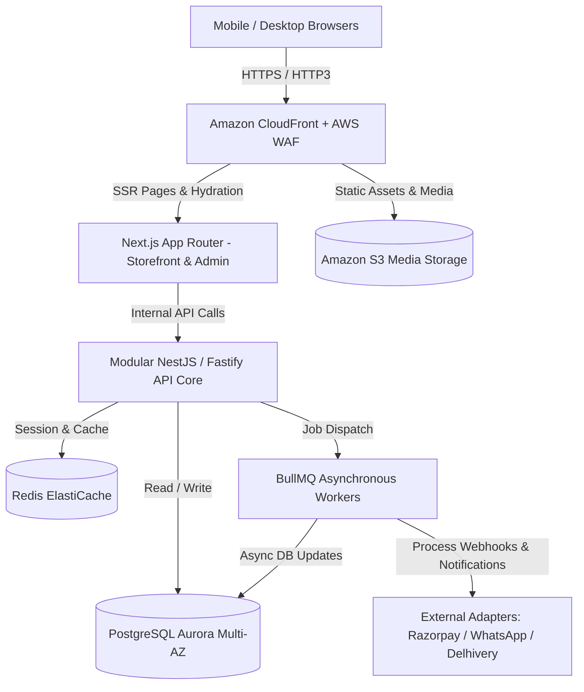
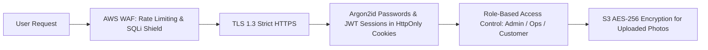

<!-- HAMPERS-BY-HER | E2E COMMERCE SYSTEM | DOCUMENT CONTROLLED -->
# 01. Project Overview — Hampers by Her

## Document Control
- **Document Version**: 2.0.0
- **Status**: APPROVED ARCHITECTURE BASELINE
- **Last Updated**: 2026-09-18
- **Target Instagram Handle**: `@hampers._by_her`
- **Canonical Instagram URL**: `https://www.instagram.com/hampers._by_her/`
- **Primary Market**: India (Pan-India delivery with local express zones)
- **Document Quality Standard**: 15/15 Mandatory Sections Compliant (Section 40)

---

## 1. Purpose
Define the comprehensive strategic, commercial, technical, and operational blueprint for transforming **Hampers by Her** (`@hampers._by_her`) from an Instagram-first artisanal gifting boutique into an enterprise-grade, conversion-optimized digital commerce platform and bespoke gifting atelier.

The primary mission is to establish an owned digital home for the brand that scales revenue, streamlines fulfillment, and captures high-margin bespoke, corporate, and wedding gifting demand without sacrificing the intimate, handcrafted warmth that defines artisanal gifting.

---

## 2. Scope

### 2.1 In Scope
- **Customer Experience**:
  - Editorial, mobile-first storefront featuring ready-to-ship curated collections.
  - Interactive 11-step "Build Your Hamper" digital atelier with live visual assembly and budget tracking.
  - Bespoke personalization engine (wax-sealed handwritten message cards, monogrammed ribbons, custom polaroids, engraving).
  - High-conversion, friction-minimized 2-step checkout supporting guest checkout, recipient address validation, and instant UPI Intent via Razorpay.
- **Assisted & Social Commerce**:
  - Deep two-way WhatsApp Cloud API integration for automated quote delivery, order updates, and human agent handoff.
  - Instagram DM / Story lead ingestion into an integrated CRM qualification pipeline.
- **Operations & Fulfillment**:
  - Unified Admin Console for catalog management, custom order approvals, inventory tracking, and production batching.
  - Logistics routing with pincode serviceability checks, delivery slot scheduling, and courier tracking webhook ingestion.
- **Technical Architecture**:
  - Modular Monolith architecture built with Next.js App Router, TypeScript, NestJS/Fastify backend services, PostgreSQL, Redis, Amazon S3, and CloudFront.

### 2.2 Out of Scope (Non-Goals for V1)
- Multi-vendor marketplace or third-party seller onboarding.
- Complex machine learning recommendation systems (replaced by deterministic, occasion-based filtering).
- Autonomous AI agent auto-negotiating corporate discounts without staff approval.
- International shipping outside India in Phase 1 (currency locked to INR `₹`).

---

## 3. Context & Background
Hampers by Her originated as a social-first business on Instagram (`@hampers._by_her`), leveraging visual aesthetics and personalized customer interaction. While Instagram is unmatched for visual discovery and brand desire, running a scaling business entirely through Instagram Direct Messages (DMs) and manual WhatsApp chats leads to severe operational limits:

```mermaid
graph TD
    subgraph "Current Unstructured Bottlenecks"
        A[Instagram Post / Story] -->|User sends DM| B[Unstructured Instagram DM]
        B -->|Manual chat negotiations| C[Context Scattered in WhatsApp]
        C -->|Manual calculation & QR sharing| D[Unverified Bank / UPI Transfer]
        D -->|Order details written on paper/notes| E[Fulfillment & Dispatch Delays]
        E -->|Manual courier tracking| F[Customer Frustration & Lost Data]
    end

    subgraph "Target E2E Architecture"
        G[Instagram Discovery / Google Search] -->|Context-Preserving Deep Link| H[Owned Web Storefront & Atelier]
        H -->|Direct Checkout OR Guided Builder| I[Deterministic Pricing & Cart Engine]
        I -->|Server-Verified Payment Webhook| J[PostgreSQL Transaction of Record]
        J -->|Automated Event Dispatch| K[Unified Admin / Production Queue]
        J -->|Automated Notification| L[WhatsApp & SMS Transactional Alerts]
        J -->|Customer 360 Profile| M[Centralized CRM & Retention Engine]
    end
```



---

## 4. Requirements

### 4.1 Business & Commercial Requirements
- **BR-01 (Dual-Track Commerce)**: The platform must support two distinct buying modes on a single unified cart infrastructure:
  1. *Quick Purchase*: Pre-curated signature gift hampers purchased in < 90 seconds.
  2. *Bespoke Atelier*: Interactive custom hamper creation with component-level pricing.
- **BR-02 (Conversion Optimization)**: Reduce checkout abandonment below 25% on mobile devices through pre-filled addresses, guest checkout, and 1-tap UPI payment.
- **BR-03 (Bespoke & Bulk Lead Generation)**: Provide dedicated inquiry portals for Wedding and Corporate gifting with instant budget estimators and WhatsApp routing.
- **BR-04 (Zero Price Discrepancy)**: All prices, discounts, taxes, and shipping rates must be calculated server-side; client-side overrides are strictly rejected.

### 4.2 Technical & Operational Requirements
- **TR-01 (Performance)**: Core Web Vitals targets: Largest Contentful Paint (LCP) < 2.2s, Interaction to Next Paint (INP) < 150ms, Cumulative Layout Shift (CLS) < 0.05 on 4G mobile networks.
- **TR-02 (Data Integrity)**: Strict ACID compliance on all orders and financial ledger entries in PostgreSQL.
- **TR-03 (Availability)**: 99.9% uptime with multi-AZ database clustering and CloudFront CDN caching.
- **TR-04 (Traceability)**: Every state change across orders, payments, and inventory must generate an immutable audit log entry.

---

## 5. Architecture & System Design
The platform is designed as a **Modular Monolith** to maximize engineering velocity and simplify transactional consistency during initial growth, while strictly enforcing bounded contexts that can be extracted into microservices when scale demands.



---

## 6. Business Rules

### 6.1 Gifting & Fulfillment Rules
- **Rule 101 (Recipient Privacy)**: Gift packaging slips must never display the itemized prices or total payment amount unless explicitly requested by the buyer (billing invoice sent to buyer email only).
- **Rule 102 (Delivery Date Guarantees)**: Delivery dates are selectable only if the required lead time (`production_time + shipping_sla`) is met before the daily dispatch cutoff (standard: 12:00 PM IST).
- **Rule 103 (Customization Immutability)**: Once an order enters `IN_PRODUCTION`, customization attributes (printed photos, engraved text, ribbon selection) cannot be modified online.
- **Rule 104 (Perishable Item Handling)**: Hampers containing meltable chocolates or fresh flora require express temperature-monitored shipping and local metro pincode eligibility.

---

## 7. Technical Details & Specifications

### 7.1 Tech Stack Matrix
| Domain / Tier | Chosen Technology | Architectural Rationale |
| :--- | :--- | :--- |
| **Frontend Storefront** | Next.js 15+ (App Router), TypeScript, React 19 | Server-Side Rendering (SSR) for SEO, Streaming UI, React Server Components. |
| **Styling & Design System** | Tailwind CSS v4, Framer Motion, Radix UI / shadcn | High-performance CSS, accessible micro-interactions, responsive mobile fluidity. |
| **State Management** | Zustand (client cart & builder), TanStack Query (server state) | Lightweight, persistent client storage with zero boilerplate. |
| **Backend Core** | Node.js (v22 LTS), NestJS, Fastify adapter | Enterprise modularity, strict dependency injection, high-throughput REST API. |
| **Database & ORM** | PostgreSQL 16+, Prisma ORM | Relational integrity, JSONB support for dynamic customizations, type safety. |
| **Caching & Queues** | Redis 7.2+, BullMQ | Distributed caching, session revocation, idempotent webhook processing. |
| **Cloud Infrastructure** | AWS ECS Fargate, CloudFront, Route 53, S3, RDS Aurora | Fully managed containerized runtime with automated scaling and zero server maintenance. |
| **Payments** | Razorpay (Primary), Cashfree (Fallback) | India-first payment rails (UPI Intent, QR, Cards, NetBanking, Wallets). |
| **Messaging** | Meta WhatsApp Business Cloud API, AWS SES (Email), MSG91 (SMS) | Omnichannel conversational notifications with automatic delivery fallback. |

---

## 8. Dependencies & Integrations
- **Upstream Dependencies**:
  - Meta Graph API (Instagram Professional Account connection).
  - WhatsApp Business Cloud API (Meta developer account & verified phone number).
  - Razorpay Merchant Account (KYC verified, webhook endpoints configured).
  - Courier Logistics API (Shiprocket / Delhivery for pincode tracking & NDR management).
- **Downstream Consumers**:
  - Internal Admin Fulfillment Dashboard.
  - Centralized Marketing & Analytics Pipeline (Meta Pixel, Google Tag Manager, Server-Side GA4).

---

## 9. Security & Governance



- **Data Minimization**: Customers can checkout as guests; recipient phone numbers are collected strictly for courier delivery coordination.
- **Payment Tokenization**: No card numbers or banking passwords touch Hampers by Her servers (PCI-DSS compliance via Razorpay checkout iFrame/Intent SDK).
- **Input Sanitization**: All custom messages and engraving texts are sanitized with Zod validation schemas to prevent XSS.

---

## 10. Failure Modes & Resilience Engineering

| Failure Scenario | Impact | Autonomous Mitigation | Operator Action |
| :--- | :--- | :--- | :--- |
| **Payment Webhook Dropped** | Payment deducted from user, order remains pending | Cron reconciliation job queries Razorpay API every 5 minutes for unverified orders | Alert sent to Slack/Admin if discrepancy persists > 15 mins |
| **WhatsApp API Outage** | Order confirmation not received on WhatsApp | Automatic fallback triggers transactional SMS (MSG91) and email (SES) | Monitor Meta status dashboard; queue retries in Redis |
| **Custom Photo Upload Fails** | Incomplete bespoke order submitted | Client-side chunked upload with retry; order blocked from submission until upload confirms | Support agent contacts user via WhatsApp with pre-signed upload link |
| **High Traffic Festive Spike** | Database connection exhaustion | RDS Proxy connection pooling; CloudFront edge caching on catalog endpoints | ECS Fargate automatically autoscales containers based on CPU/Memory > 70% |

---

## 11. Testing & Quality Assurance
- **Unit Testing (Jest / Vitest)**: 100% coverage on pricing calculations, discount coupon engines, and volume bin-packing algorithms.
- **Integration Testing (Supertest)**: Complete end-to-end API test suites covering cart creation, checkout submission, webhook verification, and state transitions.
- **E2E Testing (Playwright)**:
  - Critical Journey 1: Homepage → Category → Ready-made Hamper → UPI Checkout → Order Confirmed.
  - Critical Journey 2: 11-Step Hamper Builder → Custom Photo & Message → Add to Cart → Checkout.
  - Critical Journey 3: WhatsApp Inquiry Button → Deep link generation → Session verification.
- **Accessibility**: WCAG 2.2 Level AA compliance verified via automated axe-core scans and manual keyboard navigation testing.

---

## 12. Observability & Monitoring
- **Structured Logging**: JSON logs with trace IDs (`X-Correlation-ID`) across all incoming requests and background workers.
- **Metrics Dashboard**: Prometheus + CloudWatch tracking:
  - API Request Latency (p50, p95, p99).
  - Checkout Conversion Funnel drop-offs.
  - Payment Gateway Success vs. Failure rates.
  - Redis Queue Backlog and Dead Letter Queue (DLQ) counts.
- **Error Tracking**: Real-time Sentry alerting on uncaught frontend exceptions or backend worker failures.

---

## 13. Open Questions & Owner Verification Register

```yaml
unknown_registry:
  - field: brand_legal_name
    status: TO_VERIFY
    source_required: brand_owner
    impact: high
    temporary_assumption: "Hampers by Her"

  - field: primary_city_dispatch_hub
    status: TO_VERIFY
    source_required: brand_owner
    impact: high
    temporary_assumption: "Tier-1 Metro Hub (Mumbai / Bengaluru / Delhi)"

  - field: same_day_delivery_serviceability
    status: TO_VERIFY
    source_required: brand_owner
    impact: medium
    temporary_assumption: "Supported for local intra-city orders placed before 12:00 PM"

  - field: official_support_contact_number
    status: TO_VERIFY
    source_required: brand_owner
    impact: high
    temporary_assumption: "+91-XXXXXXXXXX (Pending official WhatsApp Cloud API number)"
```

---

## 14. Future Evolution (Phase 2 & Beyond)
- **AI Gifting Concierge**: Natural language gifting assistant ("Find a birthday gift for my sister who loves coffee and journals under ₹2,000") utilizing deterministic catalog RAG search.
- **Corporate Gifting Multi-Address Dispatch**: CSV bulk address upload allowing corporate clients to send 500 personalized hampers to remote employees in a single checkout.
- **Gifting Calendar & Reminders**: Automated WhatsApp/Email reminders for recurring customer anniversaries and birthdays.
- **Augmented Reality (AR) Hamper Preview**: Interactive 3D photorealistic unboxing preview on mobile devices.

---

## 15. References
- AWS Web Store Reference Architecture: `https://docs.aws.amazon.com/solutions/latest/web-store-on-aws/`
- Meta Instagram Graph API Documentation: `https://developers.facebook.com/docs/instagram-api/`
- WhatsApp Business Cloud API Reference: `https://developers.facebook.com/docs/whatsapp/cloud-api/`
- Razorpay E-Commerce Payment Integration: `https://razorpay.com/docs/payments/`
- Google Search Central E-Commerce SEO: `https://developers.google.com/search/docs/specialty/ecommerce`
- OWASP ASVS v4.0.3 Web Application Security Standard: `https://owasp.org/www-project-application-security-verification-standard/`
