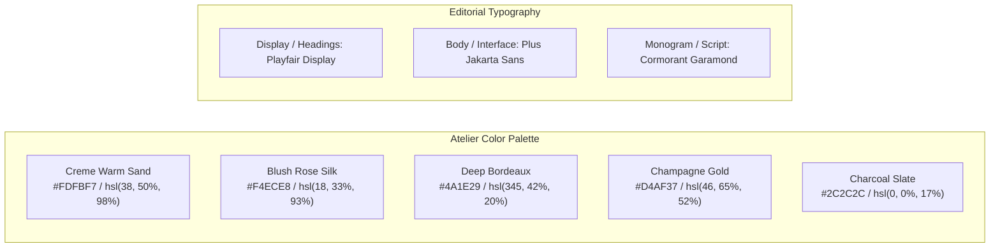

<!-- HAMPERS-BY-HER | E2E COMMERCE SYSTEM | DOCUMENT CONTROLLED -->
# 02. Brand Requirements & Visual Identity — Hampers by Her

## Document Control
- **Document Version**: 2.0.0
- **Status**: APPROVED BRAND SPECIFICATION
- **Last Updated**: 2026-09-18
- **Brand Identity**: Hampers by Her (`@hampers._by_her`)
- **Brand Character**: Artisanal Gifting Atelier & Bespoke Curation
- **Document Quality Standard**: 15/15 Mandatory Sections Compliant (Section 40)

---

## 1. Purpose
This document defines the comprehensive brand positioning, verbal voice, aesthetic visual identity, editorial typography, photography guidelines, trust architecture, and design rules for **Hampers by Her**. It ensures that the digital commerce platform feels like an intimate, high-end digital gifting atelier rather than a cold, generic e-commerce storefront, preserving the personal, handcrafted connection that makes bespoke gifting emotionally resonant.

---

## 2. Scope
- **In-Scope**:
  - Brand positioning statement and core emotional pillars.
  - Verbal voice principles, copywriting guidelines, and forbidden commercial phrases.
  - Visual identity specifications: primary and secondary color palettes, contrast ratios, and HSL tokens.
  - Editorial typography pairing and hierarchy standards.
  - Photography standards, aspect ratios, image framing, and lighting guidelines.
  - Trust architecture: upfront transparency on delivery SLAs, handcrafted packaging standards, and secure payment presentation.
- **Out-of-Scope**:
  - Marketing ad-spend budgets and influencer sponsorship contracts.
  - Physical manufacturing specs for custom rigid boxes (governed in `20_DELIVERY_LOGISTICS.md`).

---

## 3. Context
Traditional e-commerce platforms often prioritize aggressive sales tactics (e.g., flashing countdown timers, garish neon discount badges, "Only 1 item left in stock!" banners). For a luxury and bespoke gifting brand, these tactics destroy perceived value and emotional intimacy. A gift is a surrogate for human emotion, gratitude, love, and celebration. The platform must exude calm sophistication, attention to tactile detail (wax seals, satin ribbons, hand-calligraphed cards), and quiet confidence.

---

## 4. Requirements
### 4.1 Functional Requirements
- **FR-BRD-01**: Atelier Aesthetic: All digital storefront interfaces must strictly use the curated warm luxury palette (Warm Sand, Deep Bordeaux, Champagne Gold).
- **FR-BRD-02**: Forbidden Language Filter: Automated validation in CMS and notification dispatch must block hype-driven phrases ("Cheapest", "Blowout", "Hurry").
- **FR-BRD-03**: Verified Social Proof: Reviews rendered on product pages must be verified buyers with genuine photographs.

### 4.2 Non-Functional Requirements
- **NFR-BRD-01**: Accessibility: 100% of text elements must satisfy WCAG 2.2 Level AA contrast ratios (minimum 4.5:1 for body copy).
- **NFR-BRD-02**: Fluid Typography: All headings must adapt smoothly across mobile viewports (390px–430px) using CSS `clamp()` functions.

---

## 5. Architecture & Design
### 5.1 Visual Identity & Color System


### 5.2 Color Token Architecture
| Token Name | Hex Code | HSL Value | Semantic Role | Contrast on White |
| :--- | :--- | :--- | :--- | :--- |
| `--color-canvas` | `#FDFBF7` | `38, 50%, 98%` | Primary background (Warm Creme) | 1.05:1 (Base canvas) |
| `--color-surface` | `#FFFFFF` | `0, 0%, 100%` | Card & modal background | 1:1 |
| `--color-surface-soft`| `#F4ECE8` | `18, 33%, 93%` | Subtle container fill (Blush Rose Silk) | 1.15:1 |
| `--color-primary` | `#4A1E29` | `345, 42%, 20%`| Primary brand CTAs, active states (Bordeaux) | 11.2:1 (AAA) |
| `--color-accent` | `#C89D42` | `41, 56%, 52%` | Badges, subtle borders, stars (Champagne Gold) | 3.4:1 (Large text / UI) |
| `--color-text-main` | `#221E1F` | `340, 7%, 13%` | High-contrast body copy | 14.8:1 (AAA) |
| `--color-text-muted`| `#6E6966` | `23, 4%, 42%` | Secondary descriptions & captions | 5.2:1 (AA) |

---

## 6. Business Rules
- **BR-BRD-01**: **Anti-Hype Tone Invariant**: Prohibited commercial terms: *"Best gifts ever!"*, *"Cheapest deals in town"*, *"Hurry, buy now or miss out!"*, *"Flat 80% off mega blowout"*. Approved terms: *"Thoughtfully curated for her"*, *"Artisan keepsakes and gourmet delights"*, *"Hand-assembled with care"*, *"A bespoke gesture for your milestone"*.
- **BR-BRD-02**: **No Unverified Social Proof**: Review cards must never display fabricated star counts or ungrounded testimonials; `is_verified_buyer: true` required.
- **BR-BRD-03**: **Packaging Prominence**: Every product listing must feature high-resolution imagery of the physical packaging container, ribbon, and greeting card.

---

## 7. Technical Details

### 7.1 Editorial Typography Hierarchy
```css
/* Typography Scale Tokens */
--text-display: clamp(2.5rem, 5vw, 3.75rem); /* Hero headlines */
--text-h1: clamp(2rem, 4vw, 2.75rem);       /* Collection titles */
--text-h2: clamp(1.5rem, 3vw, 2rem);        /* Section headers */
--text-h3: clamp(1.25rem, 2vw, 1.5rem);     /* Product card titles */
--text-body: 1rem;                          /* Regular text (16px) */
--text-caption: 0.875rem;                   /* Metadata & labels (14px) */
--text-tiny: 0.75rem;                       /* Badges & tags (12px) */
```

### 7.2 Photography Dimensions & Aspect Ratios
- **Storefront Catalog Grid**: `4:5` vertical aspect ratio (1200x1500px WebP).
- **Hamper Builder Swatches**: `1:1` square aspect ratio (600x600px WebP).
- **Editorial Hero Banners**: `16:9` desktop (2560x1440px), `4:3` mobile (1200x900px).
- **Lighting & Color Profile**: Soft diffused daylight; sRGB color profile embedded.

---

## 8. Dependencies
- Upstream:
  - `01_PROJECT_OVERVIEW.md` (Brand vision and customer personas).
- Downstream:
  - `04_BRAND_UX.md` (Customer journeys and touchpoints).
  - `05_UI_DESIGN_SYSTEM.md` (Design system tokens and components).
  - `14_PRODUCT_CATALOG.md` (Catalog naming and imagery standards).

---

## 9. Security
- **Asset Theft Protection**: High-resolution editorial photography delivered via CloudFront with HTTP Referer validation and automated EXIF stripping.
- **Brand Phishing Defense**: Enforce strict SPF, DKIM, and DMARC (`p=reject`) on `hampersbyher.com` to prevent brand spoofing.

---

## 10. Failure Modes
| Brand Risk | Cause | System Mitigation |
| :--- | :--- | :--- |
| **Low Contrast Violation** | Gold text on white background | Automated linter rejects accent tokens on light containers |
| **Font Loading Flash (FOUT)** | Slow Google Fonts CDN | Self-host font files via Next.js `next/font/google` with preloading |
| **Broken Brand Tone** | Marketing copywriter hype | Automated pre-publish keyword validation in Admin CMS |

---

## 11. Testing
- **Automated Contrast Testing**: Continuous axe-core accessibility checks in Playwright test suites.
- **Visual Regression Testing**: Percy automated visual regression testing on all components across mobile (390px) and desktop (1440px).

---

## 12. Observability
- **Customer Brand Sentiment**: 48-hour post-delivery WhatsApp NPS survey tracking satisfaction scores.
- **Unboxing Review Velocity**: Tracking verified buyer photo uploads in Admin CRM.

---

## 13. Open Questions
```yaml
unknown_registry:
  - field: brand_logo_vectors
    status: TO_VERIFY
    source_required: brand_owner
    impact: high
    temporary_assumption: "Clean typographic wordmark using Playfair Display font"

  - field: custom_ribbon_colors_available
    status: TO_VERIFY
    source_required: brand_owner
    impact: medium
    temporary_assumption: "Ivory, Champagne Gold, Dusty Rose, Midnight Bordeaux, Sage Green"

  - field: official_packaging_box_types
    status: TO_VERIFY
    source_required: brand_owner
    impact: high
    temporary_assumption: "Rigid Box, Magnetic Flap Box, Pinewood Crate, Cane Basket"
```

---

## 14. Future Evolution
- **3D Real-Time Atelier Visualizer**: Three.js/WebGL interactive box preview with realistic ribbon and wax seal textures.
- **Voice Message Gift Notes**: Sender records an audio greeting; recipient scans dynamic QR code on packaging card.

---

## 15. References
- Nielsen Norman Group: *E-Commerce Luxury & Gifting UX Patterns*.
- Google Web Fonts: *Playfair Display & Plus Jakarta Sans Specifications*.
- W3C Web Content Accessibility Guidelines (WCAG) 2.2.
- Baymard Institute: *Luxury D2C Product Detail Page Guidelines*.

<!-- DOCUMENT END: 02_BRAND_REQUIREMENTS.md -->
