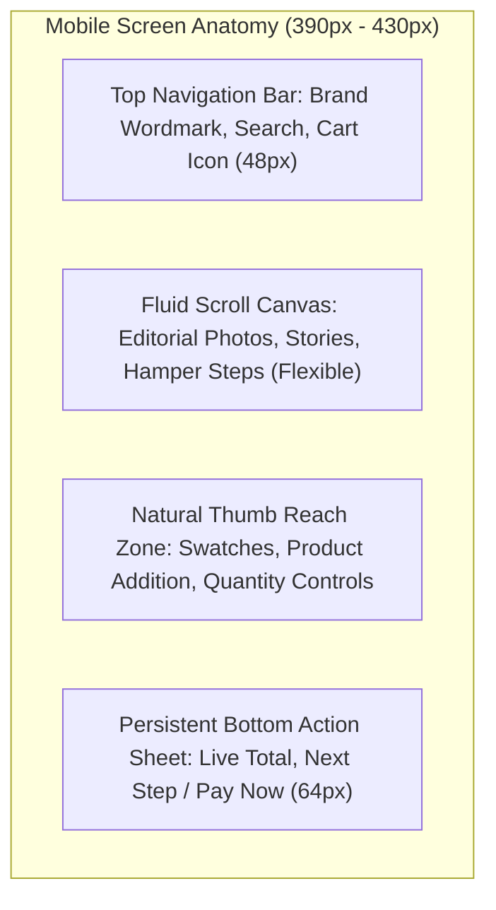

<!-- HAMPERS-BY-HER | E2E COMMERCE SYSTEM | DOCUMENT CONTROLLED -->
# 04. Brand UX & Customer Journeys — Hampers by Her

## Document Control
- **Document Version**: 2.0.0
- **Status**: APPROVED UX SPECIFICATION
- **Last Updated**: 2026-09-18
- **Platform Design Philosophy**: Mobile-First, Touch-First, Gifting Atelier
- **Governing Directives**: Sections 6, 8, 46, 47, 48
- **Document Quality Standard**: 15/15 Mandatory Sections Compliant (Section 40)

---

## 1. Purpose
This document defines the user experience (UX) architecture, interaction design models, micro-interactions, responsive mobile ergonomics, and comprehensive user journey maps for **Hampers by Her**. The UX evokes the tactile, emotional pleasure of stepping into a boutique gifting salon while providing a frictionless, lightning-fast digital commerce flow that maximizes conversion on mobile devices.

---

## 2. Scope
- **In-Scope**:
  - Detailed specifications for the 6 Core Customer Journeys (Journeys A through F).
  - Mobile ergonomics and thumb-zone accessibility for 390px / 430px viewports.
  - Interaction design for the 11-Step Hamper Builder Atelier.
  - Micro-interaction physics (Framer Motion transitions, wax-seal stamp animations, drawer sheet transitions).
  - Conversion architecture, contextual CTAs, and friction removal.
- **Out-of-Scope**:
  - Backend database schema implementation (governed in `13_DATABASE_DESIGN.md`).
  - Marketing copy A/B test variations (governed in `02_BRAND_REQUIREMENTS.md`).

---

## 3. Context
Over 80% of traffic originating from Instagram arrives on mobile handheld devices (iOS Safari and Android Chrome via Instagram in-app browser). In-app mobile web browsers suffer from high latency, erratic back-navigation, and keyboard obstruction over checkout forms. Therefore, Hampers by Her UX is engineered as a **mobile-first web experience** designed specifically to thrive within mobile web constraints, featuring native-like swipe gestures, bottom-sheet drawers, and 1-tap UPI payment sheet handoffs.

---

## 4. Requirements
### 4.1 Functional Requirements
- **FR-UX-01**: Mobile Thumb-Zone Priority: Primary interactive actions (Add to Box, Proceed to Checkout, Next Step) must reside within the bottom 35% natural thumb reach zone on mobile screens.
- **FR-UX-02**: Tap Target Standards: All interactive buttons, chips, and color swatches must maintain a minimum touch target of `48px x 48px`.
- **FR-UX-03**: Zero Layout Shift: All image containers must possess explicit CSS aspect ratio placeholders (`aspect-[4/5]`, `aspect-[1/1]`) ensuring CLS $< 0.05$.

### 4.2 Non-Functional Requirements
- **NFR-UX-01**: Motion Performance: All UI animations must execute at a sustained 60 frames per second using hardware-accelerated CSS transform and opacity properties.
- **NFR-UX-02**: Accessibility Motion Toggle: Interfaces must automatically disable all non-essential spring animations when `prefers-reduced-motion: reduce` is active.

---

## 5. Architecture & Design
### 5.1 The 6 Core Customer Journeys


### 5.2 Mobile Screen Anatomy


---

## 6. Business Rules
- **BR-UX-01**: **Upfront Transparent Pricing**: The order summary drawer must itemize base hamper price, customization add-ons, gift wrapping, and shipping fee before initiating payment. Hidden fees are strictly prohibited.
- **BR-UX-02**: **No Form Reset on Failure**: If a payment gateway transaction fails or is cancelled by the customer, the shopping cart and hamper builder state must be preserved 100% intact.
- **BR-UX-03**: **Gift Privacy Default**: The checkout form must default to `is_gift: true`, automatically omitting monetary values from physical packing slips and gift box packaging.

---

## 7. Technical Details

### 7.1 Micro-Interaction Physics & Component Signatures
All animations are implemented using `framer-motion` with defined spring curves:
```typescript
// Component Signature for Mobile Sticky Action Sheet
interface StickyActionSheetProps {
  totalAmountPaise: bigint;
  itemCount: number;
  boxFullnessPercentage: number;
  primaryActionLabel: string;
  onPrimaryAction: () => void;
  isWhatsAppFallbackAvailable: boolean;
  onWhatsAppInquiry: () => void;
}
```

### 7.2 Micro-Interaction Patterns
1. **Atelier Box Fullness Gauge**: As the customer selects items in the Hamper Builder, a sleek circular ring fills dynamically (`0%` to `100%`) with an organic spring animation (`stiffness: 300, damping: 25`), shifting from subtle creme to warm gold when optimal fullness is achieved.
2. **Wax Seal Stamping Feedback**: When the user customizes their gift card seal, a subtle haptic-like stamping micro-animation simulates a seal pressing into warm wax with an elegant gold particle shimmer.
3. **Cart Slide-Over Drawer**: Smooth spring slide from screen right (desktop) or sheet bottom (mobile) with background backdrop blur (`backdrop-filter: blur(8px)`).
4. **Contextual Add-to-Cart Morph**: The CTA transitions smoothly into a mini loading spinner and checkmark: *"Added to Hamper"* before restoring its original state.

---

## 8. Dependencies
- **UI Motion Framework**: `framer-motion` v11+.
- **Touch Gesture Utilities**: `@use-gesture/react` for fluid swipe and drag-to-dismiss sheet gestures.
- **Iconography**: `lucide-react` with refined 1.5px stroke width matching the editorial typography.
- Upstream: `02_BRAND_REQUIREMENTS.md` (Brand identity tokens).
- Downstream: `05_UI_DESIGN_SYSTEM.md` (Design tokens and atomic components).

---

## 9. Security
- **Secure Data Presentation**: Sensitive customer addresses and recipient phone numbers are masked in order review screens (e.g. `+91 98*** ***12`).
- **No Client-Side Financial Trust**: Displayed totals on the UX layer are visual representations; server-side recalculation in integer Paise is authoritative.

---

## 10. Failure Modes
| Error Event | User-Facing UX Treatment | Recovery Action |
| :--- | :--- | :--- |
| **Pincode Unserviceable** | Inline non-modal badge below pincode input: *"We cannot reach this pincode via standard courier."* | Displays secondary button: *"Inquire via WhatsApp for Special Courier Arrangement"* |
| **Payment Failed / Cancelled** | Calm modal: *"Your payment was not completed, but your curated hamper has been safely saved."* | Single CTA: *"Try UPI Again"* or *"Change Payment Method"*; zero cart reset |
| **Photo Upload Too Large (> 10MB)**| Instant toast: *"Please select a photo under 10MB (JPG or PNG)."* | Client-side Canvas automatically downsizes image to 1200px before S3 upload |

---

## 11. Testing
- **Usability Benchmarks**: 5-second test on homepage: 80%+ of testers must identify Hampers by Her as a curated, bespoke gifting boutique.
- **Task Completion Time**:
  - Journey A (Ready-Made Instant Purchase): Target $< 75\text{ seconds}$ from landing to payment completion.
  - Journey B (11-Step Custom Hamper Builder): Target $< 180\text{ seconds}$ from entry to checkout.
- **Automated Viewport Audits**: Playwright headless tests running across mobile viewports: 390x844 (iPhone 14), 412x915 (Pixel 7), and 768x1024 (iPad).

---

## 12. Observability
- **Funnel Drop-Off Telemetry**: Track step-by-step abandonment in the 11-step Hamper Builder to detect cognitive overload points.
- **Micro-Interaction Latency**: OpenTelemetry custom frontend traces recording touch-to-render duration on drawer expansions.

---

## 13. Open Questions
```yaml
unknown_registry:
  - field: recipient_address_delivery_call_permission
    status: TO_VERIFY
    source_required: brand_owner
    impact: medium
    temporary_assumption: "Checkout UX includes checkbox: 'Call recipient before delivery to ensure someone is home' (default checked)"
```

---

## 14. Future Evolution
- **Dynamic 3D Box Unpacking Gesture**: Recipient unboxes their gift digitally via an interactive mobile scratch-and-reveal 3D unboxing animation sent via WhatsApp.
- **Personalized Video Greetings**: QR code on the box card links to a personalized video greeting page recorded by the sender.

---

## 15. References
- Apple Human Interface Guidelines: *Touch Targets and Gestures*.
- Nielsen Norman Group: *Mobile Thumb Zone Ergonomics*.
- Framer Motion Official Animation & Layout Guides.
- Baymard Institute: *Mobile E-Commerce Checkout Usability*.

<!-- DOCUMENT END: 04_BRAND_UX.md -->
