<!-- HAMPERS-BY-HER | E2E COMMERCE SYSTEM | DOCUMENT CONTROLLED -->
# 05. UI Design System & Component Library — Hampers by Her

## Document Control
- **Document Version**: 2.0.0
- **Status**: APPROVED DESIGN SYSTEM SPECIFICATION
- **Last Updated**: 2026-09-18
- **Design Token Model**: 3-Tier Token Architecture (Primitive → Semantic → Component)
- **CSS Architecture**: Tailwind CSS v4 + Radix UI Primitives + Framer Motion
- **Document Quality Standard**: 15/15 Mandatory Sections Compliant (Section 40)

---

## 1. Purpose
Establish the canonical UI design system, token architecture, component specifications, and accessibility benchmarks for the **Hampers by Her** digital platform. This document ensures absolute visual harmony, responsive fluidity, and rigorous component reusability across customer storefronts, the Hamper Builder atelier, and internal merchant dashboards.

---

## 2. Scope
- **In-Scope**:
  - Three-tier design token architecture (Primitives, Semantics, Components) defined in CSS custom properties and Tailwind tokens.
  - Complete Atomic Component Inventory:
    - *Atoms*: Typography, Buttons, Inputs, Radios, Checkboxes, Swatches, Badges, Fullness Indicators.
    - *Molecules*: Product Card, Pincode Lookup Widget, Personalization Note Preview, Ribbon Swatch Selector.
    - *Organisms*: Hamper Builder Stepper, Slide-Over Cart Drawer, Mobile Sticky Action Sheet, Filter Drawer.
  - Interaction states (Hover, Active, Focus-Visible, Disabled, Loading, Error).
  - Responsive grid, spacing scale, and container constraints.
  - WCAG 2.2 Level AA accessibility compliance rules.
- **Out-of-Scope**:
  - Marketing email HTML table templates (governed in `30_NOTIFICATION_SYSTEM.md`).
  - Third-party payment gateway iframe styling (governed by Razorpay SDK).

---

## 3. Context
Generic e-commerce UI libraries often employ generic border-radii, stark pure-black `#000000` text on blinding `#FFFFFF` backgrounds, and harsh blue focus outlines. In contrast, an artisanal luxury atelier requires warm, tactile materials: soft creme canvas, velvety rose tones, bordeaux accents, subtle antique gold borders, and delicate, high-legibility serif headings. The design system translates the physical beauty of bespoke packaging into digital tokens, ensuring micro-interactions feel weighted and deliberate.

---

## 4. Requirements
### 4.1 Functional Requirements
- **FR-DS-01**: Design Token Consistency: All UI components must consume strictly from CSS custom property tokens; zero ad-hoc hex values in component stylesheets.
- **FR-DS-02**: Accessible Focus Rings: Focusable interactive elements must display high-contrast focus rings (`--border-focus`) for keyboard navigation.
- **FR-DS-03**: Fluid Breakpoint Scale: Responsive layouts must adapt across mobile (390px), tablet (768px), and desktop (1024px, 1440px).

### 4.2 Non-Functional Requirements
- **NFR-DS-01**: Lightweight Bundle: The design token CSS bundle must not exceed $15\text{ KB}$ gzipped.
- **NFR-DS-02**: WCAG 2.2 AA Compliance: Minimum contrast ratio of 4.5:1 for normal text and 3:1 for graphical UI elements.

---

## 5. Architecture & Design
### 5.1 3-Tier Token Hierarchy

```mermaid
flowchart LR
    subgraph Tier1 ["Tier 1: Primitives (Raw Values)"]
        P1["palette.creme.50: #FDFBF7"]
        P2["palette.bordeaux.900: #4A1E29"]
        P3["palette.gold.500: #C89D42"]
        P4["space.4: 16px"]
    end
    subgraph Tier2 ["Tier 2: Semantics (Intent & Role)"]
        S1["color.bg.canvas: {palette.creme.50}"]
        S2["color.interactive.primary: {palette.bordeaux.900}"]
        S3["color.border.accent: {palette.gold.500}"]
        S4["spacing.container.padding: {space.4}"]
    end
    subgraph Tier3 ["Tier 3: Component Tokens (Scoped Specs)"]
        C1["btn.primary.bg: {color.interactive.primary}"]
        C2["card.hamper.border: {color.border.accent}"]
        C3["builder.gauge.fill: {palette.gold.500}"]
    end
    Tier1 --> Tier2 --> Tier3
```


---

## 6. Business Rules
- **BR-DS-01**: **No Ad-Hoc Hex Colors**: Components must strictly use defined semantic tokens (`var(--color-primary)`, `var(--bg-canvas)`). Arbitrary inline styles will fail linting.
- **BR-DS-02**: **Minimum Touch Target Invariant**: On mobile viewports $\le 768\text{px}$, all clickable elements must have a minimum dimensions of $48\text{px} \times 48\text{px}$.
- **BR-DS-03**: **Packaging Image Prominence**: Product cards must allocate at least 65% of their vertical visual area to the product packaging photograph.

---

## 7. Technical Details

### 7.1 Design Tokens (Tailwind v4 Theme Configuration)
```css
:root {
  /* Primitive & Semantic Colors */
  --bg-canvas: #FDFBF7;           /* Warm Alabaster Creme */
  --bg-surface: #FFFFFF;          /* Pure White for elevated cards */
  --bg-surface-subtle: #F6EFEA;   /* Soft Rose Silk background */
  --bg-overlay: rgba(34, 30, 31, 0.4); /* Backdrop blur dim */

  /* Text & Foreground */
  --text-primary: #221E1F;        /* Deep Charcoal Bordeaux */
  --text-secondary: #6E6966;      /* Warm Muted Gray */
  --text-tertiary: #A49E9B;       /* Light Placeholder */
  --text-inverse: #FFFFFF;        /* White text on dark buttons */

  /* Brand Accents & Interactive */
  --color-primary: #4A1E29;       /* Signature Bordeaux */
  --color-primary-hover: #38151E; /* Darkened Bordeaux */
  --color-gold: #C89D42;          /* Antique Champagne Gold */
  --color-gold-subtle: #F3EBD8;   /* Light Gold Tint */
  --color-success: #2E5A44;       /* Deep Forest Sage */
  --color-error: #9E2A2B;         /* Terracotta Red */

  /* Borders & Dividers */
  --border-subtle: #EDE5DF;       /* Hairline card divider */
  --border-accent: #E2D1B3;       /* Gold-tinted border */
  --border-focus: #4A1E29;        /* 2px Solid High-Contrast Ring */

  /* Elevation Shadows */
  --shadow-sm: 0 1px 2px rgba(74, 30, 41, 0.04);
  --shadow-md: 0 4px 12px rgba(74, 30, 41, 0.08);
  --shadow-lg: 0 12px 32px rgba(74, 30, 41, 0.12);
  --shadow-modal: 0 24px 64px rgba(34, 30, 31, 0.2);

  /* Radius & Curves */
  --radius-sm: 4px;
  --radius-md: 8px;
  --radius-lg: 16px;
  --radius-pill: 9999px;
}
```

### 7.2 Core Component Signatures
```typescript
export interface ProductCardProps {
  id: string;
  slug: string;
  title: string;
  subtitle: string;
  basePricePaise: bigint;
  currency: 'INR';
  primaryImage: { url: string; alt: string; blurHash: string };
  hoverImage?: { url: string; alt: string };
  badge?: 'Best Seller' | 'Artisan Pick' | 'Limited Festive';
  leadTimeHours: number;
  onQuickAdd: () => void;
}
```

---

## 8. Dependencies
- **Tailwind CSS v4** for utility compilation.
- **Radix UI Primitives** for unstyled, accessible components (Dialog, Dropdown, RadioGroup).
- **Framer Motion** for spring physics micro-interactions.
- Upstream: `02_BRAND_REQUIREMENTS.md` (Brand visual identity).
- Downstream: `10_FRONTEND_ARCHITECTURE.md` (Next.js component implementation).

---

## 9. Security
- **XSS Prevention in Customization Previews**: User-inputted gift messages and handwritten card text are strictly sanitized using DOMPurify before live preview rendering.
- **Secure Image Ingestion**: User-uploaded polaroid images are rendered via signed CloudFront URLs with strict Content Security Policy (CSP) image-src restrictions.

---

## 10. Failure Modes
| Design System Risk | Trigger | Mitigation Strategy |
| :--- | :--- | :--- |
| **Token Collision** | Global CSS variable name conflict | Enforce strict naming namespace: `--hbh-*` |
| **Flicker on Hydration** | Dynamic theme script mismatch | Static light-theme enforcement in HTML `head` |
| **Missing Glyph in Font** | Rare unicode emoji in card note | System fallback stack: `Playfair Display, serif, Apple Color Emoji` |

---

## 11. Testing
- **Storybook Component Audits**: 100% of atomic components documented and tested in Storybook with accessibility addon.
- **Automated Axe-Core Audits**: Integrated into CI pipeline, verifying zero color contrast or ARIA violations.

---

## 12. Observability
- **Design System Drift Tracking**: Automated ESLint rule flags hardcoded hex colors in `.tsx` files.
- **Render Performance Metrics**: Monitoring React component re-render counts using React DevTools profiling.

---

## 13. Open Questions
```yaml
unknown_registry:
  - field: studio_custom_wax_seal_crests
    status: TO_VERIFY
    source_required: brand_owner
    impact: medium
    temporary_assumption: "Standard wax seal crests modeled as Botanical Monogram, Heart Seal, and 'With Love' script"
```

---

## 14. Future Evolution
- **Dynamic Dark Theme Atelier**: A moody, velvet-inspired dark mode designed specifically for evening gifting shopping.
- **Micro-Haptic Feedback**: Web Vibration API integration simulating physical wax seal pressing on supported mobile devices.

---

## 15. References
- Brad Frost: *Atomic Design Methodology*.
- Tailwind CSS v4 Official Documentation & Theme Architecture.
- Radix UI Primitives Accessibility Guide.
- W3C WCAG 2.2 Design System Guidelines.

<!-- DOCUMENT END: 05_UI_DESIGN_SYSTEM.md -->
