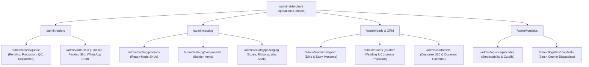

<!-- HAMPERS-BY-HER | E2E COMMERCE SYSTEM | DOCUMENT CONTROLLED -->
# 06. Site Information Architecture & Navigation — Hampers by Her

## Document Control
- **Document Version**: 2.0.0
- **Status**: APPROVED IA SPECIFICATION
- **Last Updated**: 2026-09-18
- **Domain Topology**: Public Storefront + Bespoke Atelier + Corporate Portal + Admin Console
- **Governing Directives**: Sections 7, 22, 28, 47
- **Document Quality Standard**: 15/15 Mandatory Sections Compliant (Section 40)

---

## 1. Purpose
This document defines the comprehensive Information Architecture (IA), taxonomical taxonomy, URL routing conventions, public and administrative navigation hierarchies, and content relationship graphs for the **Hampers by Her** digital platform. The IA is structured to guide visitors effortlessly from emotional social discovery to decisive commercial action while supporting search engine discoverability and high-volume seasonal campaigns.

---

## 2. Scope
- **In-Scope**:
  - Complete Public Storefront Sitemap and hierarchical taxonomies.
  - Dedicated B2B & Bespoke Portals (Wedding Favors & Corporate Gifting).
  - Admin Console Navigation and Operational Workspaces.
  - URL slug structures, canonicalization rules, and query parameter specifications.
  - Mobile navigation patterns (Sticky Bottom Bar vs. Slide-Out Drawer).
- **Out-of-Scope**:
  - Internal database index tuning for faceted queries (governed in `13_DATABASE_DESIGN.md` and `27_SEARCH_FILTERING.md`).

---

## 3. Context
Gifting websites often suffer from fragmented information architecture: products are either buried in generic department categories ("Home Goods", "Food") or scattered across seasonal sub-domains. In contrast, gifting customers shop with a distinct mental model:
- *By Intention*: *"I need a birthday surprise for my best friend."*
- *By Price Guardrail*: *"Show me luxury options under ₹2,500."*
- *By Event Scale*: *"I am a bride looking for 75 bridesmaid hampers."*

The IA bridges these models into intuitive, discoverable browsing paths that eliminate dead ends.

---

## 4. Requirements
### 4.1 Functional Requirements
- **FR-IA-01**: Occasion-First Taxonomy: The primary navigation must prioritize Occasions and Recipients over commodity product categories.
- **FR-IA-02**: Shallow Click Depth: Any ready-made hamper must be reachable within a maximum of 2 clicks from the homepage.
- **FR-IA-03**: Clean Canonical Slugs: Product and collection URLs must follow flat, human-readable hierarchy without duplicate parameters.

### 4.2 Non-Functional Requirements
- **NFR-IA-01**: Crawl Efficiency: Complete sitemap discoverable by search engine bots in $< 500\text{ ms}$.
- **NFR-IA-02**: Responsive Ergonomics: Mobile bottom navigation bar permanently docked on viewports $< 768\text{px}$.

---

## 5. Architecture & Design
### 5.1 Public Information Architecture Tree

```mermaid
graph TD
    Home["/ (Home - Editorial Storefront)"]
    
    Home --> Shop["/shop (All Collections)"]
    Shop --> Occasions["/shop/occasions/:occasion_slug<br/>(Birthday, Anniversary, Rakhi, Diwali, Baby Shower)"]
    Shop --> Recipients["/shop/recipients/:recipient_slug<br/>(For Her, For Him, For Couples, For Best Friend)"]
    Shop --> Budget["/shop/budget/:tier_slug<br/>(Under ₹1,500, ₹1,500-₹3,000, Luxury Above ₹5,000)"]
    Shop --> PDP["/product/:product_slug<br/>(Product Detail & Personalization)"]

    Home --> Atelier["/builder (Build Your Hamper Atelier)"]
    Atelier --> AtelierStep["/builder/step/:step_id (11-Step Interactive Canvas)"]
    Atelier --> AtelierPreview["/builder/preview (Unboxing Review & Share)"]

    Home --> Bespoke["Bespoke & Bulk Gifting"]
    Bespoke --> Wedding["/wedding-gifting (Bridesmaid, Trousseau & Favors)"]
    Bespoke --> Corporate["/corporate-gifting (Employee Kits, Client Gifts, GST Billing)"]

    Home --> Brand["Brand & Content"]
    Brand --> Story["/about (Our Story & Handcrafted Philosophy)"]
    Brand --> Reviews["/customer-love (Verified Unboxing Reviews)"]
    Brand --> Journal["/journal (Gifting Etiquette & Inspiration)"]
    Brand --> Contact["/contact (WhatsApp Concierge & Studio Support)"]

    Home --> Utilities["Customer Utilities"]
    Utilities --> Track["/track-order (Live Pincode & AWB Tracking)"]
    Utilities --> Cart["/cart (Slide-Over Drawer & Cart Canvas)"]
    Utilities --> Checkout["/checkout (2-Step Mobile-Optimized Payment)"]
```


### 5.2 Administrative Information Architecture


---

## 6. Business Rules
- **BR-IA-01**: **URL Canonical Invariant**: All filtered collection views (`?price=tier2&sort=popularity`) must set their `<link rel="canonical">` tag pointing strictly to the unparameterized base category URL.
- **BR-IA-02**: **Product Slug Uniqueness**: Product slugs must be permanently unique; renaming a product automatically generates a permanent 301 redirect from the old slug.
- **BR-IA-03**: **Zero Dead-End Navigation**: Category listings with zero available inventory must automatically display related gift alternatives rather than an empty page.

---

## 7. Technical Details

### 7.1 URL Routing Matrix & Canonical Discipline
| Page Type | Canonical URL Pattern | Query Parameter Rules |
| :--- | :--- | :--- |
| **Homepage** | `https://hampersbyher.com/` | Strip all tracking parameters (`utm_*`) in canonical tag. |
| **Occasion Listing** | `https://hampersbyher.com/shop/occasions/birthday` | Filter parameters (`?price=tier2&sort=popularity`) point to base occasion URL. |
| **Product Detail** | `https://hampersbyher.com/product/the-velvet-sunset-hamper` | Strict product slug; no nested category paths to prevent duplicate content. |
| **Hamper Builder** | `https://hampersbyher.com/builder` | State encoded in client storage or optional share token: `?token=wh_sess_abc123`. |
| **Corporate Portal**| `https://hampersbyher.com/corporate-gifting` | Dedicated high-authority landing page with structured B2B inquiry form. |

### 7.2 Mobile Navigation Ergonomics
- Fixed bottom navigation bar on mobile viewports ($< 768\text{px}$) with 4 core destinations:
  1. *Shop* (`/shop`)
  2. *Build* (`/builder`)
  3. *WhatsApp* (`https://wa.me/...`)
  4. *Bag* (Cart slide-over drawer trigger)

---

## 8. Dependencies
- Next.js 15 App Router routing engine.
- Dynamic `sitemap.ts` generating partitioned XML sitemaps for Google Search Console.
- Upstream: `03_PRD.md` (Functional requirements).
- Downstream: `10_FRONTEND_ARCHITECTURE.md` (Next.js route implementations).

---

## 9. Security
- **Admin Route Guard**: All `/admin/*` routes strictly guarded by Next.js middleware validating JWT session tokens and checking `role: ADMIN | ATELIER_STAFF`.
- **Parameter Validation**: All dynamic path segments (`[slug]`) validated using Zod schemas against alphanumeric slug regex to prevent directory traversal or injection.

---

## 10. Failure Modes
| Scenario | Behavior | Recovery Action |
| :--- | :--- | :--- |
| **Discontinued Product** | Attempting to access retired SKU | Returns HTTP 301 Permanent Redirect to related occasion collection |
| **Invalid Slug / Route** | 404 Not Found | Renders curated 404 atelier page with quick links to Best Sellers |
| **Sitemap Build Failure** | CI build step catches error | Fallback to cached S3 sitemap; alert DevOps |

---

## 11. Testing
- **Automated Route Audits**: Playwright crawls 100% of sitemap URLs verifying HTTP 200 responses and valid canonical tags.
- **Redirect Chain Tests**: Verify that no route undergoes more than one redirect step.

---

## 12. Observability
- **Search Query Telemetry**: Log zero-result search terms to discover missing occasion demands.
- **Route Access Latency**: CloudFront distribution logs tracking origin latency per route pattern.

---

## 13. Open Questions
```yaml
unknown_registry:
  - field: seasonal_campaign_priority
    status: TO_VERIFY
    source_required: brand_owner
    impact: medium
    temporary_assumption: "Prioritize Diwali and Valentine's Day hero banners during respective months"
```

---

## 14. Future Evolution
- **Dynamic Festive Mode**: Automated re-theming of the IA and homepage navigation based on the Indian lunar and festive calendar (Rakhi, Diwali, Valentine's).
- **Multi-City Localized Hubs**: Geolocation-based routing serving localized same-day delivery collections in major metros.

---

## 15. References
- Information Architecture: *For the Web and Beyond (Rosenfeld, Morville, Arango)*.
- Google Search Central: *E-Commerce URL Structure Best Practices*.
- Next.js 15 App Router Architecture & Parallel Routes.

<!-- DOCUMENT END: 06_SITE_INFORMATION_ARCHITECTURE.md -->
