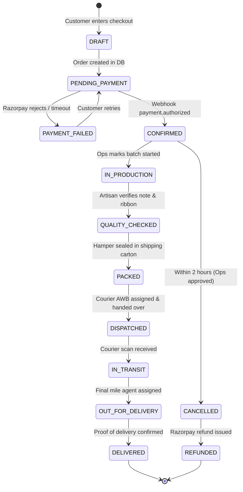
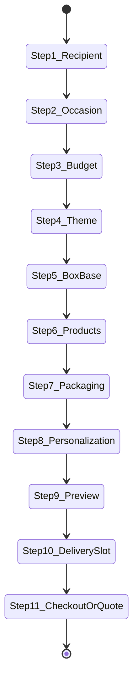

<!-- HAMPERS-BY-HER | E2E COMMERCE SYSTEM | DOCUMENT CONTROLLED -->
# 07. Functional Specification Document (FSD) — Hampers by Her

## Document Control
- **Document Version**: 2.0.0
- **Status**: APPROVED FUNCTIONAL SPECIFICATION
- **Last Updated**: 2026-09-18
- **Domain Scope**: E2E Commerce Functions, State Engines, Pricing & Fulfillment
- **Governing Directives**: Sections 10, 11, 12, 13, 14, 15, 16, 17, 18
- **Document Quality Standard**: 15/15 Mandatory Sections Compliant (Section 40)

---

## 1. Purpose
This document provides the exhaustive functional specifications, deterministic state transition engines, calculation algorithms, input/output validation contracts, and operational business logic governing the **Hampers by Her** digital platform. This document serves as the implementation specification for backend engineers, frontend developers, and QA leads.

---

## 2. Scope
- **In-Scope**:
  - Detailed functional requirements across all 8 core platform modules:
    1. Product Catalog & Inventory Service.
    2. 11-Step Hamper Builder Engine.
    3. Customization & Personalization Engine.
    4. Cart & Pricing Engine.
    5. Checkout & Address Serviceability Engine.
    6. Payment Adapter & Webhook Reconciliation.
    7. Order Management & Fulfillment Queue.
    8. Omnichannel Notification & WhatsApp Sync.
  - Strict state machines for Carts, Orders, Payments, and Builder Sessions.
  - Error handling, validation schemas, and transactional boundaries.
- **Out-of-Scope**:
  - Physical database table indexing strategies (governed in `13_DATABASE_DESIGN.md`).
  - Cloud networking and Terraform infrastructure code (governed in `35_CLOUD_ARCHITECTURE.md`).

---

## 3. Context
In custom gifting, commerce logic is significantly more complex than in standard retail. An order is rarely just a single SKU; it is a composite hierarchy:
```text
Order -> OrderItem (Hamper) -> Packaging (Box, Ribbon, Sleeve)
                             -> Components (Item A, Item B, Item C)
                             -> Personalization (Card Text, Wax Seal, Photo URL)
```
If a component runs out of stock, or if a customer selects a ribbon color that is depleted, the system must handle partial availability deterministically without breaking order history or financial ledger integrity.

---

## 4. Requirements
### 4.1 Functional Requirements
- **FR-FSD-01 (Composite SKU Definition)**: The catalog must differentiate between `READY_MADE_HAMPER`, `HAMPER_COMPONENT`, and `PACKAGING_MATERIAL`.
- **FR-FSD-02 (Inventory Reservation)**: When a customer enters checkout, inventory is reserved for 15 minutes (`status: RESERVED`). If payment is not completed within the TTL, a background Redis worker releases the lock.
- **FR-FSD-03 (Server-Authoritative Pricing)**: All pricing is computed server-side in integer Paise; client-submitted totals are strictly rejected.
- **FR-FSD-04 (State Transition Integrity)**: Orders progress strictly along the 11-stage lifecycle; illegal transitions (e.g. `DRAFT` to `SHIPPED`) throw state violation exceptions.

### 4.2 Non-Functional Requirements
- **NFR-FSD-01**: Pricing Engine Latency: Server calculation of composite hamper pricing executed in $< 5\text{ ms}$.
- **NFR-FSD-02**: Webhook Idempotency: Duplicate payment webhooks handled idempotently within $< 200\text{ ms}$.

---

## 5. Architecture & Design
### 5.1 Order State Machine (11 Stages)


### 5.2 11-Step Hamper Builder State Progression


---

## 6. Business Rules
- **BR-FSD-01**: **Volumetric Fullness Threshold**: A hamper box cannot exceed 100% capacity; if fullness $> 100\%$, item addition is blocked:
  $$\text{Box Fullness (\%)} = \left( \sum_{i=1}^{n} \frac{\text{Item Volume}_i}{\text{Box Usable Volume}} \right) \times 100$$
- **BR-FSD-02**: **Fragility Cushioning Rule**: Items tagged `is_fragile: true` (glassware, ceramics) automatically require protective shredded filler paper (`packaging_cushion: required`).
- **BR-FSD-03**: **Cancellation Policy**: Orders can only be cancelled within 2 hours of payment if production has not commenced; customized photo/engraved hampers cannot be cancelled once `IN_PRODUCTION`.

---

## 7. Technical Details

### 7.1 Server-Authoritative Pricing Formula
$$\text{Total Payable (Paise)} = (\text{Base} + \sum \text{Components} + \sum \text{Customizations} + \text{Packaging}) - \text{Discount} + \text{Shipping} + \text{Tax}$$

```typescript
export interface CalculatedPriceBreakdown {
  currency: 'INR';
  subtotalComponentsPaise: bigint;
  packagingFeePaise: bigint;
  customizationFeePaise: bigint;
  grossAmountPaise: bigint;
  discountAmountPaise: bigint;
  appliedCouponCode?: string;
  shippingFeePaise: bigint;
  gstAmountPaise: bigint;
  netPayableAmountPaise: bigint;
}
```

### 7.2 Personalization Schema
```json
{
  "gift_card": {
    "card_design_id": "card_floral_birthday_01",
    "recipient_name": "Radhika Sharma",
    "message_text": "Wishing you the happiest birthday filled with joy and laughter!",
    "sender_name": "With love, Ananya",
    "wax_seal_color": "antique_gold"
  },
  "polaroid_photo": {
    "uploaded_s3_key": "uploads/temp/cust_img_92834.jpg",
    "caption": "Summer in Goa, 2025"
  },
  "ribbon": {
    "color_token": "midnight_bordeaux",
    "style": "satin_grosgrain"
  }
}
```

---

## 8. Dependencies
- Payment Gateway: Razorpay / Cashfree orders API and webhook verification.
- Logistics: Shiprocket / Delhivery API for AWB tracking.
- Database: PostgreSQL 16 entity storage.
- Upstream: `03_PRD.md` (Functional requirements).
- Downstream: `11_BACKEND_ARCHITECTURE.md` (Module implementations).

---

## 9. Security
- **Idempotency Verification**: Mutation endpoints mandate an `Idempotency-Key` header (UUIDv4) stored in Redis with 24-hour expiration to prevent double-billing.
- **Webhook Authentication**: All payment webhooks validated with constant-time HMAC-SHA256 signature verification.

---

## 10. Failure Modes
| Failure Scenario | Immediate System Reaction | Recovery Action |
| :--- | :--- | :--- |
| **Inventory Contention** | Redis lock rejects concurrent checkout | Inform customer item held; retry in 2 mins |
| **Webhook Delivery Drop** | Webhook lost in network transit | Automated cron reconciles Razorpay orders every 5 mins |
| **Volumetric Overflow** | Hamper volume exceeds box | Prompt customer to choose larger container size |

---

## 11. Testing
- **State Machine Unit Tests**: Exhaustive test suites verifying that invalid transitions trigger HTTP 409 Conflict.
- **Pricing Edge Cases**: Vitest property tests asserting zero floating-point rounding errors on discount and GST calculations.

---

## 12. Observability
- **Order State Progression Metrics**: CloudWatch metrics tracking average time spent in each stage (`PENDING` $\to$ `PACKED`).
- **Idempotency Hit Rate**: Counter tracking prevented duplicate checkout submissions.

---

## 13. Open Questions
```yaml
unknown_registry:
  - field: maximum_hamper_weight_kg
    status: TO_VERIFY
    source_required: brand_owner
    impact: medium
    temporary_assumption: "Standard courier box maximum gross weight capped at 5.0 kg"
```

---

## 14. Future Evolution
- **Dynamic Courier Allocation**: Real-time bidding algorithm choosing between Bluedart, Delhivery, and DTDC based on historical delivery speed to specific pincodes.
- **Automated Restocking Alerts**: Machine learning predictive model anticipating ingredient shortages prior to festive spikes.

---

## 15. References
- Martin Fowler: *Patterns of Enterprise Application Architecture (State Pattern)*.
- Razorpay Webhook Event Lifecycle Documentation.
- Shiprocket Logistics API Reference.

<!-- DOCUMENT END: 07_FSD.md -->
