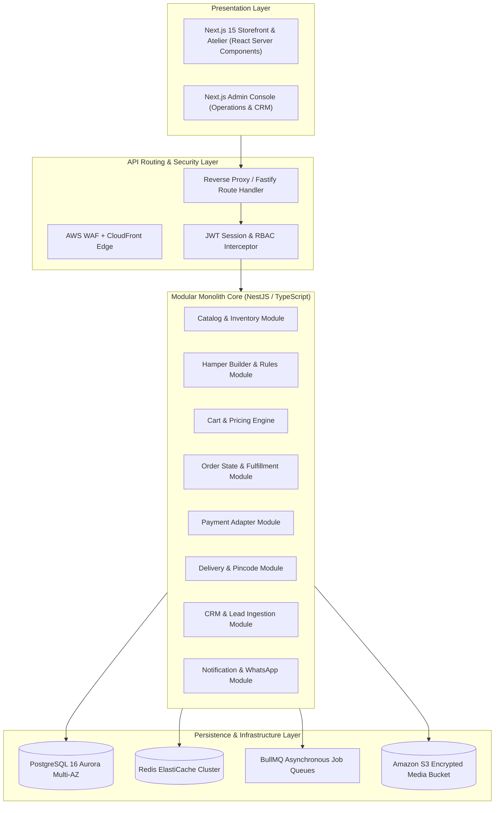
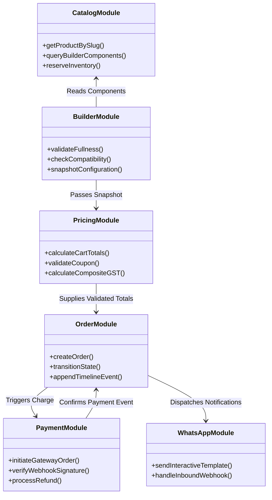

<!-- HAMPERS-BY-HER | E2E COMMERCE SYSTEM | DOCUMENT CONTROLLED -->
# 08. Technical Architecture Document (TAD) — Hampers by Her

## Document Control
- **Document Version**: 2.0.0
- **Status**: APPROVED TECHNICAL ARCHITECTURE
- **Last Updated**: 2026-09-18
- **Architectural Style**: Modular Monolith (Clean Hexagonal / Domain-Driven Architecture)
- **Primary Language**: TypeScript (Node.js v22 LTS & Next.js 15)
- **Document Quality Standard**: 15/15 Mandatory Sections Compliant (Section 40)

---

## 1. Purpose
Define the overarching technical architecture, software boundaries, domain decomposition, communication paradigms, and technology trade-offs for the **Hampers by Her** digital commerce platform. This architecture balances rapid feature delivery with robust transactional consistency, ensuring that the platform can scale gracefully from tens of daily bespoke orders to thousands of seasonal holiday hampers without requiring disruptive architectural rewrites.

---

## 2. Scope
- **In-Scope**:
  - Architectural paradigm selection (Modular Monolith vs. Microservices vs. Serverless).
  - Domain Decomposition & Module Boundary Definitions (12 Bounded Contexts).
  - Inter-module communication and asynchronous event-driven integration patterns.
  - Data persistence strategy, transaction management, and shared-nothing data boundaries.
  - Cross-cutting technical concerns: logging, tracing, caching, and idempotency.
- **Out-of-Scope**:
  - Detailed AWS infrastructure resource provisioning (governed in `35_CLOUD_ARCHITECTURE.md`).
  - SQL schema definitions and migrations (governed in `13_DATABASE_DESIGN.md`).

---

## 3. Context
Small-to-medium e-commerce enterprises frequently fail by adopting premature microservice architectures: splitting into 15 independent repositories, deploying separate databases, and introducing distributed transaction sagas before achieving product-market fit. This results in extreme operational overhead, network latency, and data consistency issues. Conversely, a disorganized spaghetti monolith leads to tight coupling, where changing a product category breaks order fulfillment. Hampers by Her adopts a **Modular Monolith** architecture: a single unified deployment unit containing strictly isolated domain modules enforcing Clean / Hexagonal boundaries.

---

## 4. Requirements
### 4.1 Functional Requirements
- **FR-TAD-01**: Bounded Contexts: The application must be decomposed into clean domain modules (Catalog, Builder, Cart, Order, Payment, Logistics, CRM, Notification).
- **FR-TAD-02**: In-Memory Domain Calls: Synchronous inter-module communication must use strongly typed service interfaces rather than HTTP overhead.
- **FR-TAD-03**: Event-Driven Asynchrony: Side effects (WhatsApp dispatch, email invoices) must be mediated asynchronously via Redis Streams / BullMQ.

### 4.2 Non-Functional Requirements
- **NFR-TAD-01**: Low Latency: API endpoints must respond in $< 100\text{ ms}$ at $p95$.
- **NFR-TAD-02**: Type Safety: 100% TypeScript type coverage from database queries to frontend React props.

---

## 5. Architecture & Design
### 5.1 System Topology


### 5.2 Bounded Context Relationships


---

## 6. Business Rules
- **BR-TAD-01**: **Transactional Boundary Invariant**: Cart checkout to Order creation must execute within a single PostgreSQL database transaction to guarantee that stock is decremented if and only if an order row is committed.
- **BR-TAD-02**: **Strict Server-Side Pricing**: Client applications only submit item IDs and personalization strings. Prices are queried dynamically from the catalog at execution time.
- **BR-TAD-03**: **Zero External State Dependency**: If an external provider (Razorpay, WhatsApp, Delhivery) goes down, internal database records remain consistent and queued for retry.

---

## 7. Technical Details

### 7.1 Technology Stack Evaluation & Matrix
| Technology Choice | Evaluated Alternative | Decided Technology | Architectural Justification |
| :--- | :--- | :--- | :--- |
| **Storefront Framework** | Remix / Shopify Liquid | **Next.js 15 (App Router)** | Superior React Server Components, image optimization, edge middleware, and immense ecosystem support. |
| **Backend Core** | FastAPI (Python) / Express | **NestJS (Fastify)** | Enterprise TypeScript architecture, dependency injection, high-throughput HTTP benchmarks, modular packaging. |
| **Primary Database** | MongoDB / DynamoDB | **PostgreSQL 16** | Relational ACID guarantees essential for e-commerce ledgers; JSONB fields provide flexibility for dynamic customizations. |
| **Cache & Message Queue**| RabbitMQ / Kafka | **Redis + BullMQ** | Extremely low operational overhead, sub-millisecond in-memory caching, reliable task queues with exponential retry. |
| **ORM Layer** | TypeORM / TypeSafe SQL | **Prisma ORM** | Unmatched TypeScript DX, auto-generated migrations, robust type inference across all relational entities. |

---

## 8. Dependencies
- **Runtime**: Node.js v22.x LTS (Dockerized on Alpine Linux).
- **External Adapters**:
  - `RazorpayClient` (Payments).
  - `WhatsAppCloudClient` (Meta Messaging).
  - `ShiprocketClient` (3PL Shipping).
  - `AwsS3Client` (Presigned file uploads).
- Upstream: `07_FSD.md` (Functional specifications).
- Downstream: `09_SAD.md` (System deployment architecture).

---

## 9. Security
- **Defense in Depth**:
  ```mermaid
  flowchart LR
      Request[Inbound HTTP Request] --> RateLimit[Redis Token Bucket Rate Limiter]
      RateLimit --> Helmet[Security Headers: CSP, HSTS, X-Frame-Options]
      Helmet --> CORS[Strict CORS: Origin hampersbyher.com]
      CORS --> Zod[Zod Schema Runtime Validation]
      Zod --> Controller[Module Controller Execution]
  ```
- **JWT Session Tokens**: Encrypted using AES-256-GCM, stored in HttpOnly, SameSite=Strict cookies.

---

## 10. Failure Modes
| Risk | Detection | Mitigation |
| :--- | :--- | :--- |
| **PostgreSQL Connection Pool Starvation** | Active connection count $> 85\%$ | PgBouncer connection pooler in transaction pooling mode |
| **Redis Cache Eviction** | Memory usage $> 90\%$ | Volatile-LRU policy configured; reservations kept non-evictable |
| **External API Latency Spike** | Request duration $> 2000\text{ ms}$ | Circuit breaker pattern trips after 5 failures |

---

## 11. Testing
- **Modular Unit Testing**: Vitest runs isolated domain service tests with 100% mocked database interfaces.
- **Architectural Boundary Linter**: Dependency cruiser rules enforce that `modules/order` cannot directly import internal services of `modules/payment`.

---

## 12. Observability
- **Distributed Tracing**: OpenTelemetry instrumentation with W3C traceparent headers propagating across Fastify and BullMQ workers.
- **Structured JSON Logging**: Pino logger emitting timestamped JSON logs to standard output for CloudWatch ingestion.

---

## 13. Open Questions
```yaml
unknown_registry:
  - field: redis_cluster_node_sizing
    status: TO_VERIFY
    source_required: brand_owner
    impact: medium
    temporary_assumption: "ElastiCache Serverless Redis configured with 1GB baseline capacity auto-scaling to 10GB"
```

---

## 14. Future Evolution
- **Microservices Carve-Out**: As order volume exceeds 10,000 orders/day, `OrderService` and `PaymentService` can be extracted into standalone microservices without schema alterations due to clean modular boundaries.
- **Edge SSR Caching**: Next.js cache handler connected directly to CloudFront key-value stores.

---

## 15. References
- Martin Fowler: *Modular Monolith Patterns*.
- Microsoft Azure Architecture Center: *Bounded Contexts & Hexagonal Architecture*.
- NestJS Official Documentation & Architectural Standards.
- AWS Architecture Center: *Building Resilient Modular E-Commerce Applications*.

<!-- DOCUMENT END: 08_TAD.md -->
