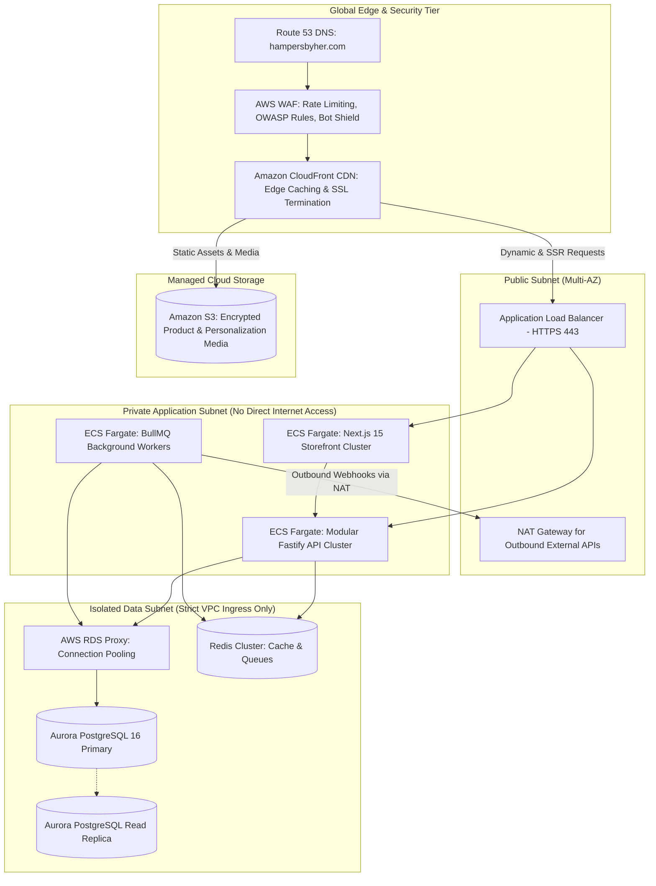
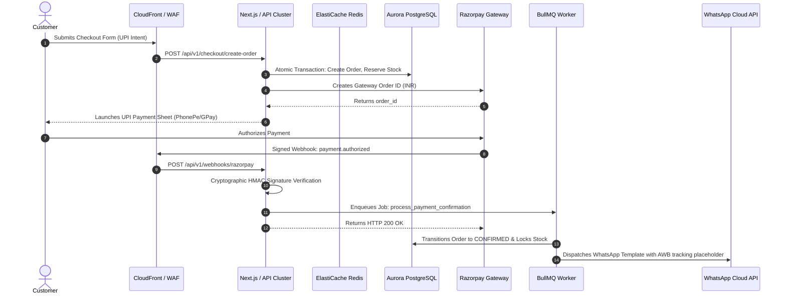

<!-- HAMPERS-BY-HER | E2E COMMERCE SYSTEM | DOCUMENT CONTROLLED -->
# 09. System Architecture Document (SAD) — Hampers by Her

## Document Control
- **Document Version**: 2.0.0
- **Status**: APPROVED SYSTEM ARCHITECTURE
- **Last Updated**: 2026-09-18
- **Infrastructure Provider**: Amazon Web Services (AWS - Asia Pacific Mumbai `ap-south-1`)
- **Runtime Environment**: Docker Containerized Services on AWS ECS Fargate
- **Document Quality Standard**: 15/15 Mandatory Sections Compliant (Section 40)

---

## 1. Purpose
Provide the exhaustive system architecture, infrastructure topology, network isolation tiers, high-availability scaling policies, and disaster recovery specifications for the **Hampers by Her** digital commerce platform. This specification ensures that the infrastructure remains highly available (99.9% uptime SLA), secure against distributed denial of service (DDoS) and injection attacks, and capable of handling 10x traffic surges during high-stakes festive gifting seasons (e.g., Diwali, Rakhi, Valentine's Day).

---

## 2. Scope
- **In-Scope**:
  - Physical and logical infrastructure topology across AWS Availability Zones (`ap-south-1a`, `ap-south-1b`).
  - Network architecture, VPC subnet partitioning, Security Groups, and NAT Gateways.
  - Scalability and autoscaling models for ECS Fargate, RDS Aurora PostgreSQL, and Redis.
  - Critical end-to-end runtime data flows (Checkout, Builder Session, and WhatsApp Webhook).
  - Disaster recovery tiers, High Availability (HA) failover, RPO, and RTO benchmarks.
- **Out-of-Scope**:
  - Internal TypeScript class structures and software design patterns (governed in `08_TAD.md`).
  - Frontend component hierarchy (governed in `10_FRONTEND_ARCHITECTURE.md`).

---

## 3. Context
E-commerce infrastructure for boutique luxury gifting differs significantly from standard software applications:
1. **Extreme Seasonality**: 60% of annual revenue is compressed into 4 festive peaks. Traffic can leap from 100 requests/minute to 4,000 requests/minute within hours of an Instagram influencer campaign.
2. **Zero Tolerance for Data Loss**: If a customer pays for an anniversary hamper via UPI, dropping that transaction due to a database connection timeout creates severe brand damage.
3. **Low Latency on Mobile Networks**: Over 80% of users connect via 4G/5G mobile networks in India; page render and API latency must be strictly minimized at the edge.

---

## 4. Requirements
### 4.1 Functional Requirements
- **FR-SAD-01**: Multi-AZ Redundancy: All production application workloads and databases must be deployed across at least two AWS Availability Zones (`ap-south-1a`, `ap-south-1b`).
- **FR-SAD-02**: Edge Acceleration: Dynamic routes and static assets must be served via CloudFront edge locations with TLS 1.3 termination.
- **FR-SAD-03**: Network Isolation: Database and Redis instances must be hosted in private subnets with zero direct public internet ingress.

### 4.2 Non-Functional Requirements
- **NFR-SAD-01**: System Availability: 99.9% uptime SLA across all public customer endpoints.
- **NFR-SAD-02**: Disaster Recovery RTO/RPO: Recovery Time Objective (RTO) $\le 30\text{ minutes}$; Recovery Point Objective (RPO) $\le 5\text{ minutes}$.

---

## 5. Architecture & Design
### 5.1 Infrastructure & Network Topology


---

## 6. Business Rules
- **BR-SAD-01**: **No Direct Database Access**: Production database port 5432 is accessible strictly through the RDS Proxy from private application subnets; direct internet ingress is prohibited.
- **BR-SAD-02**: **Immutable Container Tags**: Every production deployment must use immutable image tags tied to git commit SHAs; `:latest` tags are prohibited in production task definitions.
- **BR-SAD-03**: **Multi-AZ Failover Invariant**: Database clusters must maintain an active read replica in a secondary AZ with automated failover enabled.

---

## 7. Technical Details

### 7.1 Subnet CIDR Matrix
| Network Zone | CIDR Block | Permitted Ingress | Resources Hosted |
| :--- | :--- | :--- | :--- |
| **Edge Zone** | Public | Internet (0.0.0.0/0) via TLS 1.3 | CloudFront CDN, Route 53, WAF |
| **Public Subnet** | `10.0.1.0/24`, `10.0.2.0/24` | Port 443 from CloudFront IPs only | Application Load Balancer, NAT Gateway |
| **Private App Subnet** | `10.0.10.0/24`, `10.0.20.0/24`| Port 3000/4000 from ALB only | Next.js Containers, API Containers, BullMQ Workers |
| **Private Data Subnet** | `10.0.100.0/24`, `10.0.200.0/24`| Port 5432 from RDS Proxy only; Port 6379 from App Subnet only | Aurora PostgreSQL Multi-AZ, ElastiCache Redis |

### 7.2 End-to-End Payment & Order Placement Flow


### 7.3 Autoscaling Configuration
- **ECS Fargate Task Sizing**: 1 vCPU, 2GB RAM per task. Target tracking CPU $> 65\%$, Memory $> 75\%$.
- **Aurora Serverless v2**: 0.5 to 16 ACUs (Aurora Capacity Units) auto-scaling based on load.

---

## 8. Dependencies
- AWS Cloud Services (`ap-south-1` region).
- CloudFront WAF & Route 53.
- Upstream: `08_TAD.md` (Technical architecture).
- Downstream: `33_DEVOPS.md` (Terraform definitions) and `35_CLOUD_ARCHITECTURE.md`.

---

## 9. Security
- **Defense in Depth**:
  ```mermaid
  graph TD
      A[External Threat] -->|DDoS Flood| B[AWS Shield Standard & CloudFront Edge Rate Limits]
      A -->|SQL Injection / XSS| C[AWS WAF Managed Core Rule Set]
      A -->|Man-in-the-Middle| D[Strict HTTPS Only: HSTS max-age=31536000]
      A -->|Container Breakout| E[AWS Fargate MicroVM Isolation & Read-Only Root Filesystem]
      A -->|Database Exfiltration| F[AWS KMS Customer Managed Keys: AES-256 at rest]
  ```
- **KMS Encryption**: All S3 media assets and database volumes encrypted at rest with AWS KMS.

---

## 10. Failure Modes
| Infrastructure Failure | System Response | Automated Recovery |
| :--- | :--- | :--- |
| **AZ-a Outage** | ALB detects unhealthy targets in AZ-a | Reroutes 100% of traffic to AZ-b tasks in $< 10\text{s}$ |
| **Aurora Primary Crash** | Read replica promoted to primary | Automatic DNS failover in $< 30\text{s}$ via RDS Proxy |
| **DDoS Attack on Storefront** | CloudFront WAF rate limits trip | IP blocks applied at edge; origin unaffected |

---

## 11. Testing
- **Multi-AZ Chaos Simulation**: Simulate AZ failure in staging environment verifying zero dropped active checkout connections.
- **k6 Distributed Load Testing**: 500 concurrent virtual users testing API endpoints under simulated 4G latency.

---

## 12. Observability
- **Golden Signals Dashboards**: CloudWatch monitoring Latency, Traffic, Errors, and Saturation.
- **Alarms**: High Priority SNS notification to SRE on P99 Latency $> 1000\text{ ms}$ or Error Rate $> 1\%$.

---

## 13. Open Questions
```yaml
unknown_registry:
  - field: aws_production_cost_budget
    status: TO_VERIFY
    source_required: brand_owner
    impact: medium
    temporary_assumption: "Infrastructure provisioned on baseline $150–$300/month tier scaling dynamically during festive months"
```

---

## 14. Future Evolution
- **Multi-Region Disaster Recovery**: Cross-region read replica in AWS Europe or Singapore for active global failover.
- **Edge SSR with CloudFront Functions**: Executing personalized occasion landing page rendering directly at edge PoPs.

---

## 15. References
- AWS Well-Architected Framework: Reliability Pillar.
- AWS ECS Best Practices Guide for Fargate.
- Amazon Aurora PostgreSQL Architecture and Best Practices.

<!-- DOCUMENT END: 09_SAD.md -->
