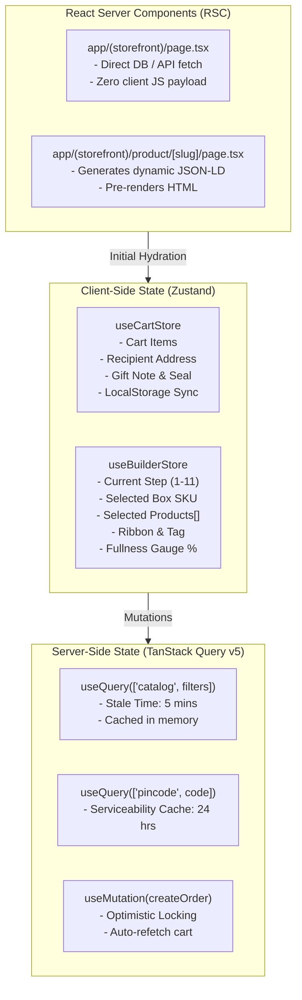

<!-- HAMPERS-BY-HER | E2E COMMERCE SYSTEM | DOCUMENT CONTROLLED -->
# 10. Frontend Architecture & State Management — Hampers by Her

## Document Control
- **Document Version**: 2.0.0
- **Status**: APPROVED FRONTEND SPECIFICATION
- **Last Updated**: 2026-09-18
- **Framework**: Next.js 15+ (App Router), React 19, TypeScript 5.5+
- **State Management**: Zustand (Client) + TanStack Query v5 (Server)
- **Document Quality Standard**: 15/15 Mandatory Sections Compliant (Section 40)

---

## 1. Purpose
Define the frontend application architecture, directory conventions, server/client component boundaries, global state management, data fetching paradigms, business rules, technical details, and performance optimization rules for the **Hampers by Her** storefront, bespoke atelier, and merchant interfaces.

This architecture guarantees a fluid, 60fps native-feeling mobile web experience that passes all Google Core Web Vitals thresholds while maintaining strict type safety and component reusability.

---

## 2. Scope

### 2.1 In Scope
- Next.js 15 App Router directory layout and route group segregation (`(storefront)`, `(atelier)`, `(checkout)`, `(admin)`).
- Hybrid rendering strategy: React Server Components (RSC) vs. Client Components (`'use client'`).
- Client-side state architecture using Zustand with local storage persistence.
- Server-state synchronization, caching, and optimistic mutations using TanStack Query v5.
- Mobile form architecture with React Hook Form and Zod validation.
- Core Web Vitals engineering (LCP < 2.2s, INP < 150ms, CLS < 0.05).

### 2.2 Out of Scope
- Backend database query optimization (governed in `13_DATABASE_DESIGN.md`).
- Merchant warehouse barcode scanning hardware integrations.

---

## 3. Context
Traditional single-page applications (SPAs) built with pure client-rendered React suffer on mobile e-commerce:
1. **Large JavaScript Bundles**: Initial load takes 4–6 seconds on spotty 4G connections, driving mobile bounce rates over 60%.
2. **SEO Deficits**: Client-rendered pages provide empty initial HTML to search engines and social media scrapers, degrading Google ranking and OpenGraph previews.
3. **Complex Nested Builder State**: The 11-step Hamper Builder requires multi-step state persistence (selected box, custom items, ribbon color, card text, uploaded photos) without causing unnecessary re-renders of unrelated UI components.

Next.js 15 App Router solves this by combining **Server-Side Rendering (SSR)** for instant catalog discovery with lightweight, isolated **Client Component islands** for interactive customization.

---

## 4. Requirements

### 4.1 Functional Requirements
- **FR-FE-01 (Route Segregation)**: Partition routes into isolated route groups: `(storefront)`, `(atelier)`, `(checkout)`, and `(admin)`.
- **FR-FE-02 (Dual State Synchronization)**: Maintain volatile UI interactions and multistep hamper configuration in Zustand client stores, with asynchronous server synchronization handled by TanStack Query v5.
- **FR-FE-03 (Guest-First Mobile Checkout)**: Provide frictionless 2-step checkout without requiring account registration upfront.
- **FR-FE-04 (11-Step Atelier Workflow)**: Implement fluid multi-step wizard state with persistence across page reloads and browser tab closures.

### 4.2 Non-Functional Requirements
- **NFR-FE-01 (Performance Budget)**: Largest Contentful Paint (LCP) $\le 2.2\text{s}$, Interaction to Next Paint (INP) $\le 150\text{ms}$, Cumulative Layout Shift (CLS) $\le 0.05$.
- **NFR-FE-02 (Bundle Size)**: Initial critical path JavaScript bundle size $\le 90\text{KB}$ gzipped.
- **NFR-FE-03 (Responsive Fidelity)**: Native-feeling 60fps micro-animations on mobile browsers (Safari iOS and Chrome Android).

---

## 5. Architecture & Design

### 5.1 Application Directory Layout
```text
src/
├── app/
│   ├── (storefront)/              # Public customer-facing routes (RSC by default)
│   │   ├── page.tsx               # Homepage / Editorial Atelier Showcase
│   │   ├── shop/
│   │   │   ├── [[...slug]]/page.tsx # Dynamic Category, Occasion & Recipient filters
│   │   ├── product/
│   │   │   └── [slug]/page.tsx    # High-conversion Product Detail Page (PDP)
│   │   ├── wedding-gifting/page.tsx
│   │   ├── corporate-gifting/page.tsx
│   │   └── track-order/page.tsx
│   ├── (atelier)/                 # Interactive Custom Hamper Builder
│   │   └── builder/
│   │       ├── page.tsx           # Entry & Step Coordinator
│   │       └── preview/page.tsx   # 3D/2D Unboxing & Review Canvas
│   ├── (checkout)/                # Frictionless Conversion Zone
│   │   ├── cart/page.tsx
│   │   └── checkout/page.tsx      # 2-Step Mobile Checkout
│   ├── (admin)/                   # Operations & CRM Workspace (Protected)
│   │   ├── layout.tsx             # Admin Navigation & RBAC Guard
│   │   ├── orders/page.tsx
│   │   ├── catalog/page.tsx
│   │   └── leads/page.tsx
│   ├── api/                       # Edge route handlers & webhook ingestion
│   │   └── webhooks/route.ts
│   ├── layout.tsx                 # Root layout (Fonts, Providers, Toast viewport)
│   └── error.tsx / not-found.tsx
├── components/                    # Atomic Design Component Library
│   ├── ui/                        # Low-level primitives (Button, Input, Sheet, Dialog)
│   ├── modules/                   # Composite organisms (ProductCard, BuilderStepper)
│   └── layout/                    # Header, StickyBottomBar, Footer, CartDrawer
├── stores/                        # Zustand Client Stores
│   ├── useCartStore.ts            # Cart items, coupon, gift message state
│   ├── useBuilderStore.ts         # 11-Step Hamper Builder selection & fullness
│   └── useUIStore.ts              # Modals, drawer visibility, mobile menu state
├── hooks/                         # Custom React Hooks
│   ├── usePincodeChecker.ts       # Serviceability & SLA calculation hook
│   └── useRazorpayCheckout.ts     # Client-side payment launch coordinator
└── lib/                           # Shared Utilities
    ├── api-client.ts              # Axios / Fetch wrapper with auth interceptors
    ├── pricing.ts                 # Client-side preview pricing calculators
    └── validations/               # Zod validation schemas
```

### 5.2 State Management Architecture


### 5.3 Client vs. Server Component Boundaries
```typescript
// app/(storefront)/product/[slug]/page.tsx (React Server Component)
import { getProductBySlug } from '@/lib/api';
import { ProductGallery } from '@/components/modules/ProductGallery'; // 'use client'
import { PersonalizationSelector } from '@/components/modules/PersonalizationSelector'; // 'use client'
import { PincodeChecker } from '@/components/modules/PincodeChecker'; // 'use client'

export default async function ProductDetailPage({ params }: { params: { slug: string } }) {
  const product = await getProductBySlug(params.slug); // Executed on Server during SSR

  return (
    <main className="max-w-7xl mx-auto px-4 py-8 grid grid-cols-1 md:grid-cols-2 gap-12">
      {/* Client Component Island: Touch Gestures & Image Zoom */}
      <ProductGallery images={product.images} />

      {/* Server Rendered Details */}
      <div className="flex flex-col gap-6">
        <h1 className="font-serif text-3xl md:text-4xl text-primary">{product.title}</h1>
        <p className="text-muted text-base leading-relaxed">{product.description}</p>
        <span className="text-2xl font-semibold text-charcoal">₹{product.price.toLocaleString('en-IN')}</span>

        {/* Client Component Island: Live Pincode & SLA Check */}
        <PincodeChecker productId={product.id} />

        {/* Client Component Island: Gift Message & Wax Seal Customization */}
        <PersonalizationSelector product={product} />
      </div>
    </main>
  );
}
```

---

## 6. Business Rules

### 6.1 State Synchronization & Hydration Rules
- **Rule FE-101 (Client State Persistence)**: The Hamper Builder state and active Cart state must be serialized to `localStorage` under `hbh_builder_v2` and `hbh_cart_v2`. State is restored within 50ms upon browser reload.
- **Rule FE-102 (Server Price Authoritativeness)**: Client stores may compute display price estimates, but checkout mutations always submit raw SKU identifiers to the backend pricing engine. No client-calculated currency totals are trusted.
- **Rule FE-103 (Session Merge upon Login)**: When an anonymous guest signs in or completes OTP verification, the guest cart items are merged into the customer account profile without discarding existing bespoke configurations.

---

## 7. Technical Details

### 7.1 Largest Contentful Paint (LCP < 2.2s)
- **Priority Image Loading**: Hero banner images on the homepage and the primary product image on PDPs utilize `priority={true}` and `fetchPriority="high"` in `next/image`.
- **Preconnect Headers**: Preconnect to image CDN and Google Fonts in root `layout.tsx`:
  ```html
  <link rel="preconnect" href="https://cdn.hampersbyher.com" />
  <link rel="preconnect" href="https://fonts.googleapis.com" />
  ```

### 7.2 Cumulative Layout Shift (CLS < 0.05)
- **Explicit Aspect Ratios**: All image wraps enforce CSS aspect ratio classes (`aspect-[4/5]`, `aspect-[1/1]`) to reserve screen space before images load.
- **Font Fallback Matching**: Next.js `next/font/google` automatically generates fallback size adjustments (`size-adjust`) to prevent text shifts when web fonts finish downloading.

### 7.3 Interaction to Next Paint (INP < 150ms)
- **React 19 `useTransition`**: Step changes in the 11-step Hamper Builder wrap visual state updates in `startTransition()`, keeping the main thread responsive to user touches even when rendering heavy component grids.

---

## 8. Dependencies
- **Core Framework**: `next` (15.0+), `react` (19.0+), `react-dom` (19.0+).
- **State & Data Fetching**: `zustand` (v5.0+), `@tanstack/react-query` (v5.50+).
- **Form Management**: `react-hook-form` (v7.52+), `@hookform/resolvers`, `zod` (v3.23+).
- **UI Animation**: `framer-motion` (v11.3+).
- **Icons**: `lucide-react` (v0.400+).

---

## 9. Security
- **XSS Prevention**: React automatically escapes all string interpolations. Rich text descriptions are sanitized via `dompurify` if raw HTML injection is required.
- **Session Protection**: JWT authentication tokens are stored strictly in `HttpOnly`, `Secure`, `SameSite=Strict` cookies, preventing malicious JavaScript from exfiltrating customer session data.

---

## 10. Failure Modes

| Failure Mode | Client-Side Behavior | Recovery Mechanism |
| :--- | :--- | :--- |
| **User Loses Internet Connection** | Floating offline toast appears: *"You are currently offline. Your cart and hamper selections are safely saved."* | Zustand persists state in `localStorage`; mutations queue until `navigator.onLine` fires |
| **Image CDN 404 / Network Drop** | Image container displays elegant branded SVG monogram placeholder | Automatic retry via Service Worker cache |
| **Cart Checkout Submit Failure** | Checkout button displays retry state; form fields and inputs remain completely populated | Error toast explains exact cause (e.g., *"Pincode serviceability timed out. Please retry."*) |

---

## 11. Testing
- **Component Unit Tests (Vitest + React Testing Library)**: Tests covering all UI component states (Empty, Loading, Success, Error).
- **End-to-End Tests (Playwright)**: Full browser automated tests verifying cart additions, hamper builder step-by-step progress, and payment modal triggering across mobile (iPhone 14) and desktop viewports.

---

## 12. Observability
- **Core Web Vitals Telemetry**: Integrated `reportWebVitals` sending LCP, FID/INP, and CLS scores to CloudWatch RUM and Google Analytics 4.
- **Client Error Logging**: Uncaught React component errors intercepted by Sentry boundary with stack traces and user action breadcrumbs.

---

## 13. Open Questions

```yaml
unknown_registry:
  - field: customer_guest_checkout_ratio_target
    status: TO_VERIFY
    source_required: brand_owner
    impact: medium
    temporary_assumption: "Assume 70% of social media gifters prefer guest checkout without mandatory account creation"

  - field: brand_social_links
    status: TO_VERIFY
    source_required: brand_owner
    impact: low
    temporary_assumption: "Instagram: @hampers._by_her; WhatsApp: official business link"
```

---

## 14. Future Evolution
- **Progressive Web App (PWA) Offline Catalog**: Allow users to browse pre-cached gift hampers even in low-connectivity mobile areas.
- **Web Share API**: 1-click sharing of curated bespoke hampers directly to WhatsApp or Instagram Stories with dynamic preview cards.

---

## 15. References
- Next.js 15 Documentation: *App Router, React Server Components & Streaming*
- Google Chrome Developers: *Optimizing Core Web Vitals for E-Commerce*
- Zustand Documentation: *Design Patterns & Persistent Storage*
- TanStack Query v5: *Caching & Optimistic Mutation Best Practices*

<!-- DOCUMENT END: 10_FRONTEND_ARCHITECTURE.md -->
