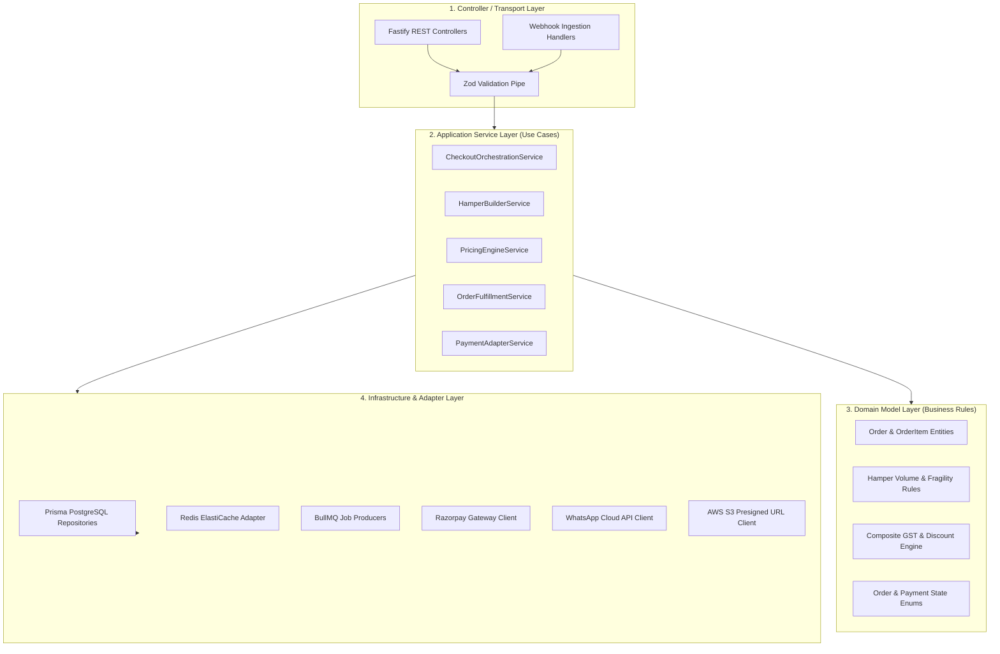
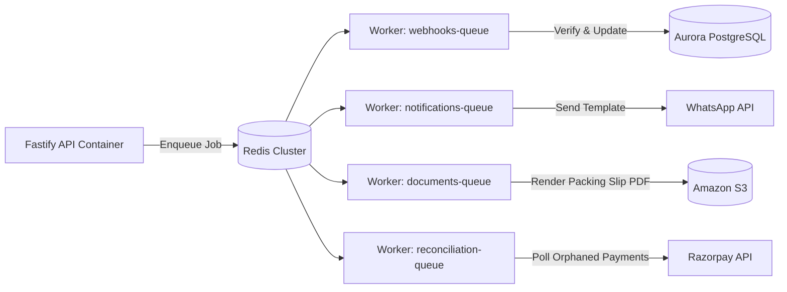

<!-- HAMPERS-BY-HER | E2E COMMERCE SYSTEM | DOCUMENT CONTROLLED -->
# 11. Backend Architecture & Service Layer — Hampers by Her

## Document Control
- **Document Version**: 2.0.0
- **Status**: APPROVED BACKEND SPECIFICATION
- **Last Updated**: 2026-09-18
- **Core Framework**: Node.js v22 LTS, NestJS with Fastify Adapter
- **Database & ORM**: PostgreSQL 16 + Prisma ORM
- **Task Queue Engine**: BullMQ 5.x + Redis 7.2
- **Document Quality Standard**: 15/15 Mandatory Sections Compliant (Section 40)

---

## 1. Purpose
Define the backend application architecture, domain service boundaries, clean layer isolation, transactional integrity models, background worker queues, and external gateway adapter patterns for the **Hampers by Her** digital commerce platform.

This architecture ensures rock-solid transactional reliability, sub-50ms database operations, deterministic server-side pricing, and seamless integration with third-party payment and messaging networks.

---

## 2. Scope

### 2.1 In Scope
- Hexagonal / Layered architectural structure (Controllers → Services → Domain Models → Repositories).
- Specifications for all 10 core domain services.
- Database transaction boundaries, optimistic locking, and concurrency controls.
- Asynchronous background worker architecture using BullMQ and Redis.
- Gateway adapter interfaces for Razorpay, Meta WhatsApp Cloud API, and Courier Logistics.
- Idempotency guarantees and webhook retry mechanics.

### 2.2 Out of Scope
- SQL table DDL creation scripts (governed in `13_DATABASE_DESIGN.md`).
- Cloud networking VPC routing tables (governed in `35_CLOUD_ARCHITECTURE.md`).

---

## 3. Context & Background
In custom hamper commerce, backend failures directly result in lost revenue or ruined gifting moments. Typical failure points include:
1. **Race Conditions on Scarce Items**: Two customers purchasing the last artisanal candle simultaneously in different custom hampers.
2. **Double Charges**: Network drops during checkout causing a customer to tap "Pay" twice, resulting in duplicate order creation.
3. **Webhook Timeouts**: External payment gateways timing out if order confirmation logic takes > 5 seconds to process synchronously.

The backend is engineered to separate **synchronous HTTP request handling** from **asynchronous background jobs**, guaranteeing instant HTTP 200 responses to webhooks while executing heavy tasks (PDF generation, WhatsApp notifications, stock reconciliation) in dedicated worker processes.

---

## 4. Requirements

### 4.1 Functional Requirements
- **FR-BE-01 (Domain Service Isolation)**: Encapsulate core e-commerce workflows into decoupled domain services with strict transactional boundaries.
- **FR-BE-02 (Server Authoritative Pricing)**: Enforce all pricing, tax, packaging, and coupon deductions on the server; never trust client-provided totals.
- **FR-BE-03 (Asynchronous Queue Decoupling)**: Offload external API calls, PDF rendering, and WhatsApp notifications to BullMQ Redis queues to keep HTTP response times under 200ms.
- **FR-BE-04 (Zero Overselling)**: Utilize serializable transactions and row-level locking on inventory items during checkout order reservation.

### 4.2 Non-Functional Requirements
- **NFR-BE-01 (Latency Budget)**: Database read operations $\le 30\text{ms}$; transactional checkout mutations $\le 200\text{ms}$.
- **NFR-BE-02 (Throughput Capacity)**: Sustain 500 concurrent requests/sec during peak festival drops (Diwali, Rakhi, Valentine's).
- **NFR-BE-03 (High Availability)**: Target 99.95% uptime with automated multi-AZ failover on Aurora Serverless v2.

---

## 5. Architecture & Layered Domain Model



---

### 5.1 Core Domain Services (Specifications)

### 5.1 PricingEngineService
- **Responsibility**: Single source of truth for financial calculations.
- **Contract**: Accepts an array of item SKUs, packaging tokens, and customization add-on IDs.
- **Formula**:
  $$\text{Subtotal} = \sum (\text{item.price} \times \text{qty}) + \text{packaging.price} + \sum \text{customization.price}$$
  $$\text{Discount} = \text{calculateDiscount}(\text{Subtotal}, \text{couponCode})$$
  $$\text{Tax} = \text{round}((\text{Subtotal} - \text{Discount}) \times 0.18)$$
  $$\text{Total} = (\text{Subtotal} - \text{Discount}) + \text{Tax} + \text{ShippingFee}$$

### 5.2 CheckoutOrchestrationService
- **Responsibility**: Atomically converts a validated Cart into an Order in `PENDING_PAYMENT` state.
- **Transaction Boundary**:
  ```typescript
  await prisma.$transaction(async (tx) => {
    // 1. Lock and decrement stock for all component SKUs
    for (const item of cart.items) {
      const stock = await tx.inventory.update({
        where: { sku: item.sku, available: { gte: item.quantity } },
        data: { available: { decrement: item.quantity }, reserved: { increment: item.quantity } }
      });
      if (!stock) throw new InsufficientStockException(item.sku);
    }
    // 2. Insert Order and composite OrderItems
    const order = await tx.order.create({ data: orderPayload });
    // 3. Register Razorpay Order via Adapter
    const gatewayOrder = await razorpayAdapter.createOrder(order.id, order.totalAmount);
    return { order, gatewayOrder };
  }, { isolationLevel: Prisma.TransactionIsolationLevel.Serializable });
  ```

### 5.3 PaymentAdapterService
- **Responsibility**: Gateway-agnostic abstraction wrapping Razorpay with Cashfree fallback capability.
- **Methods**:
  - `createPaymentOrder(orderId, amount, currency)`
  - `verifyWebhookSignature(payload, signature, secret)`
  - `fetchPaymentStatus(paymentId)`
  - `processRefund(paymentId, amount, reason)`

---

## 6. Business Rules & Background Processing

### 6.1 Core Business Rules
- **Rule BE-201 (Transactional Stock Allocation)**: Inventory cannot be decremented without an active database transaction. If any item within a composite hamper fails stock availability, the entire order transaction is rolled back.
- **Rule BE-202 (Idempotent Webhook Processing)**: External payment webhooks must be verified via HMAC-SHA256 signature and deduplicated against the `WebhookEvent` table using `provider_event_id`.
- **Rule BE-203 (Automatic Expiry of Stale Orders)**: Orders in `PENDING_PAYMENT` state expire automatically after 15 minutes, unlocking reserved inventory back to available stock.

### 6.2 Asynchronous Background Worker Architecture (BullMQ)



### 6.1 Job Queue Definitions
1. `webhooks-queue`: Ingests and processes raw incoming webhooks asynchronously to return HTTP 200 within 200ms.
2. `notifications-queue`: Dispatches customer WhatsApp templates, order confirmation emails, and delivery SMS alerts with exponential backoff retry.
3. `documents-queue`: Generates thermal shipping labels, picking lists, and wax-sealed gift message cards in PDF format.
4. `reconciliation-queue`: Cron job running every 5 minutes auditing orders stuck in `PENDING_PAYMENT` for > 15 minutes.

---

## 7. Technical Details & Code Conventions
- **Strict DTO Validation**: Every controller parameter is parsed through a strongly-typed Zod schema:
  ```typescript
  export const CreateOrderDTOSchema = z.object({
    cartId: z.string().uuid(),
    recipientAddress: AddressSchema,
    buyerContact: ContactSchema,
    giftMessage: z.string().max(300).optional(),
    waxSealColor: z.enum(['antique_gold', 'bordeaux', 'sage']).default('antique_gold'),
    deliverySlotDate: z.string().date()
  });
  export type CreateOrderDTO = z.infer<typeof CreateOrderDTOSchema>;
  ```
- **Error Handling**: Standardized HTTP exception filters mapping domain errors (`EntityNotFoundException`, `InsufficientStockException`, `PaymentVerificationException`) to clean JSON error contracts with HTTP status codes.

---

## 8. Dependencies & Integrations
- **Web Framework**: `@nestjs/core`, `@nestjs/platform-fastify`.
- **Database Access**: `@prisma/client` v5.18+.
- **Queue Management**: `bullmq` v5.8+, `ioredis` v5.4+.
- **Payment & External SDKs**: `razorpay` v2.9+, `@aws-sdk/client-s3`.
- **Validation**: `zod` v3.23+.

---

## 9. Security & Backend Hardening
- **SQL Injection Prevention**: All queries execute via Prisma parameterized queries; raw SQL is strictly audited and parameterized.
- **Rate Limiting**: Tiered token-bucket rate limiting via `fastify-rate-limit`:
  - Public Storefront: 120 requests/minute per IP.
  - Checkout Mutations: 10 requests/minute per IP.
  - Webhook Endpoints: Exempt from IP rate limits, protected by cryptographic HMAC verification.

---

## 10. Failure Modes & Idempotency Controls

| Failure Scenario | Backend Autonomous Handling |
| :--- | :--- |
| **Duplicate Checkout Tap** | `Idempotency-Key` header stored in Redis. Subsequent identical requests return the cached initial response without charging twice. |
| **Database Deadlock during Flash Sale** | Prisma transactions configured with automatic 3-time retry with jittered exponential backoff. |
| **Razorpay API Downtime** | If Razorpay returns HTTP 500, adapter falls back to generating a pending order and notifies customer to pay via WhatsApp Payment Link. |

---

## 11. Testing & Service Verification
- **Unit Testing (Vitest)**: 100% test coverage on `PricingEngineService`, `HamperBuilderService`, and state machine guards.
- **Integration Testing (Supertest + Testcontainers)**: Ephemeral Docker containers for PostgreSQL and Redis running in GitHub Actions to execute end-to-end checkout and webhook tests.

---

## 12. Observability & Service Metrics
- **Prometheus Metrics**:
  - `http_request_duration_ms_bucket` (Latency histogram).
  - `bullmq_jobs_completed_total` / `bullmq_jobs_failed_total`.
  - `active_database_connections` via RDS Proxy telemetry.
- **Distributed Context Tracing**: OpenTelemetry spans injected into all Prisma queries and external HTTP calls.

---

## 13. Open Questions & Owner Verification

```yaml
unknown_registry:
  - field: merchant_notification_phone_number
    status: TO_VERIFY
    source_required: brand_owner
    impact: high
    temporary_assumption: "+91-XXXXXXXXXX (Receives instant WhatsApp alert on every new high-value order)"

  - field: packaging_materials_inventory_tracking
    status: TO_VERIFY
    source_required: brand_owner
    impact: medium
    temporary_assumption: "Boxes and ribbons tracked as inventory items with low-stock alerts at 20 units"
```

---

## 14. Future Evolution
- **GraphQL Federation Gateway**: Option to introduce a Apollo Federation layer if multiple frontend clients (PWA, Admin, Native App) require tailored query schemas.
- **Multi-Warehouse Routing**: Routing order fulfillment to regional workshop hubs based on recipient pincode proximity.

---

## 15. References
- NestJS Documentation: *Enterprise Modular Architecture & Fastify HTTP Engine*
- BullMQ Guide: *Message Queues, Retries, and Concurrency in Node.js*
- Prisma ORM: *Transactions, Concurrency, and Isolation Levels in PostgreSQL*
- OWASP Backend Security Verification Guide
