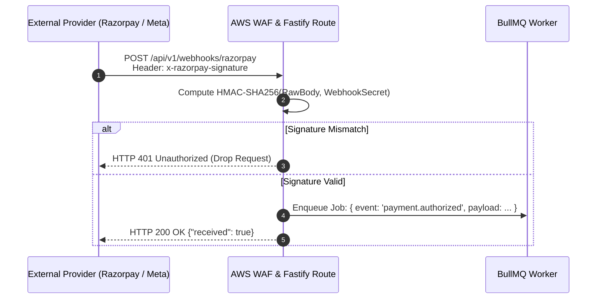

<!-- HAMPERS-BY-HER | E2E COMMERCE SYSTEM | DOCUMENT CONTROLLED -->
# 12. API Specification & Webhook Contracts — Hampers by Her

## Document Control
- **Document Version**: 2.0.0
- **Status**: APPROVED API SPECIFICATION
- **Last Updated**: 2026-09-18
- **API Protocol**: RESTful JSON over HTTPS / HTTP/3
- **Base Endpoint**: `https://api.hampersbyher.com/v1`
- **Document Quality Standard**: 15/15 Mandatory Sections Compliant (Section 40)

---

## 1. Purpose
Provide the definitive REST API contracts, request/response payload schemas, authentication paradigms, rate limiting headers, error representations, and webhook signature verification standards for the **Hampers by Her** digital platform.

This specification serves as the formal interface contract connecting frontend applications, merchant dashboards, and third-party partner systems (Razorpay, Meta WhatsApp, Shiprocket) with backend micro-services.

---

## 2. Scope

### 2.1 In Scope
- OpenAPI 3.1 compliant endpoint specifications across all 7 functional areas:
  1. Catalog & Discovery (`/catalog/*`)
  2. Hamper Builder Atelier (`/builder/*`)
  3. Cart & Pricing Engine (`/cart/*`)
  4. Checkout & Order Submission (`/checkout/*`, `/orders/*`)
  5. Payment Verification & Webhooks (`/payments/*`, `/webhooks/*`)
  6. WhatsApp & Social Leads (`/leads/*`, `/inquiries/*`)
  7. Merchant Operations & CRM (`/admin/*`)
- Idempotency protocol (`Idempotency-Key` header).
- Cryptographic signature validation protocols for incoming webhooks.

### 2.2 Out of Scope
- Internal in-memory method signatures (governed in `11_BACKEND_ARCHITECTURE.md`).

---

## 3. Context & Background
In custom gifting commerce, API endpoints must handle both lightweight read requests (browsing product listings) and highly complex transactional mutations (submitting an 11-step customized hamper with image uploads, gift messages, and real-time inventory locks).

An inconsistent API contract results in frontend serialization bugs, inaccurate pricing calculations, and orphaned payments. This specification standardizes all responses using strict TypeScript interfaces and RFC 7807 Problem Details.

---

## 4. Requirements

### 4.1 Functional Requirements
- **FR-API-01 (RESTful Resource Design)**: Provide OpenAPI 3.1 compliant endpoints across Catalog, Builder, Cart, Checkout, Payments, WhatsApp Leads, and Admin operations.
- **FR-API-02 (Idempotency Enforcement)**: Require and validate `Idempotency-Key` UUID headers on all mutating financial and order submission requests.
- **FR-API-03 (Cryptographic Webhook Handshakes)**: Enforce HMAC-SHA256 signature verification on Razorpay and Meta WhatsApp webhooks before job ingestion.

### 4.2 Non-Functional Requirements
- **NFR-API-01 (Latency Budget)**: P95 latency $\le 100\text{ms}$ for catalog read requests; $\le 250\text{ms}$ for transactional mutations.
- **NFR-API-02 (Error Standardization)**: RFC 7807 Problem Details representation across all error responses.

---

## 5. Architecture & Endpoint Specifications

### 5.1 API Design Standards & Global Headers

```mermaid
flowchart LR
    ClientReq[Client Request] --> AuthCheck{Auth Header or Cookie?}
    AuthCheck -->|Valid JWT| AddContext[Inject user_id & role into Request Context]
    AuthCheck -->|Guest Token| AddGuest[Inject guest_session_id into Context]
    AddContext --> IdempotencyCheck{Idempotency-Key Provided?}
    AddGuest --> IdempotencyCheck
    IdempotencyCheck -->|Yes| RedisCheck{Key Exists in Redis?}
    RedisCheck -->|Yes| CachedRes[Return Cached Response (HTTP 200/201)]
    RedisCheck -->|No| ExecuteAPI[Execute Controller & Cache Result for 24h]
    IdempotencyCheck -->|No| ExecuteAPI
```

### 4.1 Global Request Headers
| Header Name | Type | Description | Mandatory On |
| :--- | :--- | :--- | :--- |
| `Content-Type` | String | `application/json` | All `POST`, `PUT`, `PATCH` requests |
| `Idempotency-Key`| UUIDv4 | Unique client request identifier | All `/checkout/*` and `/payments/*` mutations |
| `X-Correlation-ID`| UUIDv4 | Distributed request trace identifier | All incoming requests |
| `Authorization` | String | `Bearer <JWT_TOKEN>` | All `/admin/*` and customer account routes |

---

### 5.2 Comprehensive Endpoint Specifications

### 5.1 Catalog & Discovery Endpoints
- `GET /catalog/products`
  - *Query Params*: `occasion`, `recipient`, `min_price`, `max_price`, `limit` (default: 20), `cursor`.
  - *Response (200 OK)*:
    ```json
    {
      "success": true,
      "data": {
        "items": [
          {
            "id": "prod_velvet_sunset",
            "slug": "the-velvet-sunset-hamper",
            "title": "The Velvet Sunset Hamper",
            "subtitle": "Artisanal soy candle, berry tea, and satin silk scarf",
            "basePrice": 2850,
            "currency": "INR",
            "primaryImageUrl": "https://cdn.hampersbyher.com/products/velvet_sunset_hero.webp",
            "blurHash": "L6PZfSi_.AyE_3t7t7R**0o#DgR4",
            "isCustomizable": true,
            "stockStatus": "IN_STOCK"
          }
        ],
        "pageInfo": { "hasNextPage": true, "nextCursor": "cur_98765" }
      }
    }
    ```

- `GET /catalog/builder/components`
  - *Description*: Returns all individual products, boxes, ribbons, and wax seals available in the 11-step Hamper Builder.

---

### 5.2 Hamper Builder Endpoints
- `POST /builder/validate-step`
  - *Request Body*:
    ```json
    {
      "boxSku": "box_rigid_creme_large",
      "selectedComponentSkus": [
        { "sku": "candle_lavender_200g", "quantity": 1 },
        { "sku": "tea_rose_hibiscus", "quantity": 1 },
        { "sku": "tumbler_rose_gold", "quantity": 1 }
      ]
    }
    ```
  - *Response (200 OK)*:
    ```json
    {
      "success": true,
      "data": {
        "isValid": true,
        "boxFullnessPercentage": 78.5,
        "remainingVolumeCm3": 450.0,
        "totalWeightGrams": 920,
        "requiresFragileCushion": true,
        "livePricing": {
          "componentsSubtotal": 2450,
          "boxFee": 400,
          "estimatedTotal": 2850
        }
      }
    }
    ```

---

### 5.3 Cart & Pricing Endpoints
- `POST /cart/items`
  - *Request Body*:
    ```json
    {
      "cartId": "cart_uuid_12345",
      "itemType": "BESPOKE_HAMPER",
      "configuration": {
        "boxSku": "box_rigid_creme_large",
        "components": [
          { "sku": "candle_lavender_200g", "quantity": 1 },
          { "sku": "tumbler_rose_gold", "quantity": 1 }
        ],
        "ribbonToken": "midnight_bordeaux",
        "giftCard": {
          "recipientName": "Radhika",
          "messageText": "Happy 25th Birthday dearest sister! Shine bright.",
          "senderName": "Ananya",
          "waxSealColor": "antique_gold"
        }
      }
    }
    ```

---

### 5.4 Checkout & Order Submission Endpoints
- `POST /checkout/create-order`
  - *Headers*: `Idempotency-Key: c9b8a7f6-5d4e-3c2b-1a0f-9e8d7c6b5a4f`
  - *Request Body*:
    ```json
    {
      "cartId": "cart_uuid_12345",
      "buyer": {
        "fullName": "Ananya Verma",
        "email": "ananya@example.com",
        "phoneNumber": "+919876543210"
      },
      "recipientAddress": {
        "recipientName": "Radhika Sharma",
        "addressLine1": "Apt 402, Lotus Heights, Bandra West",
        "pincode": "400050",
        "city": "Mumbai",
        "state": "Maharashtra",
        "phoneNumber": "+919812345678"
      },
      "deliverySchedule": {
        "preferredDate": "2026-10-24",
        "deliverySlot": "STANDARD_AFTERNOON"
      },
      "paymentMethod": "RAZORPAY_UPI"
    }
    ```
  - *Response (201 Created)*:
    ```json
    {
      "success": true,
      "data": {
        "orderId": "ord_hbh_928374",
        "orderStatus": "PENDING_PAYMENT",
        "amountPayable": 3250,
        "currency": "INR",
        "razorpayOrderId": "order_EKfLW92834z",
        "razorpayKeyId": "rzp_live_XXXXXXXXXX"
      }
    }
    ```

---

## 6. Business Rules & Webhook Contracts

### 6.1 Webhook Contracts & Security Handshakes



### 6.1 Razorpay Webhook Events Handled
1. `payment.authorized`: Payment successfully held by gateway.
2. `payment.failed`: Transaction failed by bank/user cancellation.
3. `order.paid`: Gateway confirms financial capture.
4. `refund.processed`: Refund credited back to source.

---

## 7. Technical Details & RFC 7807 Error Contract

When an error occurs, the API returns a structured Problem Details payload:
```json
{
  "success": false,
  "error": {
    "type": "https://api.hampersbyher.com/errors/insufficient-inventory",
    "title": "Insufficient Stock",
    "status": 409,
    "detail": "The requested item 'candle_lavender_200g' only has 0 units available.",
    "instance": "/v1/cart/items",
    "errorCode": "ERR_INVENTORY_DEPLETED",
    "invalidParams": [
      {
        "name": "candle_lavender_200g",
        "reason": "Out of stock during checkout reservation"
      }
    ]
  },
  "meta": {
    "timestamp": "2026-09-18T12:00:00Z",
    "correlationId": "corr_123456"
  }
}
```

---

## 8. Dependencies & Libraries
- **Specification Engine**: OpenAPI 3.1 (`@nestjs/swagger`, `swagger-ui-express`).
- **Validation Engine**: `zod` v3.23+, `fastify-zod`.
- **Crypto Engine**: Node.js native `node:crypto` for HMAC-SHA256 signature verification.

---

## 9. Security & Rate Limiting Specifications
- **Strict HTTPS Only**: API endpoints strictly reject plain HTTP requests with `301 Moved Permanently`.
- **Rate Limit Response Headers**:
  - `X-RateLimit-Limit: 120`
  - `X-RateLimit-Remaining: 118`
  - `X-RateLimit-Reset: 1726660860`

---

## 10. Failure Modes & Edge Case Responses

| Failure Mode | HTTP Status | Error Code | Client Remediation |
| :--- | :--- | :--- | :--- |
| **Invalid Idempotency Key Format** | 400 Bad Request | `ERR_INVALID_IDEMPOTENCY_KEY` | Provide a valid UUIDv4 string |
| **Expired Cart Session (> 7 Days)** | 410 Gone | `ERR_CART_EXPIRED` | Re-initialize a new cart session |
| **Pincode Out of Serviceability** | 422 Unprocessable Entity | `ERR_PINCODE_UNSERVICEABLE` | Prompt user to change delivery address |
| **Payment Signature Mismatch** | 401 Unauthorized | `ERR_INVALID_WEBHOOK_SIGNATURE`| Reject forged webhook request |

---

## 11. Testing & Contract Verification
- **Prism Mock Server**: Automated CI testing running a Prism mock server validating that frontend requests adhere 100% to the OpenAPI schema.
- **Contract Testing (Pact / Dredd)**: Automated validation ensuring backend responses never introduce breaking field deletions.

---

## 12. Observability & API Telemetry
- **Endpoint Latency Tracking**: CloudWatch alarms trigger if p95 latency on `/checkout/create-order` exceeds 400ms.
- **Webhook Rejection Alerts**: Immediate PagerDuty alert if > 3 invalid webhook signatures occur within 5 minutes (indicating potential webhook spoofing).

---

## 13. Open Questions & Owner Verification

```yaml
unknown_registry:
  - field: razorpay_account_mode
    status: TO_VERIFY
    source_required: brand_owner
    impact: high
    temporary_assumption: "Standard Razorpay Standard Checkout in Live Mode with Webhook Secret configured"

  - field: whatsapp_template_namespace
    status: TO_VERIFY
    source_required: brand_owner
    impact: medium
    temporary_assumption: "Pre-approved templates in English and Hinglish under business manager account"
```

---

## 14. Future Evolution
- **Webhooks for Corporate Clients**: Allowing large enterprise clients to register webhooks for automated delivery status ingestion into their internal Slack or HRMS.
- **GraphQL Storefront Subscriptions**: Real-time push updates for live box fullness and stock countdowns during flash drops.

---

## 15. References
- OpenAPI 3.1.0 Specification: `https://spec.openapis.org/oas/v3.1.0`
- IETF RFC 7807: *Problem Details for HTTP APIs*
- Razorpay Webhooks Developer Guide & Verification
- Meta Graph API Webhook Verification Standards
