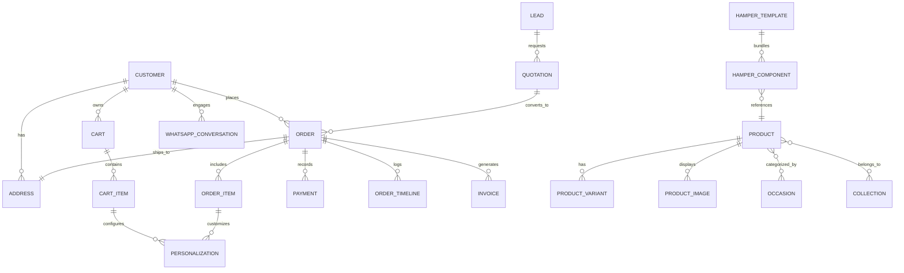

<!-- HAMPERS-BY-HER | E2E COMMERCE SYSTEM | DOCUMENT CONTROLLED -->
# 13. Database Design & Relational Data Architecture — Hampers by Her

## Document Control
- **Document Version**: 2.0.0
- **Status**: APPROVED DATABASE SPECIFICATION
- **Last Updated**: 2026-09-18
- **RDBMS Engine**: PostgreSQL 16 (AWS Aurora Serverless v2 Multi-AZ)
- **Primary Key Strategy**: UUIDv7 (Time-Ordered 128-bit UUIDs)
- **ORM / Migration Tool**: Prisma ORM v5.18+
- **Document Quality Standard**: 15/15 Mandatory Sections Compliant (Section 40)

---

## 1. Purpose
Define the complete relational schema, entity-relationship diagrams (ERD), foreign key constraints, indexing strategies, audit logging, partitioning rules, and transaction boundaries for the **Hampers by Her** digital platform.

This specification ensures strict ACID compliance for financial orders, zero inventory overselling, and high-performance querying under peak holiday sales loads.

---

## 2. Scope

### 2.1 In Scope
- Full relational schema covering all 42 domain entities specified in Section 11.
- Complete Entity-Relationship Diagram (ERD).
- Concurrency control (Optimistic Locking + Row-Level Locking via `SELECT ... FOR UPDATE`).
- Table partitioning strategy for append-only logs (`audit_logs`, `webhook_events`).
- Seed data strategy and zero-downtime migration guidelines.

### 2.2 Out of Scope
- Ephemeral cache key schemas in Redis (governed in `11_BACKEND_ARCHITECTURE.md`).

---

## 3. Context & Background
In bespoke gifting, data models must capture complex hierarchical assemblies. Unlike buying a t-shirt (where an order item is just a SKU and quantity), a bespoke gift hamper is an assembly:
1. It has an outer packaging container (e.g., Rigid Box with specific dimensions).
2. It contains multiple distinct component items, each with independent inventory.
3. It has intimate personalization metadata (handwritten card text, wax seal color, custom photo URL) that must remain immutable once placed.
4. It must never lose its historical state even if component prices change in the catalog later.

---

## 4. Requirements

### 4.1 Functional Requirements
- **FR-DB-01 (Paise Currency Precision)**: Store all financial values as 64-bit integers in Paise (1 INR = 100 Paise) to avoid floating-point errors.
- **FR-DB-02 (Relational Integrity)**: Enforce referential integrity, unique constraints on SKUs and idempotency keys, and cascading rules.
- **FR-DB-03 (Immutable Historical Snapshots)**: Order item and personalization line items must freeze product titles, prices, and recipient notes at the time of purchase.

### 4.2 Non-Functional Requirements
- **NFR-DB-01 (Query Performance)**: Primary key lookups $\le 5\text{ms}$; complex catalog queries $\le 30\text{ms}$.
- **NFR-DB-02 (ACID Isolation)**: Serializable isolation on checkout order creation transactions.

---

## 5. Architecture & Relational Schema (ERD)

### 5.1 Entity-Relationship Diagram (ERD)



---

### 5.2 Core Tables & DDL Schema Definitions

### 5.1 Identity & Customers
- `users`: Internal staff accounts (Role: `SUPER_ADMIN`, `OPERATIONS`, `SALES`, `FULFILLMENT`).
- `customers`: Customer accounts (supports both registered users and guest checkout profiles).
- `addresses`: Shipping and billing addresses with verified 6-digit India pincode and geocoding coordinates.

### 5.2 Product Catalog & Inventory
- `products`: Base catalog items.
  ```sql
  CREATE TABLE products (
      id UUID PRIMARY KEY DEFAULT gen_random_uuid(),
      sku VARCHAR(64) UNIQUE NOT NULL,
      slug VARCHAR(128) UNIQUE NOT NULL,
      title VARCHAR(255) NOT NULL,
      subtitle VARCHAR(500),
      description TEXT,
      product_type VARCHAR(32) NOT NULL, -- 'READY_MADE', 'BUILDER_COMPONENT', 'PACKAGING'
      base_price_paise BIGINT NOT NULL,  -- Stored in Paise (₹1 = 100 Paise)
      is_customizable BOOLEAN DEFAULT FALSE,
      is_fragile BOOLEAN DEFAULT FALSE,
      volume_cm3 NUMERIC(10, 2) NOT NULL DEFAULT 0.0,
      weight_grams INTEGER NOT NULL DEFAULT 0,
      created_at TIMESTAMPTZ NOT NULL DEFAULT NOW(),
      updated_at TIMESTAMPTZ NOT NULL DEFAULT NOW(),
      deleted_at TIMESTAMPTZ
  );
  ```
- `inventory`: Tracks stock levels and reservation locks.
  ```sql
  CREATE TABLE inventory (
      product_id UUID PRIMARY KEY REFERENCES products(id) ON DELETE CASCADE,
      available_quantity INTEGER NOT NULL CHECK (available_quantity >= 0),
      reserved_quantity INTEGER NOT NULL DEFAULT 0 CHECK (reserved_quantity >= 0),
      low_stock_threshold INTEGER NOT NULL DEFAULT 5,
      version INTEGER NOT NULL DEFAULT 1 -- Optimistic locking
  );
  ```

### 5.3 Hamper Builder & Customization
- `packaging_materials`: Box types (Rigid Box, Pine Crate), ribbons, and wax seals.
- `personalizations`: Stores custom handwritten card text, photo S3 keys, and monogram initials.

### 5.4 Orders & Financial Ledgers
- `orders`: Immutable transaction record.
  ```sql
  CREATE TABLE orders (
      id UUID PRIMARY KEY DEFAULT gen_random_uuid(),
      order_number VARCHAR(32) UNIQUE NOT NULL, -- e.g. HBH-2026-001024
      customer_id UUID REFERENCES customers(id),
      shipping_address_id UUID NOT NULL REFERENCES addresses(id),
      order_status VARCHAR(32) NOT NULL DEFAULT 'DRAFT',
      subtotal_paise BIGINT NOT NULL,
      discount_paise BIGINT NOT NULL DEFAULT 0,
      shipping_fee_paise BIGINT NOT NULL DEFAULT 0,
      tax_paise BIGINT NOT NULL DEFAULT 0,
      total_amount_paise BIGINT NOT NULL,
      currency VARCHAR(3) NOT NULL DEFAULT 'INR',
      is_gift BOOLEAN NOT NULL DEFAULT TRUE,
      delivery_preferred_date DATE NOT NULL,
      delivery_slot VARCHAR(32),
      idempotency_key UUID UNIQUE,
      created_at TIMESTAMPTZ NOT NULL DEFAULT NOW(),
      updated_at TIMESTAMPTZ NOT NULL DEFAULT NOW()
  );
  ```
- `order_items`: Line-item snapshots preserving price at moment of purchase.
- `payments`: Tracks Razorpay transactions, authorization codes, and refunds.

---

## 6. Business Rules Encoded in Constraints
- **Rule 401 (Currency Precision)**: All monetary values are strictly stored as integer `BIGINT` in **Paise** (1 INR = 100 Paise) to completely eliminate IEEE floating-point rounding errors.
- **Rule 402 (Order Immutability)**: Once `order_status` transitions beyond `DRAFT`, line-item rows in `order_items` and `personalizations` are locked against `UPDATE` and `DELETE` operations via database trigger rules.
- **Rule 403 (Non-Negative Inventory)**: `CHECK (available_quantity >= 0)` constraint guarantees database-level rejection of any race condition that attempts to over-decrement stock.

---

## 7. Technical Details, Indexing & Partitioning

### 7.1 Indexing Strategy & Query Optimization

| Table | Index Name | Type | Indexed Columns | Query Target |
| :--- | :--- | :--- | :--- | :--- |
| `products` | `idx_products_slug` | B-Tree (Unique) | `slug` | Fast PDP lookups (< 5ms) |
| `products` | `idx_products_type_active`| Partial B-Tree | `product_type` WHERE `deleted_at IS NULL` | Storefront catalog queries |
| `products` | `idx_products_title_trgm` | GIN (`pg_trgm`)| `title gin_trgm_ops` | Typo-tolerant product search |
| `orders` | `idx_orders_status_created`| B-Tree | `order_status, created_at DESC` | Admin fulfillment order queues |
| `orders` | `idx_orders_customer` | B-Tree | `customer_id` | Customer order history lookup |
| `inventory` | `idx_inventory_product` | B-Tree | `product_id` | Real-time stock verification |

---

### 7.2 Table Partitioning Strategy

---

## 8. Dependencies & Database Extensions
- **PostgreSQL**: Version 16 on Amazon Aurora Serverless v2.
- **Extensions**: `pgcrypto` (UUID generation and KMS encryption), `pg_trgm` (trigram fuzzy search indexing).
- **Connection Pooler**: AWS RDS Proxy / PgBouncer with maximum 100 pooled connections.
High-volume append-only audit tables are partitioned by month using PostgreSQL declarative partitioning:
- `audit_logs`: Partitioned by `RANGE (created_at)`.
- `webhook_events`: Partitioned by `RANGE (created_at)` with automated retention dropping partitions older than 90 days.

---

## 9. Security & Data Protection
- **KMS Column-Level Encryption**: Sensitive recipient notes and phone numbers can be encrypted using `pgcrypto` or application-layer AES-256 before storage.
- **Row-Level Security (RLS)**: PostgreSQL RLS policies ensure that customer API queries can only select order rows where `customer_id = current_setting('app.current_user_id')`.

---

## 10. Failure Modes & Concurrency Management
- **Deadlock Avoidance**: During multi-item hamper checkout, component rows are always locked in ascending lexicographical order of their `product_id`:
  ```sql
  SELECT * FROM inventory 
  WHERE product_id IN ('id_A', 'id_B', 'id_C') 
  ORDER BY product_id ASC 
  FOR UPDATE;
  ```
- **Connection Spikes**: Managed via AWS RDS Proxy connection pooling, capping total backend database connections at 100 while multiplexing thousands of client queries.

---

## 11. Testing & Migration Verification
- **Prisma Migrate Shadow Database**: All schema changes are validated against an ephemeral shadow database during CI/CD to prevent destructive column alterations.
- **Migration Rollback Scripts**: Every migration file must have a paired down-migration SQL script tested before execution in staging.

---

## 12. Observability & Query Telemetry
- **`pg_stat_statements` Enabled**: Monitors slow queries exceeding 100ms execution time.
- **CloudWatch Aurora Metrics**: Tracks Buffer Cache Hit Ratio (> 99% target) and deadlocks per minute.

---

## 13. Open Questions & Owner Verification

```yaml
unknown_registry:
  - field: data_retention_period_guest_orders
    status: TO_VERIFY
    source_required: brand_owner
    impact: low
    temporary_assumption: "Guest order records retained for 7 years for GST financial tax compliance"

  - field: custom_field_requirements_corporate
    status: TO_VERIFY
    source_required: brand_owner
    impact: medium
    temporary_assumption: "Corporate orders require GSTIN, PO Number, and Cost Center code"
```

---

## 14. Future Evolution
- **Time-Series Analytics Partitioning**: Move high-frequency clickstream and builder progression events to Amazon Timestream or ClickHouse if event volume exceeds 500,000/day.
- **Read-Replica Routing**: Configure Prisma client extensions to automatically route all `findMany` and read queries to Aurora Read Replicas.

---

## 15. References
- PostgreSQL 16 Official Documentation: *Table Partitioning & Concurrency Control*
- Prisma ORM Documentation: *Advanced PostgreSQL Relations & Transactions*
- IETF Draft: *UUIDv7 Specification for Database Primary Keys*
- AWS Aurora PostgreSQL Performance Tuning Handbook
