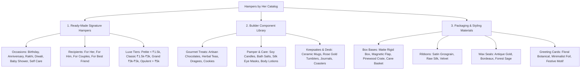

<!-- HAMPERS-BY-HER | E2E COMMERCE SYSTEM | DOCUMENT CONTROLLED -->
# 14. Product Catalog & Merchandising Architecture — Hampers by Her

## Document Control
- **Document Version**: 2.0.0
- **Status**: APPROVED CATALOG SPECIFICATION
- **Last Updated**: 2026-09-18
- **Catalog Model**: Dual-Track (Ready-Made Signature Hampers + Component Library)
- **Governing Directives**: Sections 0, 3, 7, 14, 57
- **Document Quality Standard**: 15/15 Mandatory Sections Compliant (Section 40)

---

## 1. Purpose
Define the complete product taxonomy, catalog merchandising hierarchy, SKU data structures, volumetric packaging specifications, temperature sensitivity flags, and sample product fixtures for **Hampers by Her**.

This specification governs how pre-curated signature gifts and modular hamper builder components are organized, priced, stored, and merchandised across the digital platform.

---

## 2. Scope

### 2.1 In Scope
- Dual-track catalog taxonomy: Ready-to-Ship Signature Hampers vs. Modular Builder Components.
- Packaging material specifications (Box bases, ribbons, wax seals, shredded crinkle filler).
- Product attribute schema (dimensions, net weight, shelf-life, vegetarian/vegan tags, fragile flags).
- Volumetric weight calculation models for courier shipping cost estimation.
- Seed catalog fixtures tagged as illustrative research assumptions.

### 2.2 Out of Scope
- Physical procurement agreements with artisan vendors (governed by operational supplier contracts).

---

## 3. Context & Background
In standard retail e-commerce, a product catalog is simple: a shirt has a size and color. In luxury gift hampers, catalog engineering must support two fundamentally different merchandising paradigms:
1. **Curated Bundles (Ready-Made)**: Sold as a single unit with an evocative story, photography, and fixed base price, but composed of underlying inventory items.
2. **Atelier Ingredients (Builder Components)**: Modular items selected dynamically by customers to construct a bespoke hamper.

Furthermore, products like artisanal chocolates or fresh soy candles have temperature and fragility constraints that must be modeled to prevent shipping disasters during Indian summer months.

---

## 4. Requirements

### 4.1 Functional Requirements
- **FR-CAT-01 (Merchandising Taxonomies)**: Support multi-tiered product categorization by Occasion, Recipient, Season, and Collection.
- **FR-CAT-02 (Component Decomposition)**: Distinguish ready-made pre-curated hampers from standalone artisanal components used in the Hamper Builder.
- **FR-CAT-03 (Volumetric Attribute Tracking)**: Track 3D bounding box dimensions (L x W x H in cm) and fragile flags for every physical item.

### 4.2 Non-Functional Requirements
- **NFR-CAT-01 (Search Latency)**: Trigram fuzzy search response $\le 40\text{ms}$.
- **NFR-CAT-02 (Image Optimization)**: Product images served via CloudFront CDN in next-gen WebP/AVIF formats with responsive srcset.

---

## 5. Architecture & Merchandising Hierarchy

### 5.1 Merchandising Hierarchy & Taxonomies



---

### 5.2 Product Attribute Schema & Specifications

```typescript
interface ProductEntity {
  id: string;
  sku: string;
  slug: string;
  title: string;
  subtitle: string;
  description: string;
  productType: 'READY_MADE' | 'BUILDER_COMPONENT' | 'PACKAGING_BOX' | 'PACKAGING_RIBBON';
  basePricePaise: number; // Stored in Paise (₹2,850 = 285000)
  
  // Physical & Logistics Dimensions
  dimensionsCm: {
    length: number;
    width: number;
    height: number;
  };
  weightGrams: number;
  volumetricWeightGrams: number; // (L * W * H) / 5000 * 1000
  
  // Attributes & Handling
  isCustomizable: boolean;
  isFragile: boolean;            // Requires bubble sleeve & shredded crinkle filler
  isTemperatureSensitive: boolean; // Requires insulated ice-gel packing in summer
  dietaryClassification?: 'VEGETARIAN' | 'VEGAN' | 'GLUTEN_FREE' | 'NONE';
  shelfLifeDays?: number;
  
  // Media Assets
  images: {
    url: string;
    altText: string;
    blurHash: string;
    aspectRatio: '4:5' | '1:1';
    isPrimary: boolean;
  }[];
}
```

---

## 7. Technical Details & Seed Catalog Fixtures

### 7.1 Illustrative Seed Catalog Fixtures (Research-Derived)

> [!NOTE]
> As mandated by **Section 0 and Section 3**, these product fixtures represent **research-derived assumptions** for architecture validation. Final production catalog data must be confirmed by the brand owner.

### 6.1 Sample Ready-Made Hampers
1. **The Velvet Twilight Hamper** (`SKU: HBH-RM-001`)
   - *Type*: `READY_MADE` | *Price*: ₹3,250 | *Occasion*: Birthday, Self Care
   - *Contents*: Lavender soy wax candle (200g), Rose-hibiscus herbal infusion tea (50g), Mulberry silk eye mask, artisanal almond brittle, gold-foiled celebration card.
   - *Packaging*: Midnight Bordeaux matte rigid slide box with blush satin ribbon.
2. **The Golden Radiance Hamper** (`SKU: HBH-RM-002`)
   - *Type*: `READY_MADE` | *Price*: ₹4,500 | *Occasion*: Anniversary, Wedding
   - *Contents*: Rose gold insulated coffee tumbler, double chocolate dragees jar, artisan room mist, handwritten calligraphy card with antique gold wax seal.
   - *Packaging*: Alabaster creme magnetic closure box with champagne gold grosgrain ribbon.

### 6.2 Sample Builder Components
- `COMP-CNDL-01`: French Lavender Hand-Poured Soy Candle (Volume: 350 cm³, 320g, ₹650).
- `COMP-TUMB-01`: Rose Gold Vacuum Insulated Tumbler (Volume: 500 cm³, 280g, ₹850).
- `COMP-CHOC-01`: Dark Chocolate Caramel Roasted Almonds (Volume: 200 cm³, 150g, ₹450, `isTemperatureSensitive: true`).
- `COMP-TEA-01`: Kashmiri Kahwa Green Tea Tin (Volume: 250 cm³, 100g, ₹400).

---

## 6. Business Rules & Volumetric Packing

### 6.1 Volumetric Packing & Shipping Rules
Courier partners calculate shipping rates based on whichever is greater: **Dead Weight** vs. **Volumetric Weight**:
$$\text{Volumetric Weight (kg)} = \frac{\text{Length (cm)} \times \text{Width (cm)} \times \text{Height (cm)}}{5000}$$
- Standard Hamper Rigid Box (`28cm x 22cm x 12cm`):
  $$\text{Volumetric Weight} = \frac{28 \times 22 \times 12}{5000} = 1.48 \text{ kg}$$
- Even if the items weigh only 800g, courier charges are calculated at 1.5 kg billable weight. This is automatically factored into the shipping fee calculation.

---

## 8. Dependencies & Integrations
- **CDN Media Delivery**: CloudFront image URLs serving WebP derivatives.
- **Inventory Sync**: Real-time reservation locks managed in Redis during checkout.

---

## 9. Security & Content Integrity
- **Sanitized Product Descriptions**: CMS rich-text fields are sanitized via HTML Purifier to prevent script execution.
- **Price Tampering Protection**: Product base prices are fetched exclusively by SKU from PostgreSQL during cart recalculation; client price payloads are ignored.

---

## 10. Failure Modes & Out-of-Stock Handling
- **Component Depleted in Builder**: If a component runs out of stock while a customer is building a hamper, the UI dims the card with badge: *"Restocking Soon"* and prevents selection.
- **Ready-Made Substitution Protocol**: If a pre-curated hamper has 1 minor component out of stock (e.g., specific tea flavor), the admin can define an automated `substitute_sku` of equal or higher value with customer consent.

---

## 11. Testing & Catalog Verification
- **Schema Validation Tests**: Automated test suites verifying that every product in the database has valid dimensions, non-zero price, at least 1 primary image, and valid occasion mappings.
- **Image URL Integrity Check**: Nightly cron checking that 100% of product image URLs on S3/CloudFront return HTTP 200.

---

## 12. Observability & Catalog Analytics
- **Product Velocity Tracking**: Daily dashboard reporting top viewed vs. top converted hampers.
- **Builder Item Popularity Index**: Identifies which individual items are most frequently added to bespoke hampers to inform reordering.

---

## 13. Open Questions & Owner Verification

```yaml
unknown_registry:
  - field: verified_product_catalog_list
    status: TO_VERIFY
    source_required: brand_owner
    impact: high
    temporary_assumption: "Owner to provide final CSV / Excel sheet of current signature hampers and pricing"

  - field: perishable_ice_gel_packing_fee
    status: TO_VERIFY
    source_required: brand_owner
    impact: medium
    temporary_assumption: "₹100 surcharge for cold-pack thermal shipping of chocolates in summer"
```

---

## 14. Future Evolution
- **Dynamic Hamper Personalization Engine**: AI recommending tailored component pairings based on the recipient persona selected in Step 1.
- **Artisan Vendor Portal**: Allowing boutique partner brands (candle makers, chocolatiers) to track their consignment stock levels directly.

---

## 15. References
- GS1 Standard: *E-Commerce Product Identification & Barcode Specifications*
- Shiprocket Packaging & Volumetric Weight Guidelines
- Baymard Institute: *Product Detail Page Merchandising & Information Hierarchy*
