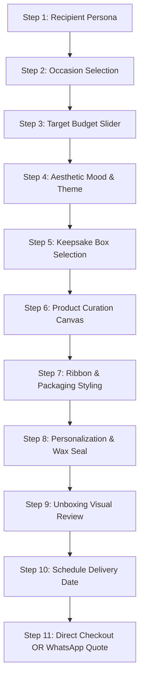

<!-- HAMPERS-BY-HER | E2E COMMERCE SYSTEM | DOCUMENT CONTROLLED -->
# 15. Hamper Builder Atelier Engine — Hampers by Her

## Document Control
- **Document Version**: 2.0.0
- **Status**: APPROVED CORE DIFFERENTIATOR SPECIFICATION
- **Last Updated**: 2026-09-18
- **Feature Name**: 11-Step Guided Gifting Atelier ("Build Your Hamper")
- **Governing Directives**: Sections 5, 12, 13, 14, 39, 46
- **Document Quality Standard**: 15/15 Mandatory Sections Compliant (Section 40)

---

## 1. Purpose
Provide the complete functional, algorithmic, interaction, and technical specification for the **11-Step Interactive Hamper Builder Atelier** — the primary brand differentiator of **Hampers by Her**.

This engine transforms bespoke gifting curation from chaotic, slow manual chat negotiations into a tactile, joyful, and conversion-optimized digital experience backed by deterministic volume, compatibility, and pricing algorithms.

---

## 2. Scope

### 2.1 In Scope
- Detailed specifications for all 11 steps of the guided curation atelier.
- Dynamic Volume & Physical Compatibility Engine (3D Bin-Packing heuristic).
- Live Box Fullness Gauge calculation and visual feedback states.
- Real-time deterministic pricing calculator and target budget tracker.
- Session persistence, multi-device recovery, and 1-tap WhatsApp quotation generation.

### 2.2 Out of Scope
- Direct courier label thermal printing (governed in `18_ORDER_MANAGEMENT.md`).

---

## 3. Context & Background
In traditional bespoke gifting, a customer texts an Instagram store: *"Can you make a hamper with a candle and coffee mug for around ₹2,500?"*
The seller takes hours to calculate prices, send photos of boxes, check stock, and ask for card text. Over 60% of potential buyers abandon the interaction due to friction and delayed responses.

The **Hamper Builder Atelier** provides instant autonomy: customers curate products visually with live feedback on box capacity, total cost, and arrival dates, seamlessly converting directly to online payment or requesting an instant WhatsApp summary.

---

## 4. Requirements

### 4.1 Functional Requirements
- **FR-BLD-01 (11-Step Guided Atelier)**: Deliver a fluid 11-step customization sequence from Occasion selection to Wax Seal and Handwritten Card.
- **FR-BLD-02 (Live Fullness & Collision Gauge)**: Real-time calculation of remaining 3D volume capacity as items are added or removed.
- **FR-BLD-03 (State Persistence)**: Automatic synchronization of active hamper draft to local storage and WhatsApp deep-link generation.

### 4.2 Non-Functional Requirements
- **NFR-BLD-01 (Interaction Latency)**: Volume calculation and price recalculation $\le 16\text{ms}$ (maintaining 60fps).
- **NFR-BLD-02 (Mobile Usability)**: 100% responsive touch-friendly interface optimized for single-handed mobile navigation.

---

## 5. Architecture & Guided Atelier Workflow

### 5.1 The 11-Step Guided Atelier Workflow



### 4.1 Step-by-Step Functional Specifications

| Step # | Step Title | User Actions & Choices | System Validation & Constraints |
| :--- | :--- | :--- | :--- |
| **Step 1** | **Who is it for?** | Select recipient chip (`For Her`, `For Him`, `For Couple`, `Sister`, `Mom`, `Best Friend`, `Colleague`) | Mandatory selection; filters recommended items in Step 6. |
| **Step 2** | **What is the occasion?**| Select occasion card (`Birthday`, `Anniversary`, `Wedding`, `Rakhi`, `Diwali`, `Self Care`, `Thank You`) | Selects greeting card artwork options in Step 8. |
| **Step 3** | **What is your budget?** | Slide target budget indicator (`₹1,000` to `₹10,000+` with preset buttons: `₹2,500`, `₹4,000`) | Optional soft budget guide; displays real-time variance (+/- ₹). |
| **Step 4** | **Aesthetic Mood** | Choose color palette (`Pastel Blush`, `Moody Bordeaux`, `Earthy Sage`, `Champagne Luxe`) | Filters box and ribbon recommendations. |
| **Step 5** | **Choose Box Base** | Select container (`Matte Rigid Box`, `Magnetic Flap Box`, `Pinewood Crate`, `Cane Basket`) | Defines base usable volume ($V_{\text{box}}$) and weight limit. |
| **Step 6** | **Curate Products** | Browse category tabs (Gourmet, Pamper, Keepsakes, Stationery); Tap `+ Add` on items | Evaluates real-time box fullness gauge ($0\% - 100\%$) and stock. |
| **Step 7** | **Ribbon & Styling** | Select ribbon color (Ivory, Champagne, Bordeaux, Sage) & material (Satin, Velvet) | Updates 2D visual packaging mock. |
| **Step 8** | **Personalization** | Enter recipient name, 300-char message, select wax seal stamp, upload optional polaroid | Validates character limits, profanity filter, image MIME type. |
| **Step 9** | **Unboxing Review** | Inspect 2D/3D flat-lay preview showing all items placed neatly in the selected box | Displays itemized price breakdown and delivery summary. |
| **Step 10**| **Delivery Date** | Pick target arrival date via calendar and delivery slot (`Standard` vs `Same-Day Express`) | Checks lead time: `Earliest Date = Today + Lead Time + Transit Days`. |
| **Step 11**| **Conversion** | Tap primary CTA: `Add to Cart & Checkout` OR secondary CTA: `Discuss on WhatsApp` | Atomically snapshots builder state to PostgreSQL / Redis. |

---

## 6. Business Rules & Fullness Engine

### 6.1 Algorithmic Specifications: Volume & Fullness Engine

```mermaid
flowchart TD
    AddItem[User Taps Add Product] --> FetchVolume[Query Item Volume & Weight]
    FetchVolume --> CalcFullness[Recalculate Current Fullness %]
    CalcFullness --> CheckCapacity{Fullness <= 100%?}
    
    CheckCapacity -->|Yes| UpdateState[Add Item to State; Animate Fullness Ring]
    UpdateState --> CheckFragility{Is Item Fragile?}
    CheckFragility -->|Yes| AutoCrinkle[Automatically Apply Protective Crinkle Filler]
    CheckFragility -->|No| CheckBudget[Update Target Budget Variance Pill]

    CheckCapacity -->|No (Overfill)| RejectAdd[Prevent Addition; Display Overcapacity Toast]
    RejectAdd --> SuggestBigger[Suggest: 'Upgrade to Large Rigid Box (+₹150)']
```

### 5.1 Volume Calculation Formula
$$\text{Fullness Percentage } (\%) = \left( \frac{\sum_{i=1}^{k} \text{Item Volume}_i}{\text{Box Usable Volume}} \right) \times 100$$
- **Usable Volume Factor**: To account for void fill (crinkle paper) and irregular item shapes, usable volume is defined as $80\%$ of raw internal box volume ($L \times W \times H \times 0.80$).
- **State Thresholds**:
  - `0% - 40%`: Underfilled (Badge: *"Room for more treats!"*).
  - `41% - 85%`: Optimal Curated Fullness (Badge: *"Perfect Balance"* in Gold).
  - `86% - 100%`: Fully Packed (Badge: *"Comfortably Full"*).
  - `> 100%`: Overfilled (Blocked from checkout).

---

### 6.2 Real-Time Pricing Engine Contract

Every addition in the builder recalculates the total deterministically:
$$\text{Builder Total} = \text{Box Base Price} + \sum \text{Component Prices} + \text{Customization Add-ons} + \text{Tax}$$

```typescript
interface BuilderPricingBreakdown {
  boxBasePrice: number;       // e.g., ₹400 (Rigid Slide Box)
  componentsSubtotal: number; // e.g., ₹2,250 (3 items)
  customizationAddons: {
    polaroidPhoto: number;    // ₹150 (if photo uploaded)
    customEngraving: number;  // ₹200 (if engraved item selected)
    waxSealCard: number;      // ₹0 (Complimentary)
  };
  grossSubtotal: number;      // ₹3,000
  applicableGst: number;      // ₹540 (18% composite GST)
  totalEstimatedPrice: number;// ₹3,540
}
```

---

## 7. Technical Details & State Persistence

### 7.1 State Persistence & WhatsApp Deep-Linking

When a customer taps **"Discuss on WhatsApp"**:
1. The client snapshots the Zustand builder state.
2. The server encrypts the state into a 12-character token: `wh_tk_987654`.
3. The server generates a WhatsApp deep-link:
   ```text
   https://wa.me/91XXXXXXXXXX?text=Hi%20Hampers%20by%20Her!%20I%20just%20curated%20a%20bespoke%20hamper%20on%20your%20website%20(Token:%20wh_tk_987654).%20Can%20we%20customize%20it%20further?
   ```
4. When the customer sends this text, the inbound webhook extracts the token, immediately loading the entire 11-step curation onto the merchant's CRM screen.

---

## 8. Dependencies & Integrations
- **Client State**: Zustand (`useBuilderStore`) with `persist` middleware in `localStorage`.
- **Motion Animation**: `framer-motion` for smooth layout transitions between steps.
- **Image Compression**: `browser-image-compression` for resizing customer polaroids before upload.

---

## 9. Security & Validation Rules
- **Content Sanitization**: Recipient name and card message sanitized using `validator.escape()`.
- **Photo Upload Verification**: Photos verified on backend via magic byte inspection (`FF D8 FF` for JPEG, `89 50 4E 47` for PNG). Non-image files are rejected.

---

## 10. Failure Modes & Edge Case Recovery

| Edge Case | User Experience | Automated Remediation |
| :--- | :--- | :--- |
| **Item Goes Out of Stock During Step 6** | Red border around item card: *"This item just sold out."* | Fullness gauge decreases; user prompted to pick alternative item |
| **Browser Refreshed on Step 8** | Zero data loss; page re-opens at exact step with all selections intact | Zustand restores snapshot from `localStorage` within 50ms |
| **Customer Uploads 40MB RAW Photo** | Instant inline error: *"Photo exceeds 10MB limit."* | Prevents network upload; canvas resizes down to 1200px max dimension |

---

## 11. Testing & Validation Matrix
- **Bin-Packing Heuristic Unit Tests**: 25 algorithmic tests validating that various item combinations accurately calculate fullness without false overcapacity flags.
- **E2E Playwright Journey**: Complete automated test clicking through all 11 steps, uploading a test image, entering text, and verifying cart payload accuracy.

---

## 12. Observability & Funnel Telemetry
- **Step-by-Step Drop-Off Tracking**:
  - Step 1 (Recipient) → Step 5 (Box Selected): Target > 75%
  - Step 5 (Box) → Step 6 (Items Added): Target > 65%
  - Step 6 (Items) → Step 11 (Checkout/Quote): Target > 45%
- **Average Hamper Assembly Time**: Monitored via PostHog (Target: 3.5 minutes).

---

## 13. Open Questions & Owner Verification

```yaml
unknown_registry:
  - field: complimentary_gift_card_policy
    status: TO_VERIFY
    source_required: brand_owner
    impact: low
    temporary_assumption: "1 complimentary greeting card with wax seal included in every custom hamper"

  - field: maximum_components_allowed_per_box
    status: TO_VERIFY
    source_required: brand_owner
    impact: medium
    temporary_assumption: "Hard cap at 8 items per box to prevent physical carton overstress"
```

---

## 14. Future Evolution
- **3D Photorealistic Three.js Unboxing Preview**: Real-time 3D canvas showing the lid lifting off the box with items arranged in realistic positions.
- **Smart Gifting Suggestions ("Pair Well With")**: When user adds a coffee mug, system gently highlights artisan biscotti and coffee beans with 1-tap add.

---

## 15. References
- 3D Bin-Packing & Heuristic Knapsack Optimization Literature
- Nielsen Norman Group: *Configurator & Custom Product Builder UX Guidelines*
- Baymard Institute: *Visual Merchandising in Custom Gift E-Commerce*
