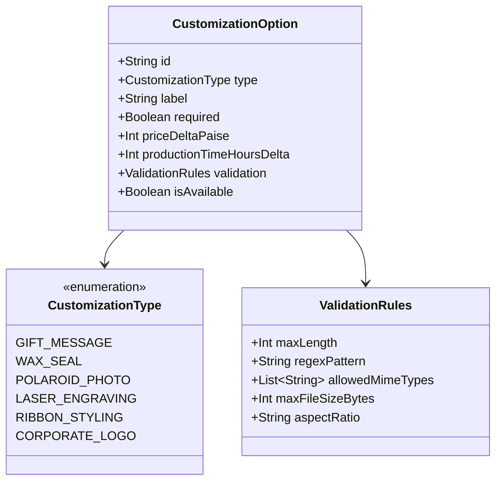
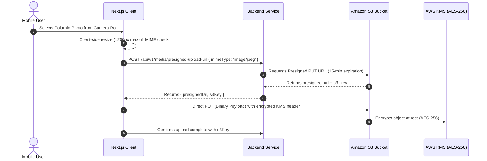
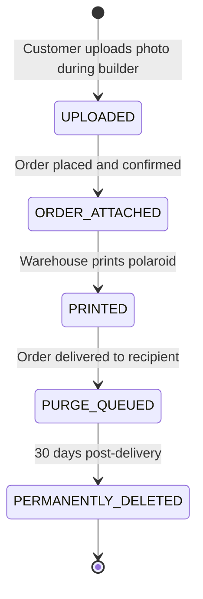

<!-- HAMPERS-BY-HER | E2E COMMERCE SYSTEM | DOCUMENT CONTROLLED -->
# 16. Customization & Personalization Engine — Hampers by Her

## Document Control
- **Document Version**: 2.0.0
- **Status**: APPROVED CUSTOMIZATION SPECIFICATION
- **Last Updated**: 2026-09-18
- **Engine Capability**: Text Calligraphy, Wax Seals, Polaroids, Engraving & Co-Branding
- **Governing Directives**: Sections 8, 12, 13, 25, 26
- **Document Quality Standard**: 15/15 Mandatory Sections Compliant (Section 40)

---

## 1. Purpose
Define the functional requirements, data schemas, validation rules, asset upload pipelines, and manufacturing handoff protocols for the **Customization & Personalization Engine** of **Hampers by Her**.

Personalization is what elevates a generic box of items into a treasured sentimental keepsake. This engine guarantees that customer emotions (letters, photos, initials) are faithfully captured, securely stored, accurately priced, and seamlessly rendered onto artisan work orders.

---

## 2. Scope

### 2.1 In Scope
- Personalization schemas across 6 distinct customization categories:
  1. Handwritten Calligraphy Message Cards.
  2. Physical Wax Seal Selection.
  3. Custom Polaroid Photograph Printing.
  4. Keepsake Monogramming & Laser Engraving (Tumblers, Wooden Boxes).
  5. Packaging Ribbon Styling (Color & Knot Style).
  6. Corporate Logo & Wedding Crest Co-Branding.
- Media upload architecture using AWS S3 presigned URLs.
- Privacy compliance and automated photo deletion lifecycle.

### 2.2 Out of Scope
- Physical laser engraving machine calibration (governed by workshop SOPs).

---

## 3. Context & Background
In bespoke gifting, customization errors are catastrophic:
- Printing a typo on a 50th wedding anniversary card destroys the gifting moment.
- Delivering a photo that is cropped awkwardly due to improper aspect ratio handling leads to refunds.
- Unencrypted customer personal photos stored indefinitely on public cloud servers creates severe privacy liabilities.

This engine provides **real-time visual validation** on the client side, **cryptographic validation** on the backend, and **automated privacy lifecycles** for all uploaded assets.

---

## 4. Requirements

### 4.1 Functional Requirements
- **FR-CST-01 (Multi-Option Personalization)**: Support wax seal stamp designs, ribbon materials, calligraphy card styles, and polaroid photo prints.
- **FR-CST-02 (Direct S3 Presigned Photo Upload)**: Direct client-to-S3 image upload with automated server-side dimension and MIME verification.
- **FR-CST-03 (Production Lead Time Modeling)**: Customizations must dynamically increment required preparation time (+24h to +48h).

### 4.2 Non-Functional Requirements
- **NFR-CST-01 (Image Processing)**: User photo variants generated within 2 seconds via Sharp in BullMQ worker.
- **NFR-CST-02 (Data Privacy)**: Automated S3 lifecycle rules purging customer personal photos 30 days after order delivery.

---

## 5. Architecture & Customization Taxonomy

### 5.1 Customization Taxonomy & Option Model



---

### 5.2 Detailed Customization Specifications

### 5.1 Handwritten Calligraphy Message Card
- **Label**: Complimentary Handcrafted Gift Card
- **Price Delta**: ₹0 (Complimentary)
- **Production Time Delta**: 0 hours (Processed during standard packing)
- **Input Fields**:
  - `recipient_name`: Max 50 chars (e.g., *"Dearest Radhika"*).
  - `card_message`: Max 300 chars (A6 textured card format).
  - `sender_signature`: Max 50 chars (e.g., *"With all our love, Vikram & Ananya"*).
- **Client Rendering**: Renders live in cursive script (`Playfair Display Italic` / simulated ink ligature).
- **Artisan Handoff**: Renders onto a printable 300 DPI PDF card template with crop marks for the packaging team.

### 5.2 Wax Seal Stamp Customization
- **Label**: Artisan Hand-Pressed Wax Seal
- **Price Delta**: ₹0 (Included with gift card)
- **Options**:
  - Color Tokens: `antique_gold`, `midnight_bordeaux`, `forest_sage`, `pearl_blush`.
  - Seal Motif: `botanical_rose`, `fleur_de_lis`, `with_love_crest`.

### 5.3 Custom Polaroid Photograph Print
- **Label**: Keepsake Polaroid Mini Print
- **Price Delta**: ₹150 (15000 Paise)
- **Production Time Delta**: +2 hours (Photo lab mini-print batch)
- **Specifications**:
  - Aspect Ratio: `1:1` square photo set within a `2:3` classic white polaroid border.
  - Optional Bottom Caption: Max 30 characters (e.g., *"Goa Sunsets • 2025"*).
  - Print Medium: 300 GSM Fujifilm archival matte paper.

### 5.4 Keepsake Laser Engraving & Monogramming
- **Label**: Precision Laser Engraving
- **Price Delta**: ₹250 (25000 Paise)
- **Applicable Items**: Rose Gold Tumbler, Wooden Keepsake Crate Lid, Leather Keychain.
- **Rules**: Exactly 2 or 3 capital initials (e.g., *"RS"* or *"AKV"*).

---

## 7. Technical Details & Media Upload Pipeline

### 7.1 Secure Media Upload Pipeline (Personal Photos)



---

## 6. Business Rules & Lead-Time Governance

### 6.1 Personalization Business Rules
- **Rule CST-101 (Card Character Limits)**: Handwritten gift card text strictly capped at 300 characters to fit artisanal stationery.
- **Rule CST-102 (Photo Quality Threshold)**: Uploaded customer photos must have minimum dimensions of $1000 \times 1000$ pixels.
- **Rule CST-103 (Lead Time Accumulation)**: Handcrafted wax seals add +1 business day to dispatch ETA.

### 6.2 Data Privacy & Automated Asset Retention



- **S3 Lifecycle Rule**: All objects in bucket prefix `uploads/personalizations/*` have an automated S3 Lifecycle policy:
  ```json
  {
    "Rules": [
      {
        "ID": "PurgeCustomerPersonalPhotosAfter30Days",
        "Status": "Enabled",
        "Filter": { "Prefix": "uploads/personalizations/" },
        "Expiration": { "Days": 30 }
      }
    ]
  }
  ```

---

## 8. Dependencies & Integrations
- **Cloud Storage**: Amazon S3 with AWS KMS (`sse: aws:kms`).
- **Client Image Processing**: `browser-image-compression` (Canvas API downscaling).
- **PDF Generation**: `pdfkit` / `@react-pdf/renderer` in backend worker to generate 300 DPI gift cards.

---

## 9. Security & Validation Controls
- **Magic Byte Validation**: Backend Lambda / Worker verifies raw byte signatures before accepting the S3 object key into the order record.
- **Profanity & Hate Speech Filtering**: Gift messages are parsed through an internal keyword filter; flagged messages trigger an administrative manual review queue before printing.

---

## 10. Failure Modes & Edge Case Recovery

| Edge Case | System Behavior | Remediation |
| :--- | :--- | :--- |
| **Photo Upload Drops on 3G Network** | Direct client upload retries up to 3 times with exponential backoff | If failure persists, order completes with placeholder; support contacts user via WhatsApp |
| **Unsupported Image Format (.HEIC)** | Client converts Apple HEIC to standard JPEG via `heic2any` library before upload | Prevents S3 ingestion of unrenderable raw formats |
| **Engraving Text Contains Emoji** | Input field rejects emoji input with helper tooltip: *"Engraving supports standard letters A-Z only."* | Client-side regex enforcement |

---

## 11. Testing & Validation Suite
- **Image Upload Integration Test**: Automated test mocking S3 presigned URL generation, file upload, and thumbnail generation.
- **Card Text Line-Wrapping Test**: Automated test verifying that a 300-character message never overflows the printable boundaries of the A6 card canvas.

---

## 12. Observability & Quality Audits
- **Upload Failure Rate Telemetry**: Sentry alert triggers if > 2% of presigned URL uploads fail to complete.
- **Reprint Tracking**: Operations dashboard logs any gift cards marked *"Reprinted due to error"* to monitor packing station quality.

---

## 13. Open Questions & Owner Verification

```yaml
unknown_registry:
  - field: gift_card_printing_hardware
    status: TO_VERIFY
    source_required: brand_owner
    impact: medium
    temporary_assumption: "Standard studio color laser printer using 300 GSM textured ivory cardstock"

  - field: corporate_laser_engraving_lead_time
    status: TO_VERIFY
    source_required: brand_owner
    impact: high
    temporary_assumption: "Requires +24 hours production lead time for orders with custom engraving"
```

---

## 14. Future Evolution
- **AI Handwriting Stylization**: Transforming typed text into photorealistic cursive handwriting matching the brand founder's natural penmanship.
- **Voice Message QR Codes**: Sender records a 30-second audio clip; system prints an elegant gold QR code on the back of the card: *"Scan to hear my voice."*

---

## 15. References
- AWS S3 Presigned URL Developer Best Practices
- W3C Media Capture and File API Standards
- Baymard Institute: *Product Customization & Personalization UX in Luxury E-Commerce*
