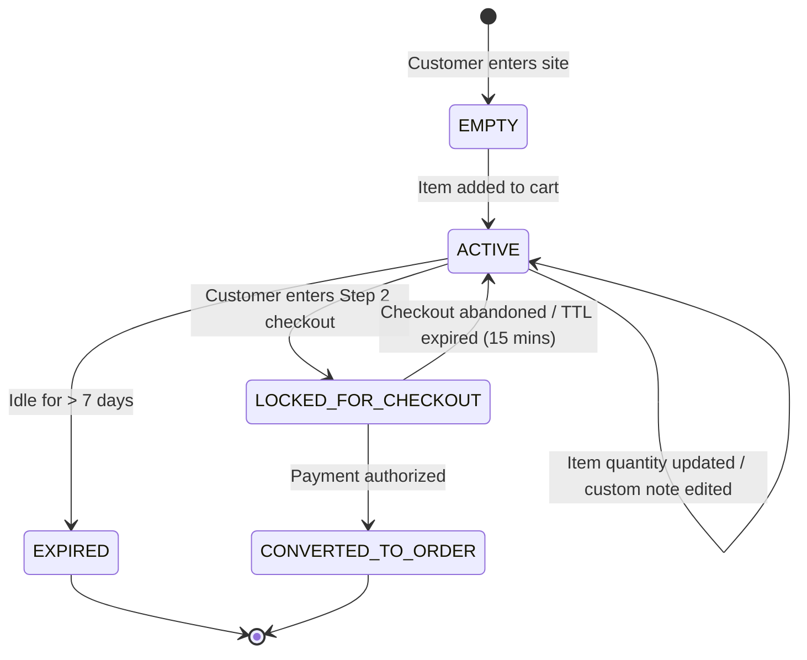
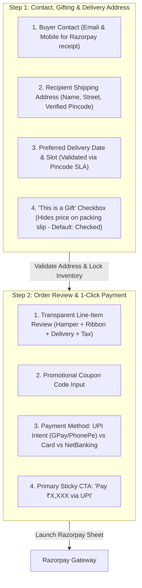

<!-- HAMPERS-BY-HER | E2E COMMERCE SYSTEM | DOCUMENT CONTROLLED -->
# 17. Cart & High-Conversion Checkout Engine — Hampers by Her

## Document Control
- **Document Version**: 2.0.0
- **Status**: APPROVED CHECKOUT SPECIFICATION
- **Last Updated**: 2026-09-18
- **Checkout Architecture**: 2-Step Frictionless Mobile Checkout (Guest-First)
- **Governing Directives**: Sections 14, 15, 16, 47, 48
- **Document Quality Standard**: 15/15 Mandatory Sections Compliant (Section 40)

---

## 1. Purpose
Define the functional architecture, cart state lifecycle, session synchronization, pricing engine rules, coupon application mechanics, and frictionless 2-step mobile checkout flow for **Hampers by Her**.

The cart and checkout systems are engineered to eliminate form fatigue, provide full transparency regarding delivery arrival dates, and achieve an industry-leading checkout completion rate on mobile web devices.

---

## 2. Scope

### 2.1 In Scope
- Dual session cart architecture: Anonymous Guest Cart vs. Authenticated Customer Cart.
- Cart merge algorithm upon customer authentication.
- Server-authoritative line-item calculation (Gross, Discounts, Shipping, Composite GST, Net).
- 2-Step Mobile Checkout flow (Contact & Address → Payment & Confirmation).
- Gift-centric order attributes: Separate Buyer vs. Recipient info, price-hidden packing slips, and scheduled delivery dates.

### 2.2 Out of Scope
- Direct payment gateway gateway cryptographic signature handshakes (governed in `19_PAYMENT_ARCHITECTURE.md`).

---

## 3. Context & Background
In traditional retail e-commerce, checkout asks: *"Where should we ship your order?"*
In luxury gifting, this question creates confusion:
- The customer is often buying for **someone else** (a friend, partner, parent, client).
- If the store auto-fills the buyer's name on the shipping label, the surprise is spoiled.
- If the packing slip includes the retail price, the gifting etiquette is violated.

Hampers by Her checkout explicitly splits **Buyer Context** (who pays and gets the receipt) from **Recipient Context** (who receives the beautifully packaged surprise without pricing).

---

## 4. Requirements

### 4.1 Functional Requirements
- **FR-CHK-01 (Frictionless 2-Step Checkout)**: Streamlined mobile checkout: Step 1 (Recipient & Delivery Date), Step 2 (Review & UPI/Payment).
- **FR-CHK-02 (Guest & Merged Carts)**: Support guest session carts seamlessly merged upon OTP authentication.
- **FR-CHK-03 (Dynamic Serviceability & Shipping)**: Real-time India PIN code lookup calculating carrier transit SLAs and delivery surcharges.

### 4.2 Non-Functional Requirements
- **NFR-CHK-01 (Cart Hydration)**: Restored from local storage in $\le 50\text{ms}$.
- **NFR-CHK-02 (Checkout Conversion)**: Sub-3-second end-to-end checkout initiation.

---

## 5. Architecture & 2-Step Mobile Checkout

### 5.1 Cart Lifecycle & State Transitions



---

### 5.2 2-Step Mobile Checkout Architecture



---

## 6. Business Rules & Pricing Governance

### 6.1 Business & Pricing Rules

### 6.1 Server-Authoritative Calculation Contract
```typescript
interface CartPricingCalculation {
  subtotalItemsPaise: bigint;    // Sum of hampers and components
  customizationFeePaise: bigint; // Polaroid, engraving, special ribbons
  packagingFeePaise: bigint;     // Keepsake box fee
  discountPaise: bigint;         // Applied coupon or volume promotion
  shippingFeePaise: bigint;      // Calculated based on pincode & delivery speed
  gstPaise: bigint;              // 18% composite GST on taxable gross
  totalPayablePaise: bigint;     // Final charge amount sent to payment gateway
}
```

### 6.2 Promotional Coupon Engine Rules
- **Rule 501 (Single Coupon per Cart)**: Stacking multiple promo codes is disallowed.
- **Rule 502 (Minimum Order Value - MOV)**: Coupons with MOV constraints (e.g., *"₹500 off on orders above ₹3,000"*) are evaluated against `subtotalItemsPaise - existingDiscounts`.
- **Rule 503 (Free Shipping Threshold)**: Standard courier delivery fee (₹100) is automatically waived if `totalPayable >= ₹2,500`.

---

## 7. Technical Details & Delivery Routing

### 7.1 Delivery Scheduling & Pincode Routing
- **Lead Time Verification**:
  $$\text{Earliest Selectable Date} = \text{Current Date} + \text{Production Lead Time (Days)} + \text{Courier Transit Days}$$
- **Daily Dispatch Cutoff**: 12:00 PM IST. Orders placed after 12:00 PM increment the earliest selectable date by +1 day.
- **Delivery Slots Available**:
  - `STANDARD_DAY`: Delivered anytime between 9:00 AM – 7:00 PM on target date.
  - `EXPRESS_EVENING` (Local Metro Only): Guaranteed between 5:00 PM – 9:00 PM (+₹150 surcharge).

---

## 8. Dependencies & Integrations
- **Session Store**: Redis cluster caching active carts (`cart:session:<id>`, TTL: 7 days).
- **Address Validation**: India Post Pincode directory with Google Places Autocomplete API.
- **Client Form Library**: `react-hook-form` with `zod` resolver.

---

## 9. Security & Fraud Prevention
- **Price Manipulation Shield**: The client payload only passes `{ cartId, address, paymentMethod }`. Any attempt to send a client-calculated total throws `400 Bad Request`.
- **Address Sanitization**: HTML tag stripping on address lines to prevent stored XSS attacks.
- **Rate-Limited Order Ingestion**: Max 5 order creation attempts per IP per minute.

---

## 10. Failure Modes & Edge Case Handlers

| Scenario | System Handling | User Experience |
| :--- | :--- | :--- |
| **Pincode Entered is Unserviceable** | System flags input immediately upon 6th digit | *"Sorry, we cannot deliver to this pincode. Try another address or chat on WhatsApp."* |
| **Inventory Depleted While on Step 2** | Checkout rejects submission; unlocks order | Returns user to cart with badge: *"Item X sold out during checkout. Please replace."* |
| **Payment Sheet Dismissed Without Paying** | Cart remains completely intact in Redis | User returns to checkout with 1-tap *"Retry Payment"* button |

---

## 11. Testing & Validation Matrix
- **Pricing Edge Cases**: Unit tests validating coupons that discount cart to ₹0, coupons exceeding cart value, and fractional rupee rounding.
- **E2E Playwright Checkout**: Automated tests simulating complete guest checkout flow with dummy Razorpay UPI test tokens.

---

## 12. Observability & Funnel Telemetry
- **Drop-Off Tracking**:
  - Cart Drawer Opened → Step 1 (Address) Started: Target > 70%
  - Step 1 Completed → Step 2 (Payment) Started: Target > 85%
  - Step 2 Submitted → Payment Success: Target > 80%
- **Abandonment Alerts**: If checkout abandonment exceeds 35% over a 2-hour rolling window, an alert notifies the operations channel.

---

## 13. Open Questions & Owner Verification

```yaml
unknown_registry:
  - field: free_shipping_order_value_threshold
    status: TO_VERIFY
    source_required: brand_owner
    impact: medium
    temporary_assumption: "Free standard shipping on orders above ₹2,500; flat ₹100 below"

  - field: express_same_day_delivery_surcharge
    status: TO_VERIFY
    source_required: brand_owner
    impact: medium
    temporary_assumption: "₹150 additional fee for local intra-city same-day delivery"
```

---

## 14. Future Evolution
- **WhatsApp Abandoned Cart Recovery**: Automatic WhatsApp message sent 30 minutes post-abandonment with a 1-click cart restore link: *"Hi Ananya, your custom hamper is safely saved. Tap here to complete your gift."*
- **Split Multi-Address Shipping**: Checkout allowing a user to send 5 identical bridesmaid hampers to 5 different addresses in a single transaction.

---

## 15. References
- Baymard Institute: *Checkout Usability Benchmark Study (2024)*
- Stripe E-Commerce Best Practices: *Reducing Friction in Mobile Payments*
- Google Pay & PhonePe UPI Deep-Link Integration Guidelines
