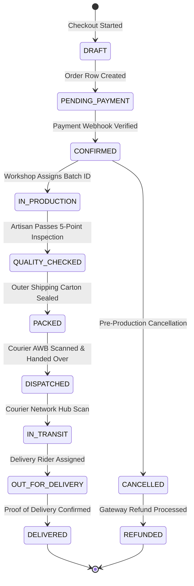
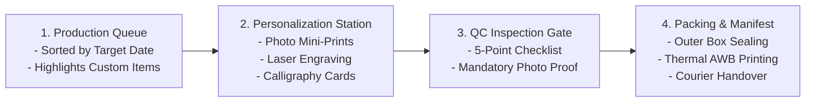

<!-- HAMPERS-BY-HER | E2E COMMERCE SYSTEM | DOCUMENT CONTROLLED -->
# 18. Order Management & Fulfillment Operations — Hampers by Her

## Document Control
- **Document Version**: 2.0.0
- **Status**: APPROVED OPERATIONS SPECIFICATION
- **Last Updated**: 2026-09-18
- **Operational Scope**: Order State Machine, Assembly Workflows, Quality Check & Dispatch
- **Governing Directives**: Sections 10, 11, 18, 20, 53
- **Document Quality Standard**: 15/15 Mandatory Sections Compliant (Section 40)

---

## 1. Purpose
Define the comprehensive order lifecycle, operational fulfillment queues, artisan assembly workflows, quality control (QC) gates, manual assisted order creation, and post-purchase customer notifications for **Hampers by Her**.

This specification bridges online customer expectations with physical workshop execution, ensuring that every gift hamper is assembled with handcrafted precision, thoroughly checked, and dispatched on schedule.

---

## 2. Scope

### 2.1 In Scope
- Complete 11-stage Order Lifecycle State Machine.
- Workshop Operational Queues (Production, QC, Packing, Dispatch).
- Physical Artisan Assembly Checklist and Quality Assurance Gate.
- Assisted Manual Order Entry for high-touch WhatsApp and Instagram inquiries.
- Order cancellation rules, return exceptions, and automated refund triggers.

### 2.2 Out of Scope
- Courier vehicle GPS telemetry routing (governed in `20_DELIVERY_LOGISTICS.md`).

---

## 3. Context & Background
Fulfillment in luxury gifting is fundamentally different from standard warehouse picking:
- Standard warehouse: Pick SKU 123 from bin B, drop in polybag, slap shipping label, ship.
- **Hampers by Her Atelier**:
  1. Retrieve rigid keepsake box and inspect corners for dents.
  2. Place delicate tissue and food-grade crinkle paper bedding.
  3. Arrange gourmet treats and candles in aesthetic focal balance.
  4. Print and hand-inspect the personalized greeting card; melt and press the wax seal.
  5. Tie the champagne satin ribbon with an artisan double-loop knot.
  6. Place into protective corrugated outer carton with fragile bubble cushioning.

A single missed step (e.g., forgetting to tie the ribbon or misspelling the recipient's name) ruins the emotional intent. Operational workflows must enforce **mandatory quality checkpoints**.

---

## 4. Requirements

### 4.1 Functional Requirements
- **FR-ORD-01 (11-Stage Order Lifecycle)**: Enforce formal state transitions from DRAFT to DELIVERED with audit logging.
- **FR-ORD-02 (Atelier QC Photo Gate)**: Physical hampers cannot be marked ready for carrier pickup without an uploaded inspection photo.
- **FR-ORD-03 (Automated AWB & Shipping Generation)**: Instant generation of Shiprocket/carrier shipping labels upon QC approval.

### 4.2 Non-Functional Requirements
- **NFR-ORD-01 (State Transition Latency)**: Order status mutations processed in $\le 100\text{ms}$.
- **NFR-ORD-02 (Auditability)**: 100% of order modifications tracked with actor ID, timestamp, and metadata in `AuditLog`.

---

## 5. Architecture & Order Lifecycle State Machine

### 5.1 Order State Machine & Lifecycle



---

### 5.2 Operational Workshop Queues



### 5.1 The 5-Point Artisan Quality Check (QC Gate)
Before an order transitions from `IN_PRODUCTION` to `QUALITY_CHECKED`, the workshop technician must verify on the admin tablet:
1. **Contents Match**: All listed gourmet items and keepsakes are present with valid expiry dates.
2. **Card Accuracy**: Recipient name and message text match the order sheet with zero spelling or printing artifacts.
3. **Wax Seal Integrity**: Seal is clean, crisp, and firmly affixed to the card envelope.
4. **Ribbon Presentation**: Ribbon knot is taut, aligned, with ends cut at clean 45-degree angles.
5. **Fragile Protection**: Delicate items cushioned with internal bubble sleeves.

---

## 7. Technical Details & Assisted Commerce

### 7.1 Assisted Manual Order Creation (WhatsApp / DM Commerce)
For high-value corporate clients or bespoke wedding inquiries negotiated on WhatsApp:
1. Operations agent opens Admin Console: `/admin/orders/new-assisted`.
2. Agent searches customer phone number or enters new contact.
3. Agent builds the hamper configuration using the same backend pricing engine.
4. System generates a **Razorpay Payment Link**: `https://rzp.io/i/hbh_92834`.
5. System dispatches an interactive WhatsApp message:
   ```text
   Hi Sneha! 🌸 Here is the custom proposal for your 60 Bridesmaid Hampers:
   - Total Amount: ₹1,50,000 (Inclusive of GST & Custom Ribbon Monogramming)
   - Delivery Date: Nov 15, 2026
   Tap here to view the visual proposal and pay: https://hampersbyher.com/pay/prop_92834
   ```
6. Upon payment completion, the order seamlessly merges into the standard production queue.

---

## 6. Business Rules & Cancellation Policy

### 6.1 Business Rules & Cancellation Policy

- **Rule 601 (Pre-Production Cancellation Window)**: Customers can self-cancel standard ready-made orders within 2 hours of payment for a 100% instant refund.
- **Rule 602 (Custom Order Lock)**: Once an order containing custom laser engraving or personalized polaroid printing enters `IN_PRODUCTION`, cancellations are prohibited.
- **Rule 603 (Address Correction Window)**: Customers can update the delivery address via self-service link up until the order enters `PACKED` state.

---

## 8. Dependencies & Integrations
- **Courier Aggregator**: Shiprocket REST API (automated label generation and manifest submission).
- **Messaging**: WhatsApp Business Cloud API (Order updates at `CONFIRMED`, `DISPATCHED`, `DELIVERED`).
- **Printer Hardware**: Zebra Thermal Barcode Printer (4x6 shipping labels) and Studio Card Printer.

---

## 9. Security & Operational Auditing
- **Immutable Timeline Log**: Every single status transition records the exact staff user ID, timestamp, and optional QC photograph:
  ```json
  {
    "order_id": "ord_hbh_1024",
    "transition": "IN_PRODUCTION -> QUALITY_CHECKED",
    "artisan_id": "user_sunita_04",
    "qc_photo_s3_url": "s3://hbh-internal/qc/ord_1024_qc.webp",
    "timestamp": "2026-09-18T14:32:10Z"
  }
  ```

---

## 10. Failure Modes & Operational Recovery

| Incident | Impact | Protocol |
| :--- | :--- | :--- |
| **Hamper Damaged During Packing** | Delay in dispatch | System auto-creates emergency replenishment ticket; replacement item pulled from buffer stock |
| **Courier Misses Daily Pickup** | Potential delivery SLA breach | Operations manager reassigns batch to backup courier (e.g., Delhivery Express) before 4:00 PM |
| **Customer Reports Non-Delivery** | Delivery dispute | System checks courier digital Proof of Delivery (POD) and GPS coordinates; issues replacement if unresolved in 24h |

---

## 11. Testing & Process Audits
- **State Transition Test Suite**: Automated tests verifying that skipped steps (e.g., `CONFIRMED` straight to `DISPATCHED` without QC) are strictly rejected by the API.
- **Simulated Festive Load**: Staging environment test simulating 500 orders moving through the workshop queues simultaneously without database locking.

---

## 12. Observability & Operational KPIs
- **Fulfillment Cycle Time**: Measured from `CONFIRMED` to `DISPATCHED` (Target: < 24 hours for ready-made; < 48 hours for bespoke).
- **QC Failure Rate**: Target < 0.5% of assembled hampers failing initial artisan inspection.
- **On-Time Delivery Rate**: Target > 98.5% across all serviceable metro zones.

---

## 13. Open Questions & Owner Verification

```yaml
unknown_registry:
  - field: daily_workshop_capacity_limit
    status: TO_VERIFY
    source_required: brand_owner
    impact: high
    temporary_assumption: "Maximum 150 bespoke hampers per day capacity before delivery dates dynamically roll over to next day"

  - field: warehouse_qc_camera_integration
    status: TO_VERIFY
    source_required: brand_owner
    impact: low
    temporary_assumption: "Artisans capture QC confirmation photo using studio mobile tablet"
```

---

## 14. Future Evolution
- **RFID / QR Bin Tracking**: Every hamper box affixed with a unique QR code scanned at every table (Prep → Personalization → Packing → Dispatch).
- **Live Unboxing Video SMS**: Send the buyer a 5-second video of their completed hamper right before the carton is taped shut.

---

## 15. References
- Toyota Production System (TPS): *Poka-Yoke & Visual Management in Small Ateliers*
- Shiprocket Logistics API Documentation: *AWB Generation & Manifest Workflows*
- Baymard Institute: *Post-Purchase Customer Experience & Transparency in E-Commerce*
