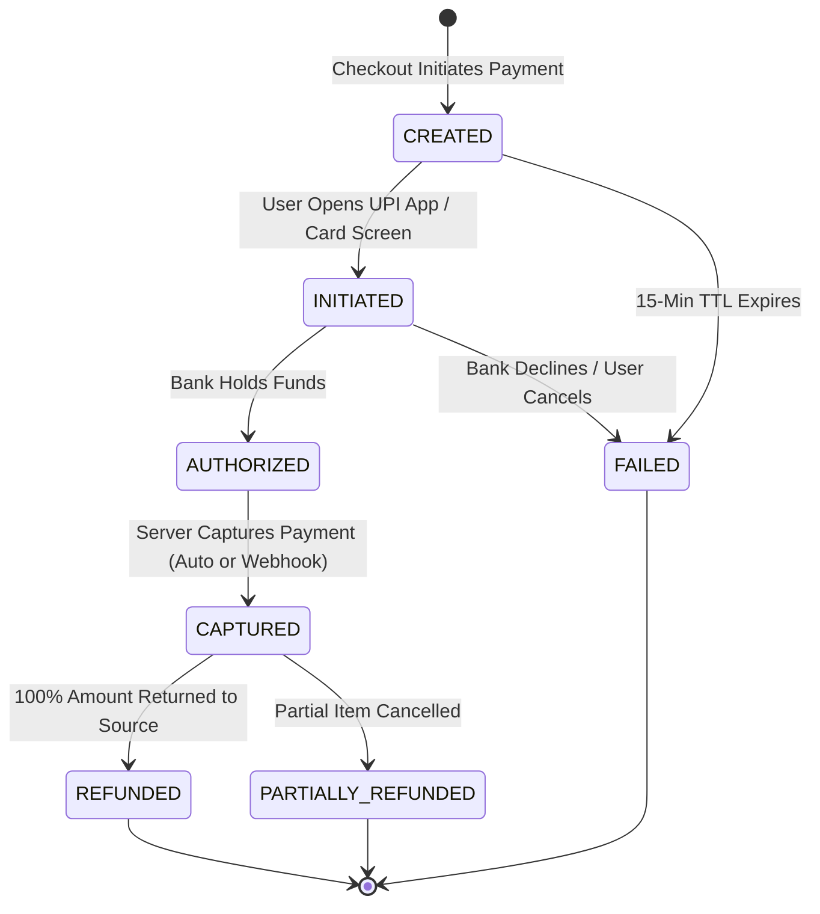
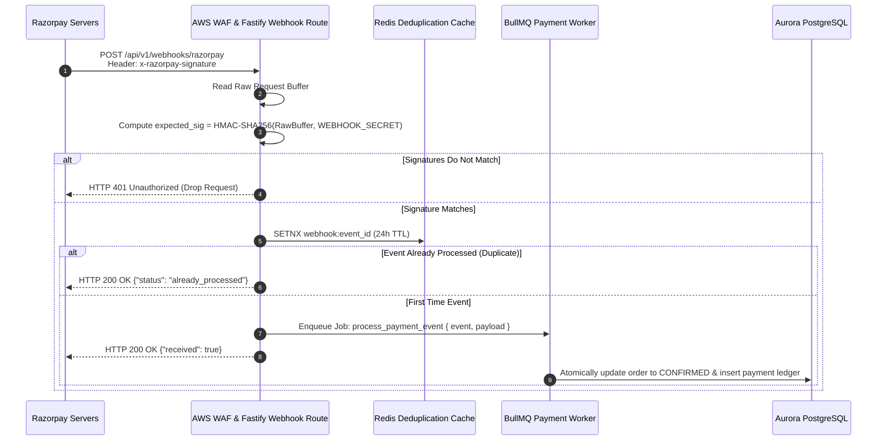

<!-- HAMPERS-BY-HER | E2E COMMERCE SYSTEM | DOCUMENT CONTROLLED -->
# 19. Payment Architecture & Gateway Integration — Hampers by Her

## Document Control
- **Document Version**: 2.0.0
- **Status**: APPROVED PAYMENT SPECIFICATION
- **Last Updated**: 2026-09-18
- **Primary Payment Rails**: India UPI Intent (Google Pay, PhonePe, Paytm) + Cards + NetBanking
- **Primary Gateway**: Razorpay (with Cashfree Secondary Fallback)
- **Governing Directives**: Sections 14, 16, 25, 53
- **Document Quality Standard**: 15/15 Mandatory Sections Compliant (Section 40)

---

## 1. Purpose
Define the payment system architecture, gateway provider abstraction interfaces, cryptographic signature verification protocols, payment state machines, automated reconciliation jobs, and refund workflows for **Hampers by Her**.

This architecture guarantees 100% financial reconciliation, zero duplicate charges, and seamless mobile UPI conversion while strictly offloading PCI-DSS cardholder data scope to licensed payment aggregators.

---

## 2. Scope

### 2.1 In Scope
- Gateway Provider Abstraction Layer (`PaymentGatewayProvider` interface).
- Native Razorpay integration: UPI Intent, Cards, NetBanking, and Payment Links.
- Payment Lifecycle State Machine (`CREATED` → `CAPTURED` / `REFUNDED`).
- Cryptographic HMAC-SHA256 signature validation on inbound webhooks.
- Asynchronous reconciliation worker for network timeouts and abandoned browser sheets.
- Complete refund and partial cancellation financial ledgers.

### 2.2 Out of Scope
- Direct banking host-to-host NEFT/RTGS settlement integrations.
- Storing raw credit/debit card primary account numbers (PAN) or CVVs (strictly prohibited).

---

## 3. Context & Background
In India’s mobile e-commerce ecosystem, **Unified Payments Interface (UPI)** accounts for over 75% of online retail transaction volume. On mobile web, traditional card entry forms suffer severe drop-off (40%+ abandonment) due to OTP delays and SMS switching.

Conversely, UPI Intent allows mobile browsers to launch installed UPI apps (PhonePe, Google Pay, Paytm, CRED) directly with a single tap, authenticating via biometric fingerprint or MPIN in < 10 seconds. 

However, mobile app switching frequently causes browser session loss. A customer may authorize payment in PhonePe, but close the mobile browser before the redirect returns. The architecture must rely on **server-authoritative webhooks and automated background reconciliation**, never client-side redirects alone.

---

## 4. Requirements

### 4.1 Functional Requirements
- **FR-PAY-01 (Multi-Modal Indian Payments)**: Native support for UPI (Google Pay, PhonePe, Paytm), Credit/Debit Cards, NetBanking, and Wallets via Razorpay.
- **FR-PAY-02 (Idempotent Webhook Processing)**: Secure ingestion of payment gateway webhooks with HMAC-SHA256 signature verification.
- **FR-PAY-03 (Automated Reconciliation)**: Background worker polling and reconciling orphaned payments stuck in pending states.

### 4.2 Non-Functional Requirements
- **NFR-PAY-01 (Zero Financial Discrepancy)**: Strict integer arithmetic in Paise eliminating any float rounding discrepancies.
- **NFR-PAY-02 (Webhook Ingestion SLA)**: Webhook endpoints return HTTP 200 within 200ms by deferring processing to BullMQ.

---

## 5. Architecture & Payment Gateway Abstraction

### 5.1 Payment Gateway Abstraction Architecture

```mermaid
flowchart TB
    OrderService[Order Orchestration Service] --> PaymentManager[Payment Manager Core]
    
    PaymentManager --> IGateway["<<interface>> PaymentGatewayProvider"]
    
    IGateway -.-> RazorpayAdapter[Razorpay Gateway Adapter (Primary)]
    IGateway -.-> CashfreeAdapter[Cashfree Gateway Adapter (Secondary Fallback)]
    
    RazorpayAdapter --> RZP_API[Razorpay REST API v1]
    CashfreeAdapter --> CF_API[Cashfree REST API v2]

    WebhookController[Fastify Webhook Controller] --> WebhookVerifier[HMAC Signature Verifier]
    WebhookVerifier --> EventQueue[BullMQ Reconciliation Queue]
    EventQueue --> PaymentManager
```

### 4.1 PaymentGatewayProvider TypeScript Interface
```typescript
export interface PaymentGatewayProvider {
  createOrder(params: {
    orderId: string;
    amountPaise: bigint;
    currency: 'INR';
    customer: { email: string; phone: string; name: string };
  }): Promise<{ gatewayOrderId: string; keyId: string }>;

  verifySignature(params: {
    orderId: string;
    paymentId: string;
    signature: string;
  }): boolean;

  fetchPaymentStatus(gatewayPaymentId: string): Promise<{
    status: PaymentStatus;
    method: string;
    amountPaise: bigint;
    bankReference: string;
  }>;

  initiateRefund(params: {
    gatewayPaymentId: string;
    amountPaise: bigint;
    reason: string;
  }): Promise<{ refundId: string; status: string }>;
}
```

---

### 5.2 Payment State Machine & Transitions



---

## 7. Technical Details & Webhook Signature Verification

### 7.1 Webhook Signature Verification & Ingestion Handshake



---

## 6. Business Rules & Payment Reconciliation

### 6.1 Asynchronous Payment Reconciliation Worker

To catch transactions where webhooks were delayed or dropped by cloud network disruptions:
1. A BullMQ cron worker runs every **5 minutes**.
2. Queries PostgreSQL for orders created between 15 and 60 minutes ago in `PENDING_PAYMENT` state.
3. For each orphaned order, queries Razorpay API directly:
   `GET /v1/orders/{razorpay_order_id}/payments`
4. If payment is `captured` on Razorpay:
   - Worker automatically reconciles database order status to `CONFIRMED`.
   - Fires customer confirmation WhatsApp template.
   - Logs reconciliation audit event: `"Reconciled by Background Cron Worker"`.
5. If payment is `failed` or non-existent after 60 minutes:
   - Worker transitions order to `FAILED` and releases inventory locks back to available stock.

---

## 8. Dependencies & Integrations
- **SDK**: `razorpay` v2.9.2 (Official Node.js SDK).
- **Crypto Engine**: Native Node.js `node:crypto` (`createHmac`).
- **Database Table**: `payments` table with unique constraint on `gateway_payment_id`.

---

## 9. Security & PCI-DSS Compliance
- **Zero Cardholder Data Storage**: Hampers by Her never stores, logs, or transmits card numbers (PAN), CVVs, or bank net-banking passwords.
- **TLS 1.3 Strict Enforced**: All communication with Razorpay APIs uses modern cipher suites.
- **Timing-Safe Equal**: Webhook signature comparison uses `crypto.timingSafeEqual()` to prevent timing attacks.

---

## 10. Failure Modes & Edge Case Handlers

| Failure Event | Automated System Response | Operational Remediation |
| :--- | :--- | :--- |
| **Razorpay API Latency Spike (> 5s)** | Circuit breaker trips; fails over to Cashfree adapter | Slack alert sent to DevOps engineering channel |
| **User Debited, But Bank Fails Capture** | Razorpay automatically initiates auto-refund within 24–48 hours | Customer receives WhatsApp notification: *"Your payment could not be captured and has been refunded."* |
| **Duplicate Webhook Delivery** | Redis deduplication key (`SETNX`) rejects duplicate execution | Returns HTTP 200 to prevent gateway retries |

---

## 11. Testing & Financial Integrity Audits
- **Razorpay Sandbox Test Harness**: Automated integration tests verifying mock UPI, NetBanking, and Card payments in CI/CD pipeline.
- **Daily Financial Reconciliation Script**: Automated SQL query matching total Razorpay captured settlement reports against database `total_amount_paise` ledger.

---

## 12. Observability & Payment Telemetry
- **Gateway Success Rate Metric**: Monitored via CloudWatch:
  $$\text{SR} = \frac{\text{Successful Payments}}{\text{Total Payment Attempts}} \times 100 \quad (\text{Target: } > 92\%)$$
- **Instant Alerting**: Alert fires on PagerDuty if payment failure rate exceeds 15% over 10 consecutive transactions.

---

## 13. Open Questions & Owner Verification

```yaml
unknown_registry:
  - field: razorpay_registered_business_type
    status: TO_VERIFY
    source_required: brand_owner
    impact: high
    temporary_assumption: "Private Limited or Registered Partnership with UPI Intent & NetBanking activated"

  - field: cash_on_delivery_policy
    status: TO_VERIFY
    source_required: brand_owner
    impact: medium
    temporary_assumption: "COD disabled for personalized photo hampers; permitted for ready-made hampers up to ₹3,000"
```

---

## 14. Future Evolution
- **Dynamic Gateway Routing**: Real-time health check router sending traffic to whichever gateway (Razorpay vs. Cashfree) currently has the lowest latency and highest bank success rate.
- **Partial Milestone Payments for Weddings**: Allowing brides to pay 30% advance deposit online with remaining balance charged 48 hours before dispatch.

---

## 15. References
- Razorpay API Documentation: *Orders, Payments, and Webhook Integration*
- PCI Security Standards Council: *PCI-DSS v4.0 Scope & SAQ A Compliance*
- Reserve Bank of India (RBI): *Guidelines on Digital Payment Aggregators & Tokenization*
