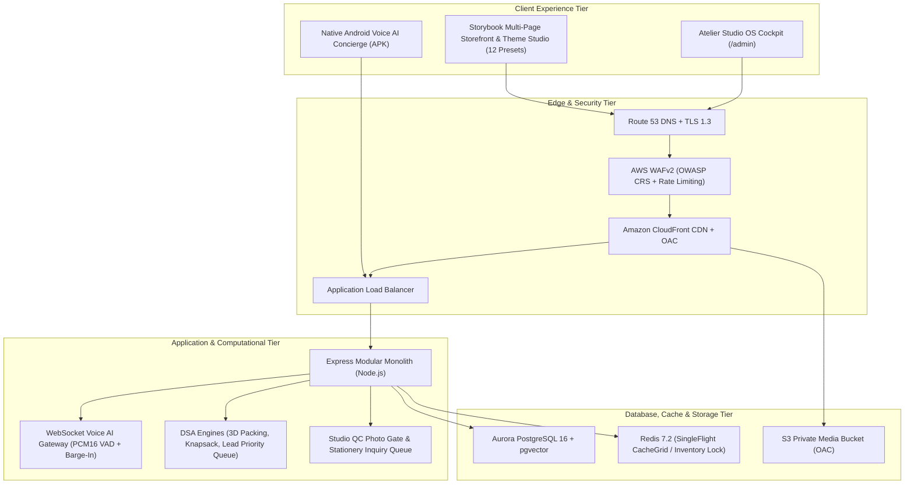

# Hampers by Her — Digital Commerce Platform & Artisanal Atelier OS

[](https://nodejs.org/)
[](Dockerfile)
[](infra/terraform/main.tf)
[](infra/k8s/)
[-success?logo=checkmarx&logoColor=white)](tests/)
[](website/)
[](scripts/audit_documentation.js)
[](CONTRIBUTING.md)

> **Artisanal Luxury Gifting Digital Operating System & Storybook Commerce Storefront**  
> Brand Acquisition Channel: [`@hampers._by_her` on Instagram](https://www.instagram.com/hampers._by_her/)

---

## Table of Contents

- [1. System Overview](#1-system-overview)
- [2. Architecture Topology](#2-architecture-topology)
- [3. Storefront Routes & Multi-Page Atelier Experience](#3-storefront-routes--multi-page-atelier-experience)
- [4. Key Capabilities & Engineering Subsystems](#4-key-capabilities--engineering-subsystems)
- [5. Repository Structure](#5-repository-structure)
- [6. Quickstart Guide](#6-quickstart-guide)
- [7. Verification, Scripts & Quality Gates](#7-verification-scripts--quality-gates)
- [8. Architecture & Operations Documentation](#8-architecture--operations-documentation)
- [9. Security, Governance & License](#9-security-governance--license)

---

## 1. System Overview

**Hampers by Her** is a full-stack luxury digital commerce ecosystem and artisanal atelier operating system built for bespoke gifting. It pairs a tactile **Storybook & Scrapbook Multi-Page Storefront** (backed by 12 live-switchable Theme Studio presets and a 4D sensory motion engine) with an **11-Step Bespoke Hamper Builder**, an **AI Budget Knapsack Curator**, a **Real-Time Voice AI Concierge** (WebSocket + native Android APK), **Multi-Gateway Smart Payment Routing**, **Atelier Studio OS** fulfillment with photographic QC gates and stationery inquiry triage, and **AWS / Terraform / Kubernetes** infrastructure as code.

---

## 2. Architecture Topology



---

## 3. Storefront Routes & Multi-Page Atelier Experience

Clean extensionless routes are served directly by [server/index.js](server/index.js) alongside static asset caching and `/api/v1` endpoints:

| Route | View File | Purpose |
| :--- | :--- | :--- |
| `/` | [`website/index.html`](website/index.html) | Storybook storefront home, Hero arches, 4D Unboxing Theater, 11-Step Builder, AI Curator, Voice Concierge & Cart/Checkout |
| `/catalog` | [`website/catalog.html`](website/catalog.html) | Multi-row sketchbook catalog with occasion, dispatch speed, budget filters & live search |
| `/hamper` | [`website/hamper.html`](website/hamper.html) | Enriched PDP with gallery switcher, ribbon/seal customization, PIN serviceability check, enquiry form & pairings grid |
| `/moments` | [`website/moments.html`](website/moments.html) | Taped Polaroid wall synced with Instagram feed + dark keyboard-accessible lightbox |
| `/how-it-works` | [`website/how-it-works.html`](website/how-it-works.html) | Interactive workflow tabs comparing Ready-to-Ship (24h) vs 11-Step Bespoke Atelier (48h) |
| `/faq` | [`website/faq.html`](website/faq.html) | Studio corkboard sticky-note FAQ with live search & accordion state |
| `/contact` | [`website/contact.html`](website/contact.html) | Fill-in-the-blank stationery contact letter posting to `/api/v1/inquiries` with DSA lead scoring |
| `/delivered` | [`website/delivered.html`](website/delivered.html) | Archived small-batch boarding-pass tickets fetched from `/api/v1/catalog/archives` |
| `/admin` | [`website/admin.html`](website/admin.html) | Studio OS fulfillment dashboard with PIN auth, QC Photo Gate, search & Stationery Letters queue |
| `/lookbook` | [`website/lookbook.html`](website/lookbook.html) | 8-slide Executive Lookbook deck with keyboard navigation |
| `/architecture` | [`docs/diagrams/hampers_by_her_architecture.html`](docs/diagrams/hampers_by_her_architecture.html) | Interactive system architecture diagram |
| `/health` & `/metrics` | [`server/index.js`](server/index.js) | Runtime health probe & Prometheus OpenMetrics exporter |

---

## 4. Key Capabilities & Engineering Subsystems

### 4.1 Storybook Storefront, Theme Studio & 4D Sensory UX
- Scalloped theme-synced navigation bar, full-screen mobile drawer + sticky `.mobile-bar`, reading progress bar (`#sb-scroll-progress`), back-to-top seal (`#sb-back-top`), and animated WhatsApp preview card (`website/storybook.css`, `website/storybook-ui.js`).
- **Theme Studio (`website/themes.css`, `website/theme-switcher.js`)**: 12 synchronized palette presets led by **Atelier Signature** and **Craft Storybook**, persisted in `localStorage`.
- **4D Sensory Suite (`website/script.js`)**: Cursor parallax tilt cards, 4-stage virtual Unboxing Theater, 60fps golden leaf particle canvas (visibility-aware), magnetic buttons, and Web Audio API synthetic chimes (`playVelvetTap()`, `playGoldenChime()`).

### 4.2 11-Step Bespoke Builder & DSA Optimization Engines
- Guided 11-step hamper composer (`vessel box -> cotton shred -> gourmet & wellness inclusions -> raw silk ribbon & monogram -> wax seal -> pressed botanicals -> calligraphy note -> Polaroid upload -> live SVG review`) with `cm³` fullness tracking and >85% capacity warnings.
- Live vector SVG preview rendered via `/api/v1/atelier/visualize-hamper` (`platform/services/atelier-visualizer/previewGenerator.js`).
- Deterministic integer-paise pricing ledger (`pricingLedger.js`), 3D volumetric bin-packing (`binPacker3D.js`), multi-constraint Knapsack curator (`budgetKnapsack.js`), ReDoS-safe intent search tokenizer (`intentTokenizer.js`), coupon DAG (`couponDAG.js`), and binary max-heap lead scheduler (`leadPriorityQueue.js`).

### 4.3 Commerce, Payments & Omnichannel Concierge
- **Multi-Gateway Smart Payment Router (`platform/services/payment-service/smartRouter.js`)**: Failover across Razorpay, Cashfree, and Stripe International with UPI Intent / QR routing, idempotency locks, and constant-time HMAC-SHA256 webhook verification.
- **Studio OS (`/admin`)**: Staff JWT login (`/api/v1/auth/staff-login`), order pipeline tabs, mandatory QC Photo Gate, AWB tracking, and the **Stationery Letters** queue (`GET /api/v1/inquiries`) with `P1`/`P2`/`P3` priority scoring and pre-filled WhatsApp reply links.
- **Voice AI Gateway & Android App (`server/services/voiceAiGateway.js`, `android/`)**: WebSocket PCM16 streaming concierge with VAD, barge-in interruption, and Android APK packaging (`scripts/build_android_apk.js`).

### 4.4 High-Concurrency Platform & Cloud Infrastructure
- **1M-User Concurrency Primitives (`platform/services/`)**: `cacheGrid.js` (L1/L2 SingleFlight coalescing), `rateLimiter.js` (sliding window + event-loop lag shedding), `atomicInventoryLock.js`, and partitioned PostgreSQL 16 schemas (`platform/database/schemas/`).
- **Infrastructure as Code**: Multi-stage non-root Alpine Docker image ([Dockerfile](Dockerfile)), [docker-compose.yml](docker-compose.yml), 7 AWS `ap-south-1` Terraform modules ([infra/terraform/](infra/terraform/)), Kubernetes manifests ([infra/k8s/](infra/k8s/)), and Prometheus alerting rules ([infra/observability/](infra/observability/)).

---

## 5. Repository Structure

```text
.
├── website/                 # Storybook multi-page UI, 4D UX, Theme Studio & Studio OS (/admin)
├── server/                  # Express server, API v1 routes & domain services
├── platform/                # DSA engines, AI/Voice/RAG/Mesh/Payment/Cache subsystems & tests
├── android/                 # Native Android Voice AI Concierge source
├── docs/                    # 44 architecture specs, OpenAPI 3.1, Prisma/SQL DDL, ADRs & diagrams
├── infra/                   # Terraform AWS modules, Kubernetes manifests, Prometheus & scripts
├── tests/                   # 20 commerce, security, Voice AI, Theme Studio & storefront test suites
├── scripts/                 # Audit, benchmark, APK builder & repository utility scripts
├── data/                    # Local JSON persistence store for standalone development
├── .github/                 # CI/CD workflows & issue/PR templates
├── .agent/                  # Session state harness, ADRs & engineering follow-up ledger
├── AGENTS.md                # Autonomous engineering & Definition-of-Done governance contract
├── package.json             # NPM scripts & Express/WebSocket dependencies
└── README.md                # Project overview & developer manual
```

---

## 6. Quickstart Guide

### 6.1 Local Development (Node.js)

```bash
# Clone repository
git clone https://github.com/Hellthefox808/hampers-by-her.git
cd hampers-by-her

# Install dependencies
npm install

# Start local server (default port 3000)
npm start
# Storefront Home:    http://localhost:3000/
# Sketchbook Catalog: http://localhost:3000/catalog
# Studio OS Cockpit:  http://localhost:3000/admin
# Health Probe:       http://localhost:3000/health
```

### 6.2 Local Stack with Docker Compose

```bash
docker compose up -d
docker compose ps
docker compose logs -f app
```

### 6.3 Infrastructure as Code (AWS `ap-south-1`) & Kubernetes

```bash
# Terraform
cd infra/terraform
terraform init
terraform plan -var-file=terraform.tfvars.example

# Kubernetes manifests
kubectl apply -f infra/k8s/namespace.yaml
kubectl apply -f infra/k8s/configmap.yaml
kubectl apply -f infra/k8s/secret.yaml.example
kubectl apply -f infra/k8s/deployment.yaml
kubectl apply -f infra/k8s/service.yaml
kubectl apply -f infra/k8s/hpa.yaml
kubectl apply -f infra/k8s/ingress.yaml
kubectl apply -f infra/k8s/pdb.yaml
```

---

## 7. Verification, Scripts & Quality Gates

All quality gates are exposed via [package.json](package.json):

```bash
# Full release verification pipeline (docs audit + unit/integration tests + APK check)
npm run verify

# Individual verification commands
npm run audit:docs      # Audits 44 core specs + 13 auxiliary artifacts (57/57)
npm test                # Executes all 259 tests across 66 suites (tests/ & platform/tests/)
npm run test:commerce   # Runs storefront & commerce tests in tests/
npm run test:platform   # Runs DSA, RAG, Voice, Cache & Mesh tests in platform/tests/
npm run benchmark       # Runs runtime micro-benchmarks
npm run build:apk       # Builds & verifies Android Voice AI APK package
```

Latest verified quality checks:
- **`npm run audit:docs`**: **57 / 57** artifacts passed (`0` failures).
- **`npm test`**: **259 / 259** tests passed across **66 suites** (`0` failures, `0` skipped).
- **Playwright Live E2E QA**: **52 / 52** desktop (`1440×900`) & mobile (`390×844`) assertions passed with `0` console/page/HTTP errors.

---

## 8. Architecture & Operations Documentation

- Root specifications: [`00_RESEARCH_NOTES.md`](00_RESEARCH_NOTES.md) through [`44_MASTER_INDEX.md`](44_MASTER_INDEX.md) (mirrored in `docs/`).
- Key subsystem blueprints: [`ARCHITECTURE.md`](ARCHITECTURE.md), [`SCALE_1M_ARCHITECTURE.md`](SCALE_1M_ARCHITECTURE.md), [`PAYMENT_GATEWAY_RESEARCH_AND_ENHANCEMENTS.md`](PAYMENT_GATEWAY_RESEARCH_AND_ENHANCEMENTS.md), [`SECURITY.md`](SECURITY.md), and [`IMPLEMENTATION_ROADMAP.md`](IMPLEMENTATION_ROADMAP.md).
- Contracts & schemas: [`docs/api/openapi.yaml`](docs/api/openapi.yaml), [`docs/database/schema.prisma`](docs/database/schema.prisma), and [`docs/database/ddl.sql`](docs/database/ddl.sql).
- Operations & decisions: [`docs/runbooks/RECOVERY_RUNBOOK.md`](docs/runbooks/RECOVERY_RUNBOOK.md) and [`docs/decisions/`](docs/decisions/).

---

## 9. Security, Governance & License

- Security architecture and secret hygiene policies are defined in [`SECURITY.md`](SECURITY.md) (zero hardcoded secrets, sliding-window throttling, constant-time webhook verification, security headers, non-root containers).
- Engineering workflow and Definition of Done rules are defined in [`AGENTS.md`](AGENTS.md) and [`CONTRIBUTING.md`](CONTRIBUTING.md).
- Copyright &copy; 2026 **Hampers by Her**. All rights reserved (Proprietary / Unlicensed).
