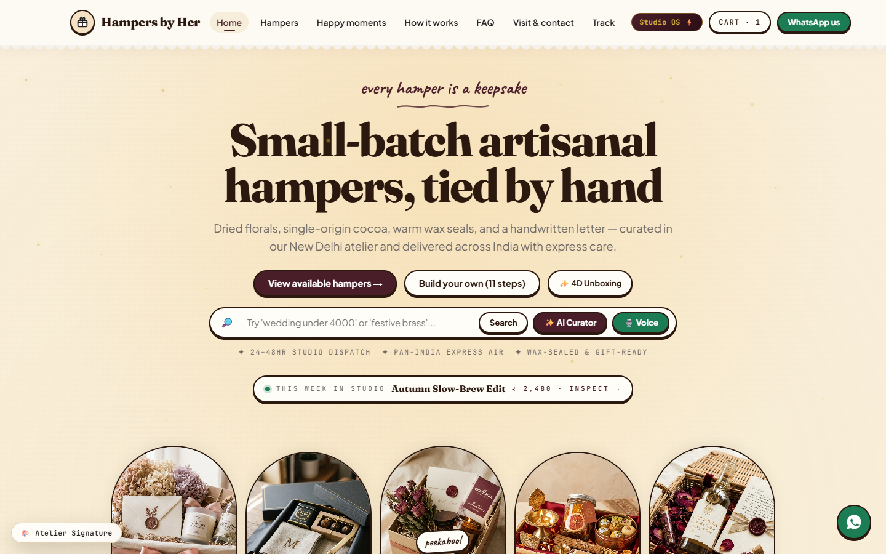
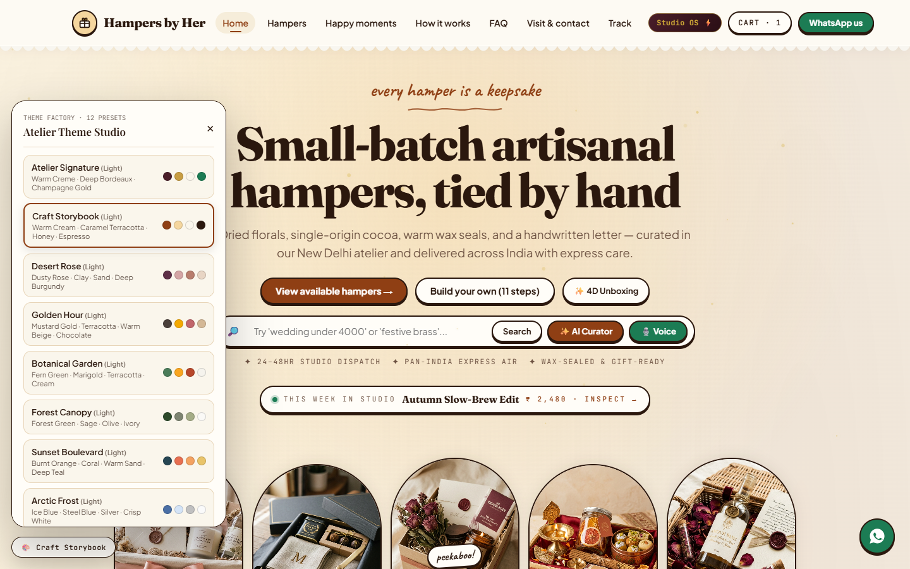
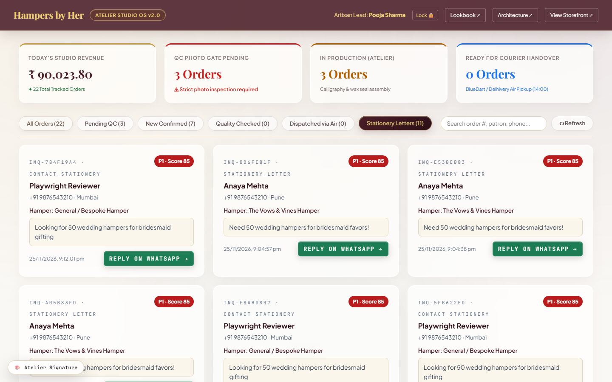
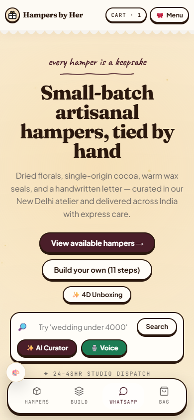
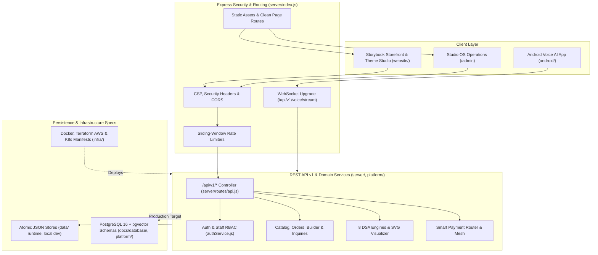

# Hampers by Her — Digital Commerce Platform & Artisanal Atelier OS

[](package.json)
[](package.json)
[](tests/)
[](website/)
[](package.json)

---

## 01. Project Identity

**Hampers by Her** (`hampers-by-her`) is an end-to-end luxury digital commerce platform and artisanal atelier operating system built for small-batch, bespoke gift hampers originating in New Delhi, India.

- **One-line Summary**: Multi-page storefront, 11-step interactive 3D hamper composer, real-time WebSocket Voice AI concierge, native Android client, Studio OS fulfillment workbench, and AWS/Kubernetes IaC in a single Node.js modular repository.
- **Value Proposition**: Replaces ad-hoc spreadsheet and chat-based gift coordination with deterministic integer-paise pricing, 3D box capacity checks, photographic quality-control gates, lead priority scoring, and live order tracking.
- **Status**: `v2.0.0` — Core storefront, Studio OS, REST/WebSocket backend, DSA optimization suite, and local persistence are implemented and verified; external payment, Meta webhook, and cloud database integrations ship with sandbox/development adapters ready for production credentials.

---

## 02. Visual Presentation

The screenshots below were captured from the live Node.js server using Playwright Chromium verification (`1440x900` desktop and `390x844` mobile):

### Desktop Storefront (`1440x900`) — Hero, Arches & Intent Search


### Theme Studio (12 Switchable Palettes) — Craft Storybook Preset


### Atelier Studio OS (`/admin`) — Stationery Letters Priority Queue


### Mobile Responsive Storefront (`390x844`) — Docked Action Bar & Search Card
<p align="center">
  
</p>

Interactive system architecture view: [Interactive Architecture Diagram](docs/diagrams/hampers_by_her_architecture.html) (served live at `/architecture`).

---

## 03. Project Overview

### What It Does
Hampers by Her powers both patron-facing luxury gift shopping and internal Okhla workshop fulfillment:
1. **Patrons** browse curated small-batch edits (`/catalog`), inspect ribbon/wax-seal/serviceability details (`/hamper`), test 4D interactive unboxing, optimize custom gifts against a rupee budget with AI Knapsack curation, converse with a real-time Voice AI concierge, or build custom hampers step-by-step in an 11-step composer with live SVG previews.
2. **Atelier Staff Leads** authenticate into **Studio OS** (`/admin`) to inspect production pipelines, pass mandatory photographic QC checks before courier dispatch, search patron orders, and triage inbound stationery letters ranked by urgency (`P1`/`P2`/`P3`).

### Problem Solved & Target Users
- **Patrons & Wedding/Corporate Gifters**: Eliminates guesswork around box capacity, fragile item cushioning, PIN serviceability SLAs, and handwritten calligraphy personalization.
- **Engineering & Atelier Operations Teams**: Consolidates storefront UX, payment routing, algorithmic curation, voice streaming, inventory locking, and fulfillment QC behind one cohesive contract.

---

## 04. Core Features

### Implemented (Verified in Codebase & Automated Tests)
- **8-Page Storybook Storefront (`website/`)**: Clean extensionless routes (`/`, `/catalog`, `/hamper`, `/moments`, `/how-it-works`, `/faq`, `/contact`, `/delivered`) with scalloped navigation, scroll progress indicator, mobile drawer + bottom action bar, and Polaroid lightbox.
- **12-Preset Theme Studio (`website/themes.css`, `website/theme-switcher.js`)**: Synchronized light and dark design-token themes (including *Atelier Signature*, *Craft Storybook*, *Midnight Galaxy*, *Ocean Depths*, and *Tech Innovation*) persisted in `localStorage`.
- **11-Step Bespoke Hamper Builder (`website/script.js`)**: Box selection (`cm³` capacity tracking & >85% overflow alert), paper shred, multi-step inclusions, swatch ribbons + monograms, botanical wax seals, dried florals, calligraphy card notes, Polaroid upload preview (`FileReader`), and backend vector SVG rendering (`/api/v1/atelier/visualize-hamper`).
- **8 Computational DSA Modules (`platform/services/dsa/`)**: 3D bin packing (`binPacker3D.js`), BigInt integer-paise pricing & GST split (`pricingLedger.js`), coupon precedence DAG (`couponDAG.js`), ReDoS-safe search intent tokenizer (`intentTokenizer.js`), multi-criteria budget knapsack (`budgetKnapsack.js`), deadlock-free inventory locks (`atomicInventoryLock.js`), logistics SLA estimator, and binary max-heap lead scheduler (`leadPriorityQueue.js`).
- **Studio OS & Stationery Queue (`website/admin.html`, `server/services/inquiryService.js`)**: Staff PIN login -> HS256 JWT RBAC, order state pipeline (`CONFIRMED` -> `IN_PRODUCTION` -> `QUALITY_CHECKED` -> `DISPATCHED`), mandatory QC photo verification, and `Stationery Letters` inquiry triage with pre-filled WhatsApp reply links.
- **Real-Time Voice AI Gateway & Android Client (`server/services/voiceAiGateway.js`, `android/`)**: RFC-6455 WebSocket PCM16 streaming, VAD auto-endpointing, barge-in response cancellation, tool execution (`searchHampers`, `curateBudgetHamper`, `checkPincode`), plus native Java Android `VoiceAiClient` and `AudioStreamEngine`.
- **Resilience & Observability (`server/index.js`, `platform/services/`)**: Security response headers, CSP, sliding-window rate limiters, SingleFlight L1/L2 cache grid (`cacheGrid.js`), service mesh circuit breakers (`serviceMesh.js`), `/health`, and `/metrics` Prometheus exposition.

### In Development / Sandbox Adapters
- **Payment Acquirer Failover (`platform/services/payment-service/smartRouter.js`)**: Multi-gateway routing logic across Razorpay, Cashfree, and Stripe runs in deterministic sandbox mode until merchant keys are supplied.
- **Meta WhatsApp Cloud API & Instagram Graph Sync (`server/services/whatsappService.js`, `instagramService.js`)**: Full webhook verification (`X-Hub-Signature-256`) and conversation state machine implemented; falls back to curated sandbox feeds and `wa.me` handoff links when access tokens are unset.
- **Voice AI Cloud Providers (`server/services/voiceProviders.js`)**: Upstream OpenAI Realtime, Deepgram live STT, Vapi webhooks, and LiveKit token signing are implemented and activate when corresponding environment variables are configured.

### Planned
- Cutover from local atomic JSON stores (`PersistenceEngine` / `InquiryService`) to live managed PostgreSQL 16 (`pgvector`) and Redis 7 cluster via Prisma/SQL schemas.
- Live Shiprocket carrier API manifest booking and webhook tracking ingestion.
- Running full Playwright headless E2E UI tests directly inside GitHub Actions PR workflows.

---

## 05. System Architecture



---

## 06. Technology Stack

| Layer | Technologies Used |
| :--- | :--- |
| **Frontend Storefront & Admin** | Semantic HTML5, Vanilla ES6+ JavaScript, Custom CSS3 + CSS Custom Properties (`storybook.css`, `themes.css`), HTML5 Canvas & Web Audio API |
| **Backend & Real-Time** | Node.js (22+ LTS / v26), Express (`^4.21.2`), `ws` (`^8.21.3`), `cors` (`^2.8.5`), Native Node `crypto` HMAC-SHA256 JWT & Signatures |
| **Mobile Client** | Native Android Java (Target SDK 36), `AudioRecord` / `AudioTrack` PCM16 Streaming, TLS `SSLSocketFactory` WebSocket Client |
| **Data & Schemas** | Local Atomic JSON Persistence (`PersistenceEngine`), PostgreSQL 16 + `pgvector` SQL Schemas, Prisma 3 Schema (`docs/database/schema.prisma`) |
| **Infrastructure & DevOps** | Multi-stage Alpine Docker, Docker Compose (Postgres, Redis, LocalStack, Prometheus), Terraform `>= 1.8` (AWS `ap-south-1`), Kubernetes Manifests, GitHub Actions + Trivy |
| **Testing & Quality** | Node native `node:test` + `assert/strict` (`tests/`, `platform/tests/`), Playwright (`verify_webapp.py`), Custom Artifact Audit (`scripts/audit_documentation.js`) |

---

## 07. Project Structure

```text
.
├── .github/                  # CI/CD workflows (ci.yml, deploy.yml) & CODEOWNERS
├── android/                  # Native Android Voice AI source & manifest
├── docs/
│   ├── api/openapi.yaml      # OpenAPI 3.1 REST contract
│   ├── assets/               # Verified desktop/mobile/admin screenshots
│   ├── database/             # schema.prisma & ddl.sql PostgreSQL schema
│   └── diagrams/             # Mermaid diagrams & interactive HTML architecture map
├── infra/
│   ├── k8s/                  # Kubernetes namespace, deployment, HPA, ingress & PDB
│   ├── observability/        # Prometheus scrape & alert rules
│   ├── scripts/              # Backup & deployment verification shell scripts
│   └── terraform/            # 7 modular AWS stacks (VPC, Security, IAM, DB, ALB, ECS, CDN)
├── platform/
│   ├── database/             # Database client & partitioned scale schemas
│   ├── services/             # DSA, Visualizer, CacheGrid, Mesh, Payment, RAG, Voice, Scaling
│   ├── shared/               # Shared contract definitions
│   └── tests/                # 7 platform unit & concurrency test suites
├── scripts/                  # audit_documentation.js, benchmark_runtime.js, build_android_apk.js
├── server/
│   ├── routes/api.js         # /api/v1 route handlers
│   ├── services/             # Commerce, Auth, Voice Gateway, Inquiries, WhatsApp & IG services
│   └── index.js              # Express app bootstrap, middleware, routes, health & metrics
├── tests/                    # 20 storefront, commerce, API, security & E2E suites
├── website/                  # Multi-page HTML storefront, Theme Studio, Lookbook & Studio OS
├── .editorconfig             # Cross-editor indentation and encoding rules
├── .env.example              # Safe environment configuration template
├── .gitattributes            # Line-ending normalization & binary asset tracking
├── .gitignore                # Excludes secrets, dependencies, local stores & internal notes
├── Dockerfile                # Multi-stage non-root Alpine container build
├── docker-compose.yml        # Local full-stack development containers
├── package.json              # Scripts & Node runtime dependencies
└── prisma.config.ts          # Prisma configuration
```

---

## 08. Getting Started

### Prerequisites
- **Node.js**: `>= 22.0.0` (tested in CI on Node `22 LTS` and locally on `v26.13.1`)
- **npm**: `>= 10.0.0`
- **Optional**: Docker & Docker Compose (for full Postgres/Redis/LocalStack emulation), Android SDK 36 + JDK (only if compiling native APK)

### Installation & Local Launch

```bash
# 1. Clone the repository
git clone https://github.com/Hellthefox808/hampers-by-her.git
cd hampers-by-her

# 2. Install Node.js dependencies
npm install

# 3. Configure local environment variables
cp .env.example .env

# 4. Start Express server and storefront
npm start
```

Available local endpoints:
- Storefront Home: `http://localhost:3000/`
- Catalog & Subpages: `/catalog`, `/hamper`, `/moments`, `/how-it-works`, `/faq`, `/contact`, `/delivered`
- Studio OS Admin: `http://localhost:3000/admin` (default non-production PIN: `2026`; override via `STUDIO_ADMIN_PIN`)
- Interactive Architecture: `http://localhost:3000/architecture`
- Health & Metrics: `http://localhost:3000/health` and `http://localhost:3000/metrics`

### Docker Compose Local Stack

```bash
docker compose up -d
docker compose ps
```

### Verification Commands

```bash
npm run audit:docs      # Audits repository technical deliverables
npm test                # Runs all 259 automated tests across 66 suites
npm run build:apk       # Verifies Android sources (or compiles APK when SDK present)
npm run verify          # Runs audit:docs, full test suite, and Android build check
```

---

## 09. Environment Configuration

All configuration variables are documented in [`.env.example`](.env.example). Never commit `.env` files.

| Variable | Required In Prod | Purpose & Fallback Behavior |
| :--- | :--- | :--- |
| `NODE_ENV` | Yes | Runtime mode (`development`, `test`, `production`) |
| `PORT` | No (default `3000`) | HTTP & WebSocket server port |
| `ALLOWED_ORIGINS` | Yes | Comma-separated CORS origin allowlist |
| `JWT_SECRET` | Yes (`>= 16 chars`) | HS256 JWT signing key (throws in production if missing; dev fallback outside prod) |
| `STUDIO_ADMIN_PIN` | Yes | Studio OS `/admin` authentication PIN (dev fallback `2026` outside prod) |
| `REQUIRE_ADMIN_AUTH` | Recommended | Enforces strict RBAC staff headers |
| `DISABLE_RATE_LIMIT` | No | Keep `false` in production; toggles rate limiter bypass for tests |
| `LOG_LEVEL` / `LOG_FORMAT` | No | Controls request logs (`silent` / `info`, `pretty` / `json`) |
| `DATABASE_URL` | Yes (DB mode) | PostgreSQL 16 connection string for Prisma / SQL client |
| `OPENAI_API_KEY`, `DEEPGRAM_API_KEY`, `ELEVENLABS_API_KEY`, `LIVEKIT_*`, `VAPI_WEBHOOK_SECRET` | Optional | Live upstream Voice AI providers (deterministic local gateway fallback active when unset) |
| `WHATSAPP_*` & `INSTAGRAM_*` | Optional | Meta Cloud & Graph API tokens / webhook secrets (sandbox fallback active when unset) |
| `ANDROID_HOME` / `JAVA_HOME` | Optional | Toolchain path overrides for `scripts/build_android_apk.js` |

---

## 10. API Documentation

Base URL: `/api/v1` (OpenAPI specification in [`docs/api/openapi.yaml`](docs/api/openapi.yaml)).

| Domain | Endpoints | Auth & Protection |
| :--- | :--- | :--- |
| **Catalog & Archives** | `GET /catalog/products`, `GET /catalog/products/:id`, `GET /catalog/archives` | Public · SingleFlight CacheGrid |
| **Builder & Visualizer** | `GET /builder/options`, `POST /builder/validate-step`, `POST /atelier/visualize-hamper` | Public · Volume & fragility validation |
| **Cart, Pricing & Checkout** | `POST /checkout/calculate`, `POST /checkout/create-order`, `POST /payments/initiate`, `POST /payments/verify`, `POST /payments/smart-webhook`, `POST /payments/refund` | `checkoutRateLimiter` · Atomic inventory reservation + HMAC webhook check |
| **Delivery & Courier** | `GET /delivery/serviceability/:pincode`, `GET /delivery/track/:identifier` | Public PIN SLA lookup & order tracking |
| **Stationery Inquiries** | `POST /inquiries`, `GET /inquiries` | `POST` Public (`scoreInboundLead` triage); `GET` Staff `orders:read` |
| **Authentication & Admin** | `POST /auth/request-otp`, `POST /auth/verify-otp`, `POST /auth/staff-login`, `GET /auth/me`, `GET /admin/orders`, `POST /admin/orders/:id/transition` | `authRateLimiter` · HS256 JWT + RBAC + QC Gate |
| **DSA Algorithms** | `POST /dsa/bin-packing`, `POST /dsa/pricing-ledger`, `POST /dsa/coupon-dag`, `POST /dsa/search-intent`, `POST /dsa/budget-knapsack`, `POST /dsa/lead-priority`, `POST /dsa/logistics-sla` | Algorithmic micro-APIs |
| **Voice AI & Channels** | `GET /voice/status`, `WS /api/v1/voice/stream`, `POST /voice/vapi/webhook`, `POST /voice/livekit/token`, `/whatsapp/*`, `/instagram/*` | Webhook secret / `X-Hub-Signature-256` |
| **System Health** | `GET /health`, `GET /metrics`, `GET /api/v1/system/health`, `GET /api/v1/system/mesh/health` | Runtime memory, lag & Prometheus metrics |

Unmatched `/api/*` routes return structured **RFC 7807 Problem Details** (`application/json`, HTTP `404`) rather than HTML fallbacks.

---

## 11. Database Architecture

The repository supports both zero-dependency local execution and relational cloud deployment:
- **Standalone / Local Mode (`server/services/persistenceEngine.js`, `inquiryService.js`)**: Crash-safe atomic temp-file swap writes (`atelier_store.json.tmp` -> `atelier_store.json`) inside gitignored `data/`.
- **Relational & Vector Schemas**:
  - [`docs/database/schema.prisma`](docs/database/schema.prisma) & [`docs/database/ddl.sql`](docs/database/ddl.sql): **23 commerce models** covering `User`, `Customer`, `Address`, `Product`, `Inventory`, `Cart`, `Order`, `Payment`, `QualityCheckRecord`, `LogisticsShipment`, `CarrierCheckpoint`, and `OtpSession`.
  - [`platform/database/schemas/schema.sql`](platform/database/schemas/schema.sql): **11 multi-tenant platform tables** (`tenants`, `users`, `leads`, `deals`, `documents`, `document_chunks`, `voice_sessions`, `voice_events`, `outbox_events`, `processed_messages`, `audit_events`) using `pgvector`.
  - [`platform/database/schemas/scale_1m_partitioning.sql`](platform/database/schemas/scale_1m_partitioning.sql): Time-range and hash partitioning blueprints for high-volume order and session workloads.

---

## 12. CI/CD and Deployment

- **Continuous Integration ([`.github/workflows/ci.yml`](.github/workflows/ci.yml))**: Runs `npm ci`, `npm run audit:docs`, `npm test`, `npm run build:apk`, `npm run verify`, Docker build + Trivy vulnerability scan (`CRITICAL,HIGH`), and `terraform fmt -check -recursive infra/terraform/`.
- **Production Deployment ([`.github/workflows/deploy.yml`](.github/workflows/deploy.yml))**: Uses GitHub Actions OIDC (`aws-actions/configure-aws-credentials@v4`) with zero stored AWS access keys to build/push container images to Amazon ECR, roll Amazon ECS Fargate tasks in `ap-south-1`, and smoke-test `GET /health`.
- **Infrastructure (`infra/`)**: 7 Terraform modules (`vpc`, `security`, `iam`, `database`, `loadbalancer`, `compute`, `storage_cdn`), Kubernetes manifests with `PodDisruptionBudget` & HPA, Prometheus alert rules, and [`infra/scripts/backup_restore.sh`](infra/scripts/backup_restore.sh).

---

## 13. Security

- **Runtime Protections**: Disables `X-Powered-By`, enforces `X-Content-Type-Options: nosniff`, `X-Frame-Options: SAMEORIGIN`, Content-Security-Policy, strict HSTS in `NODE_ENV=production`, and configurable `ALLOWED_ORIGINS` CORS filtering.
- **Auth & Webhook Cryptography**: Enforces `JWT_SECRET` (`>= 16` chars) in production, timing-safe HMAC-SHA256 verification (`crypto.timingSafeEqual`), sliding-window throttling on auth and checkout routes, and 5-minute / 3-attempt OTP limits.
- **Container Hardening**: Multi-stage Alpine Docker build executes unprivileged `USER node` under `dumb-init`.
- **Vulnerability Reporting**: Report security findings privately to `security@hampersbyher.com` before public disclosure. No formal external compliance certification is claimed for this codebase.

---

## 14. Testing and Quality

| Check | Command | Verified Result |
| :--- | :--- | :--- |
| **Repository Deliverable Audit** | `npm run audit:docs` | Verifies repo artifacts & local specs (`57/57` when full spec suite is present locally) |
| **Automated Test Suite** | `npm test` | **259 passing / 0 failing / 0 skipped** across **66 suites** (`tests/` & `platform/tests/`) |
| **Scoped Suites** | `npm run test:commerce` · `npm run test:platform` · `npm run test:e2e` · `npm run test:dsa` | Runs focused commerce, DSA, RAG, Voice, and E2E integration suites |
| **Benchmarks** | `npm run benchmark` | Executes runtime micro-benchmark checks |
| **Headless Browser QA** | Native Python Playwright (`54` desktop & mobile assertions) | Verified `0` console/pageerrors, `0` HTTP `>=400` responses, dark-mode contrast, and mobile zero-overflow |

---

## 15. Roadmap

- Connect Prisma client runtime against live PostgreSQL 16 + Redis 7 instances provisioned via `infra/terraform/`.
- Onboard production Razorpay / Cashfree merchant credentials and Meta WhatsApp Cloud API phone certificates.
- Add headless Playwright E2E regression execution as an automated CI job on pull requests.

---

## 16. Contribution Guidelines

1. Fork the repository and clone your fork (`git checkout -b feat/your-feature`).
2. Copy `.env.example` to `.env` — never commit credentials or local runtime files under `data/`.
3. Run `npm test` and `npm run audit:docs` cleanly before opening a Pull Request.
4. Keep diffs focused, modular, and free of placeholder stubs or console debug logs.

---

## 17. Versioning and Releases

- The package follows semantic versioning in [`package.json`](package.json) (current version: **`2.0.0`**).
- Releases require green checks on `npm run verify`, updated `README.md` / OpenAPI specs for contract changes, and container Trivy scan review before tagging.

---

## 18. License

This repository is marked `"license": "UNLICENSED"` (`"private": true`) in [`package.json`](package.json) — **Proprietary**, Copyright &copy; 2026 Hampers by Her. All rights reserved.

---

## 19. Contact and Project Links

- **GitHub Repository**: https://github.com/Hellthefox808/hampers-by-her
- **Brand Channel**: https://www.instagram.com/hampers._by_her/
- **API Specification**: [`docs/api/openapi.yaml`](docs/api/openapi.yaml)
- **Engineering / Security Contacts**: `engineering@hampersbyher.com` · `security@hampersbyher.com`

---

## 20. Acknowledgments

Built with [Express](https://expressjs.com/), [`ws`](https://github.com/websockets/ws), [`cors`](https://github.com/expressjs/cors), Node.js built-in `node:test`, [Playwright](https://playwright.dev/), Docker, Terraform, PostgreSQL `pgvector`, and Prometheus.
