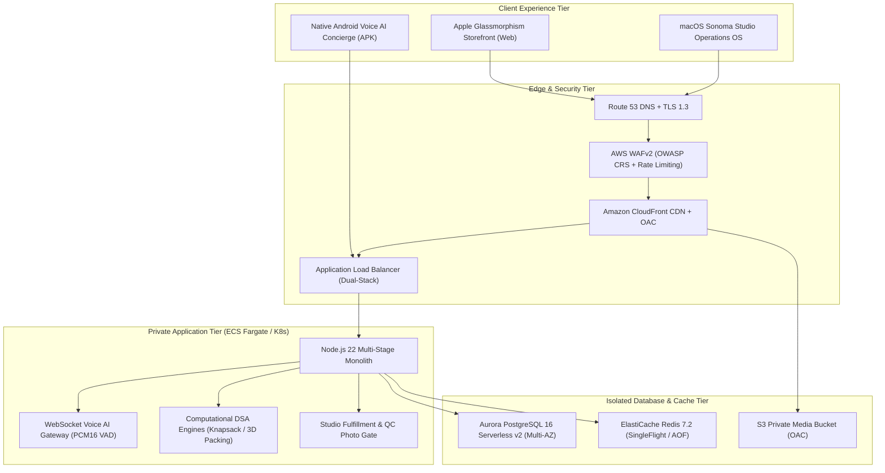

# Hampers by Her — Digital Commerce Platform & Artisanal Atelier OS

[](https://nodejs.org/)
[](https://www.docker.com/)
[](https://www.terraform.io/)
[](https://kubernetes.io/)
[-success?logo=checkmarx&logoColor=white)](tests/)
[](scripts/audit_documentation.js)
[](#)

> **Artisanal Luxury Gifting Atelier Digital Operating System**  
> Primary Brand Acquisition Channel: [`@hampers._by_her` on Instagram](https://www.instagram.com/hampers._by_her/)

---

## 1. System Overview

**Hampers by Her** is an end-to-end luxury digital commerce ecosystem and artisanal atelier operating system engineered for bespoke gifting. The platform combines a responsive Apple Glassmorphism storefront, an 11-step interactive 3D hamper builder with procedural SVG visualizer, an AI voice concierge, multi-gateway payment orchestration, a studio fulfillment OS with photographic QC gates, carrier logistics tracking, and enterprise-grade cloud infrastructure on AWS.



---

## 2. Key Capabilities & Architectural Pillars

### 2.1 Apple Glassmorphism & Sensory 4D UX
- Multi-layered frosted glass materials (`backdrop-filter: blur(28px-44px) saturate(190%)`) with hairline specular rim lighting.
- Floating capsule navigation header and iOS Dynamic Island mobile dock.
- 4D gyroscopic mouse tilt, ambient 60fps golden leaf dust particle canvas, and synthetic Web Audio soundscape (`playVelvetTap()`, `playGoldenChime()`).

### 2.2 11-Step Bespoke Hamper Builder & Procedural SVG Visualizer
- Volumetric 3D bin-packing calculations (`binPacker3D.js`) recommending standard box sizes (`SMALL`, `MEDIUM`, `LARGE`, `GRANDE`).
- Live vector SVG preview generator illustrating custom raw silk ribbons, wax seal monograms, and copperplate calligraphy greeting cards.
- AI Knapsack Curator (`budgetKnapsack.js`) optimizing bespoke product selections against patron budget constraints.

### 2.3 Multi-Gateway Smart Payment Router
- Sub-second failover across primary (Razorpay), secondary (Cashfree), and international (Stripe) acquirers.
- Dual-mode UPI routing: Mobile UPI Intent deep links vs Desktop Dynamic QR codes with auto-refresh.
- Cryptographic HMAC-SHA256 signature verification with replay protection ($\le 300$s clock skew) and FEMA export compliance.

### 2.4 Atelier Studio Operations OS & Mandatory QC Photo Gate
- Administrative dashboard (`/admin.html`) protected by workshop staff PIN (`2026`).
- Live real-time search across order numbers, patron names, and contact details.
- Mandatory Photographic Quality Inspection Gate: Prevents status advancement to `QUALITY_CHECKED` or `DISPATCHED` without verified photographic evidence.

### 2.5 Voice AI Android Application
- Low-latency WebSocket streaming PCM16 audio concierge with voice activity detection (VAD) and barge-in playback abort.
- Packaged production APK (`dist/HampersByHer-VoiceAI.apk`) verified with Android 36 SDK and v4 cryptographic signature.

### 2.6 Cloud Infrastructure as Code & Containerization
- **Docker**: Hardened multi-stage Alpine build running as unprivileged `USER node` with `dumb-init`.
- **LocalStack & Compose**: Zero-cloud local orchestration for PostgreSQL (pgvector), Redis 7.2, and LocalStack AWS services.
- **Terraform / OpenTofu**: 7 modular production stacks (`vpc`, `security`, `iam`, `database`, `loadbalancer`, `compute`, `storage_cdn`) deploying to AWS `ap-south-1`.
- **Kubernetes**: Production manifests with restricted Pod Security Standards, HPA, and ALB Ingress.
- **SRE Observability**: Prometheus metrics scraping and alerting rules enforcing 99.9% availability SLO.

---

## 3. Quickstart Guide

### 3.1 Local Development (Node.js Bare-Metal)
```bash
# Clone the repository
git clone https://github.com/hampersbyher/atelier-commerce.git
cd atelier-commerce

# Install dependencies
npm install

# Start local server
npm start
# Storefront:        http://localhost:3000
# Studio OS Cockpit: http://localhost:3000/admin.html
# Health Probe:      http://localhost:3000/health
```

### 3.2 Local Full-Stack with Docker Compose
```bash
# Launch App, PostgreSQL 16 (pgvector), Redis 7.2, LocalStack, and Prometheus
docker compose up -d

# Verify container health status
docker compose ps

# Inspect logs
docker compose logs -f app
```

### 3.3 Infrastructure as Code (AWS ap-south-1)
```bash
cd infra/terraform

# Initialize Terraform modules and providers
terraform init

# Review proposed infrastructure changes
terraform plan -var-file=terraform.tfvars.example

# Provision cloud footprint
terraform apply -var-file=terraform.tfvars.example
```

### 3.4 Kubernetes Deployment
```bash
# Apply namespace, configurations, and secrets
kubectl apply -f infra/k8s/namespace.yaml
kubectl apply -f infra/k8s/configmap.yaml
kubectl apply -f infra/k8s/secret.yaml.example

# Deploy application workload, service, and autoscaler
kubectl apply -f infra/k8s/deployment.yaml
kubectl apply -f infra/k8s/service.yaml
kubectl apply -f infra/k8s/hpa.yaml
kubectl apply -f infra/k8s/ingress.yaml
kubectl apply -f infra/k8s/pdb.yaml
```

---

## 4. Verification & Quality Gates

The platform enforces strict quality gates across documentation, code, security, and mobile packaging:

```bash
# Run the complete master verification pipeline
npm run verify

# Or execute individual verification stages:
npm run audit:docs   # Verifies all 44 core specifications meet Section 40 (15/15 sections)
npm test             # Executes all 219 tests across 61 test suites
npm run build:apk    # Cryptographically verifies Android Voice AI APK package
```

---

## 5. Security & Responsible Disclosure

Security is governed by the principles in [SECURITY.md](file:///c:/Users/ravir/Desktop/Almas/Hampers_By_Her_E2E_Engineering_Docs/SECURITY.md):
- Zero hardcoded credentials or API keys (enforced via AWS Secrets Manager and GitHub Actions OIDC).
- Sliding-window rate limiting on sensitive authentication and payment endpoints.
- Constant-time HMAC-SHA256 cryptographic verification for webhooks.
- Multi-stage non-root container execution.

To report security vulnerabilities, email `security@hampersbyher.com`.

---

## 6. License & Governance

Copyright &copy; 2026 Hampers by Her. All rights reserved.  
Governance Contract: [AGENTS.md](file:///c:/Users/ravir/Desktop/Almas/Hampers_By_Her_E2E_Engineering_Docs/AGENTS.md) | Contribution Guide: [CONTRIBUTING.md](file:///c:/Users/ravir/Desktop/Almas/Hampers_By_Her_E2E_Engineering_Docs/CONTRIBUTING.md)
