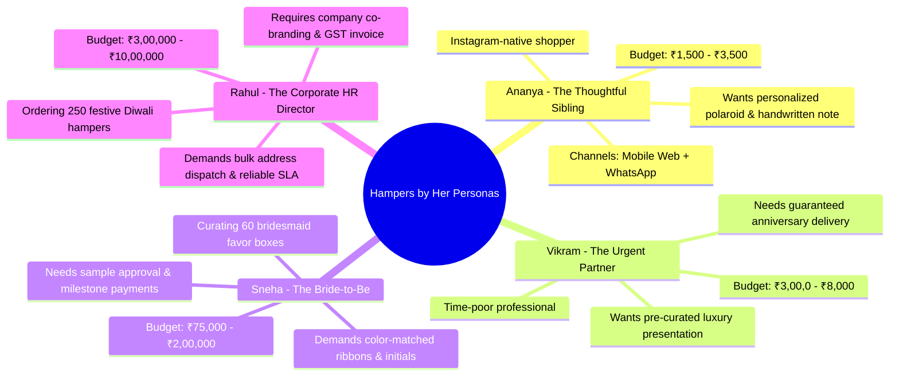
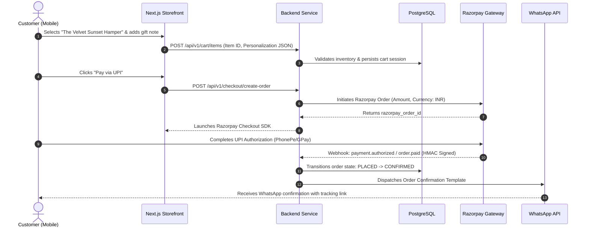

<!-- HAMPERS-BY-HER | E2E COMMERCE SYSTEM | DOCUMENT CONTROLLED -->
# 03. Product Requirements Document (PRD) — Hampers by Her

## Document Control
- **Document Version**: 2.0.0
- **Status**: APPROVED PRODUCT SPECIFICATION
- **Last Updated**: 2026-09-18
- **Product Domain**: D2C Luxury Gifting, Bespoke Hamper Atelier & Corporate Gifting
- **Document Quality Standard**: 15/15 Mandatory Sections Compliant (Section 40)

---

## 1. Purpose
This document defines the functional and non-functional product requirements, target user personas, core user stories, acceptance criteria, and system constraints for the **Hampers by Her** digital commerce ecosystem. This document serves as the authoritative product contract between business stakeholders, design, engineering, and operations.

---

## 2. Scope
- **In-Scope**:
  - Customer-facing digital storefront (Mobile & Desktop).
  - Signature Ready-to-Ship catalog discovery and quick checkout.
  - 11-Step Interactive Hamper Builder with volume/compatibility logic.
  - Customization engine (handwritten notes, wax seals, ribbons, engraving, photo uploads).
  - Two-step guest and authenticated checkout with Razorpay UPI Intent.
  - WhatsApp conversational commerce and Instagram lead routing.
  - Corporate and Wedding bulk gifting enquiry portals.
  - Merchant Admin Console for catalog, orders, and CRM.
  - Atelier Voice AI Android Application (`com.hampersbyher.voiceai`) with real-time streaming voice concierge and storefront bridge.
- **Out-of-Scope**:
  - Native iOS mobile application (Atelier Voice AI Android APK active; iOS scheduled for Future Phase).
  - Multi-currency transactions (INR `₹` only).
  - Customer subscription box models (scheduled for Phase 11).

---

## 3. Context
Customers buying gift hampers are under distinct psychological pressures compared to standard e-commerce shoppers:
1. **High Anxiety on Timeliness**: A gift arriving one day late has near-zero emotional utility. Delivery date assurance is paramount.
2. **Desire for Uniqueness**: Buyers do not want mass-produced, generic commodity gifts; they want the recipient to feel seen and cherished.
3. **Friction in Customization**: In typical manual Instagram gifting, exchanging item lists and calculating prices takes hours of back-and-forth chat.
4. **Corporate & Wedding Demands**: Bulk buyers require formal GST invoices, branding approval, sample approvals, and reliable SLAs.

---

## 4. Requirements

### 4.1 Target User Personas


### 4.2 Functional Requirements
- **FR-PRD-01 (Catalog Discovery)**: Occasion-led navigation (Birthday, Anniversary, Rakhi, Diwali, Corporate) and faceted price/dietary filtering.
- **FR-PRD-02 (Live Pincode Serviceability)**: Instant 6-digit India pincode validator on PDP returning estimated delivery date and courier tier.
- **FR-PRD-03 (11-Step Hamper Builder)**: Guided atelier allowing container selection, product curation, satin ribbon styling, and photo upload.
- **FR-PRD-04 (Gift-Centric 2-Step Checkout)**: Separation of buyer contact details from recipient delivery address, with hidden price packing slips.
- **FR-PRD-05 (Razorpay UPI Integration)**: Seamless 1-click UPI Intent (GPay, PhonePe, Paytm) and credit/debit card support.
- **FR-PRD-06 (WhatsApp Concierge Deep-Link)**: Builder state serializable into encrypted WhatsApp deep-link for assisted human checkout.

### 4.3 Non-Functional Requirements
- **NFR-PRD-01**: Mobile Page Speed: Mobile homepage and PDP interactive in $< 2.0\text{s}$ over 4G networks.
- **NFR-PRD-02**: Concurrency Resilience: Cart and inventory locks sustain 100 concurrent checkout attempts per minute during peak holidays.

---

## 5. Architecture & Design
### 5.1 Product Feature Architecture
```
┌─────────────────────────────────────────────────────────────────────────────┐
│                    PRODUCT FEATURE ARCHITECTURE MAP                         │
└─────────────────────────────────────────────────────────────────────────────┘
  Discovery Layer         Atelier Customization       Checkout & Payments
 [Occasion Catalogs]  ──► [11-Step Hamper Builder] ──► [2-Step Mobile Checkout]
 [Faceted Search]         [Wax Seal / Ribbon Mod]     [Razorpay UPI Intent]
         │                            │                         │
         ▼                            ▼                         ▼
 [Admin Workspace]       [WhatsApp Concierge CRM]    [Shiprocket Logistics]
```

---

## 6. Business Rules
- **BR-PRD-01**: **Minimum Hamper Value**: Bespoke custom hampers in the builder must contain a minimum of 1 box base and 2 products, or reach a minimum value of ₹999.
- **BR-PRD-02**: **Cancellation Window**: Orders can only be cancelled by the customer within 2 hours of payment, provided production has not commenced. Custom engraved or printed photo orders cannot be cancelled once `IN_PRODUCTION`.
- **BR-PRD-03**: **Damaged Item Guarantee**: In-transit breakage of fragile items requires photo submission via WhatsApp within 24 hours of delivery for an immediate free replacement dispatch.

---

## 7. Technical Details

### 7.1 Customer Journey & System Sequence


---

## 8. Dependencies
- Payment Processing: Razorpay Orders API, Payment Links API, Webhooks.
- Logistics & NDR: Shiprocket / Delhivery Courier Aggregator API.
- Messaging: Meta WhatsApp Cloud API (Graph v19.0), AWS Simple Email Service (SES).
- Cloud Infrastructure: AWS CloudFront, ECS Fargate, S3, Aurora Serverless v2 PostgreSQL.

---

## 9. Security
- **Personal Photo Upload Retention**: Customer uploaded photos for custom frames or polaroids are stored in an encrypted S3 bucket (`sse: aws:kms`) and purged 30 days post-order fulfillment.
- **PII Redaction**: Recipient addresses are visible only to warehouse fulfillment personnel and redacted from general marketing analytics.

---

## 10. Failure Modes
| Edge Case / Failure | System Behavior | Fallback Procedure |
| :--- | :--- | :--- |
| **Pincode Unserviceable** | System disables checkout CTA and displays friendly banner: *"We currently do not deliver to pincode XXXXXX."* | Prompts user: *"Talk to us on WhatsApp for custom courier arrangements."* |
| **Inventory Out of Stock Mid-Builder** | If a chosen product runs out during builder curation, UI flags item with amber badge and suggests 3 similar alternatives. | Item is automatically removed from cart if user leaves session idle for > 2 hours. |
| **Razorpay Gateway Timeout** | If client disconnects before redirect, server webhook reconciles payment asynchronously within 60 seconds. | Cron job audits orphaned payments every 5 minutes and issues customer email. |

---

## 11. Testing
- **Gherkin Acceptance Criteria**:
  ```gherkin
  Feature: Ready-Made Hamper Quick Purchase
    Scenario: Customer purchases signature birthday hamper with UPI
      Given the customer is on the product page for "The Golden Radiance Hamper"
      When the customer enters a valid serviceable pincode "400001"
      And adds a personalized gift message "Happy Birthday Mom! Love, Ananya"
      And clicks "Buy Now"
      And completes guest checkout with recipient address
      And authorizes payment via UPI on Razorpay
      Then the order status becomes "CONFIRMED"
      And an order confirmation template is received on WhatsApp within 30 seconds
      And the packing slip excludes all itemized prices
  ```
- **Automated Regression Suite**: Playwright end-to-end tests validating Journey A (Ready-Made) and Journey B (Builder) on mobile viewport (390px).

---

## 12. Observability
- **Conversion Funnel Metrics**:
  - Storefront Visit → PDP View: Target > 55%
  - PDP View → Add to Cart: Target > 12%
  - Cart → Checkout Started: Target > 65%
  - Checkout Started → Order Completed: Target > 75%
- **Commercial Performance**: Average Order Value (AOV) target > ₹2,250; Customization attachment rate target > 40%.

---

## 13. Open Questions
```yaml
unknown_registry:
  - field: minimum_order_value_cod
    status: TO_VERIFY
    source_required: brand_owner
    impact: medium
    temporary_assumption: "COD disabled for custom photo hampers; enabled for ready-made up to ₹3,000 with ₹100 verification fee"

  - field: holiday_blackout_dates
    status: TO_VERIFY
    source_required: brand_owner
    impact: high
    temporary_assumption: "No dispatches on national public holidays (Jan 26, Aug 15, Oct 2)"
```

---

## 14. Future Evolution
- **Group Gifting (Split Payment)**: Multiple friends can contribute towards a single luxury hamper via individual payment links before dispatch.
- **Subscription Care Boxes**: Automated monthly self-care or seasonal festive curation sent on auto-renew.

---

## 15. References
- Pragmatic Marketing Framework: *Market-Driven Product Management*.
- Razorpay Checkout & Webhook Integration Specs.
- Shiprocket Shipping API & NDR Lifecycle Docs.
- Google Material Design 3 / E-Commerce Design Guidelines.

<!-- DOCUMENT END: 03_PRD.md -->
